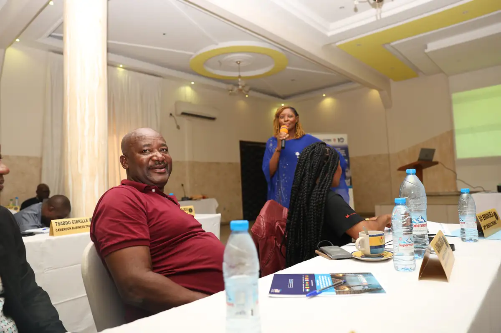
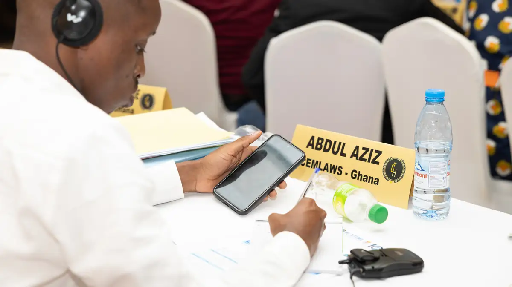
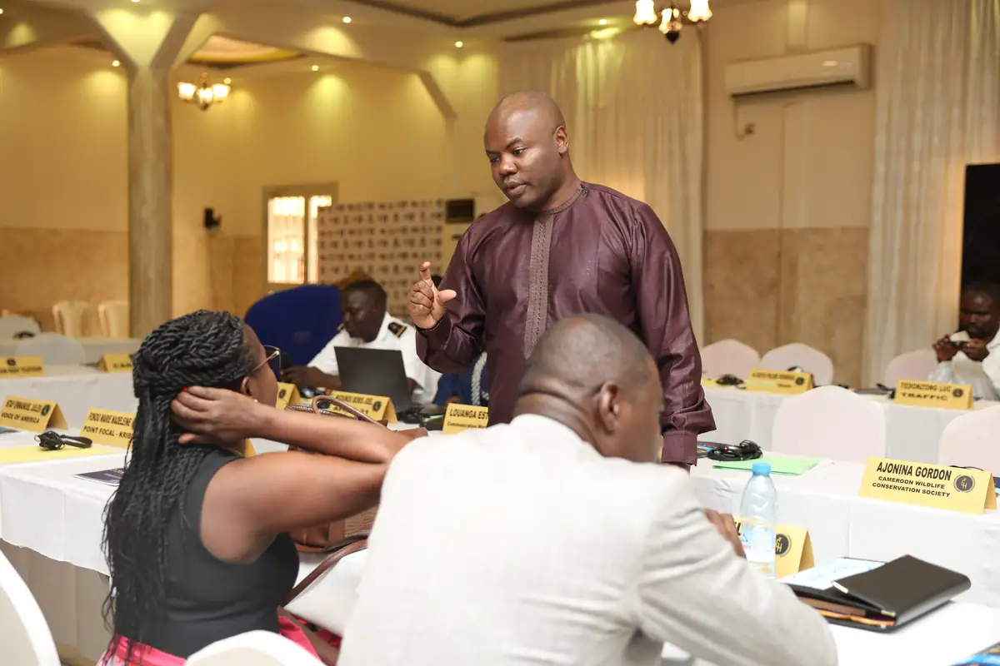
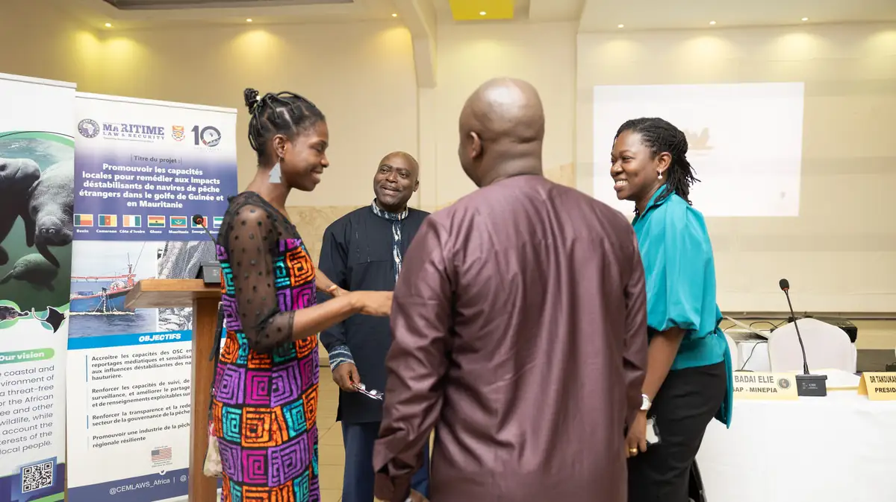
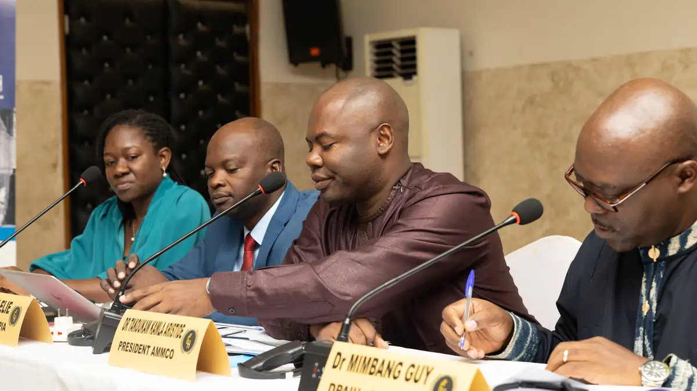

# Atelier régional sur la pêche étrangère déstabilisante dans le golfe de Guinée

<!-- wiki:infobox -->

| Atelier régional sur la pêche étrangère déstabilisante dans le golfe de Guinée | |
| --- | --- |
| Client | [AMMCO](../organisations/ammco.md) |
| Via | [UPgraders](../organisations/upgraders.md) |
| Période | 7 mai 2024 |
| Casquette | Exécution |
| Catégorie | Événement |
| Rôle | Couverture photo et vidéo |
| Fait partie de | [Street Whale](street-whale.md) |
| Folio | _pas encore sur le site_ |
| État de la fiche | Standard |
<!-- /wiki:infobox -->

**Atelier régional sur la pêche étrangère déstabilisante dans le golfe de Guinée** est un événement couvert en photo et en vidéo par Alexandre « Xtincell » Djengue (7 mai 2024).

## Description

- **Lieu** : salle de conférence d'hôtel
- **Organisateur ou client** : AMMCO avec Maritime Law & Security (10 ans), financement américain
- **Ce que montrent les images** : Travaux en salle avec chevalets nominatifs, allocutions au pupitre, remise de certificats devant un mur aux drapeaux américains.
  - 07/05/2024 : même atelier que le n° 7, version livrée (« spark_0705202… »).
- **Identification** : roll-ups « Promouvoir les capacités locales pour remédier aux impacts déstabilisants de navires de pêche étrangers dans le golfe de Guinée et en Mauritanie », « Maritime Law & Security 10 » ; chevalets nominatifs
- **Fiabilité** : confirmé

## Galerie

<!-- wiki:galerie -->

<!-- /wiki:galerie -->

## Archives

- `AMMCO\2024\Ammco ft` (575 fichiers, disque C:)
- `AMMCO\2024\Mai 2024` (142 fichiers, disque P:)

## Sources

- Notes « Événements couverts » établies lors du rangement des disques (28/10/2026), à partir des images, des dates de prise de vue et des livrables

<!-- wiki:liens-entrants -->
<!-- /wiki:liens-entrants -->
