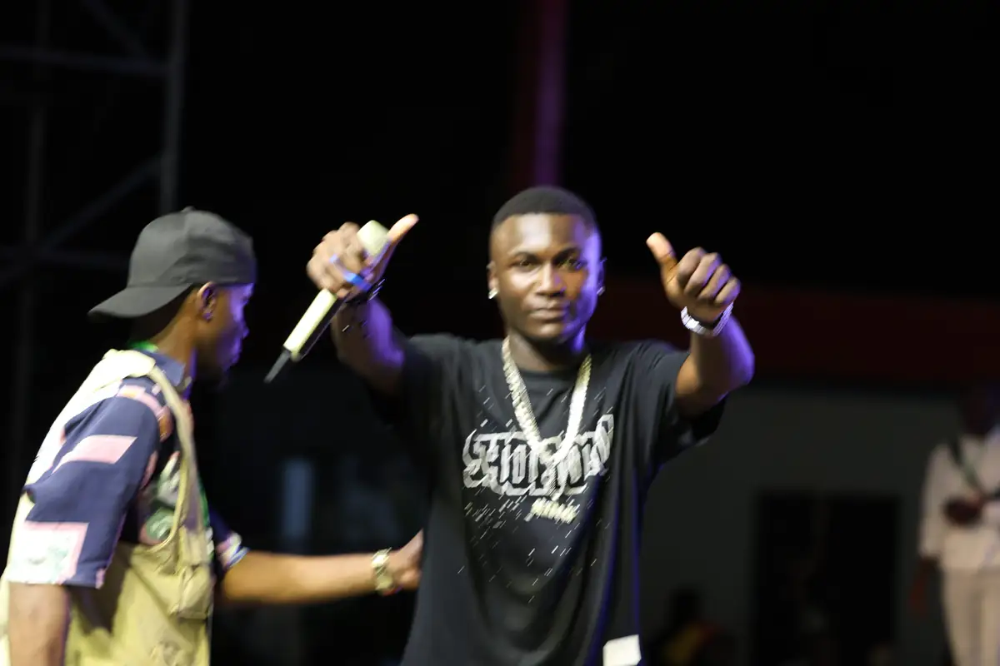
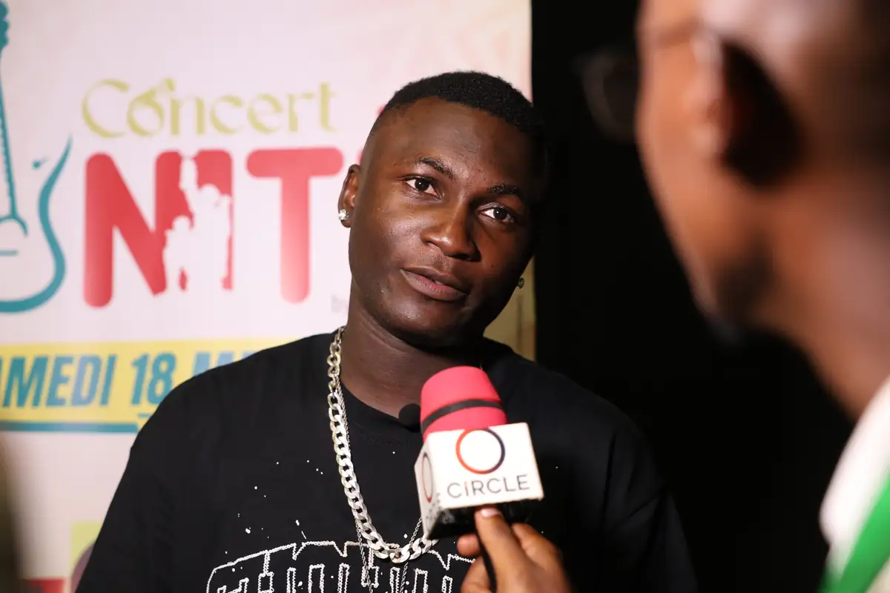
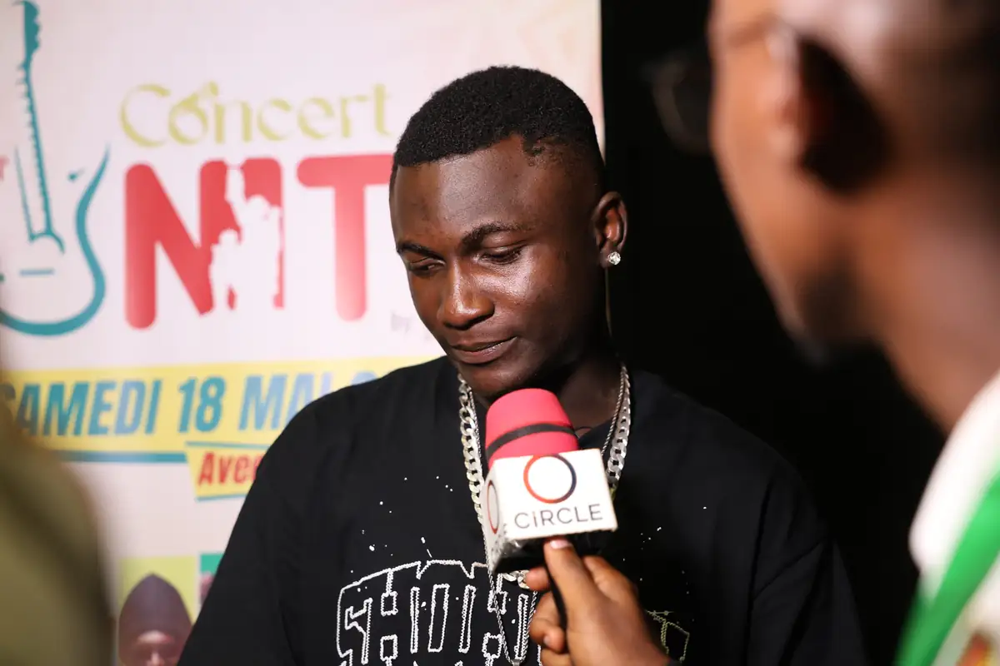
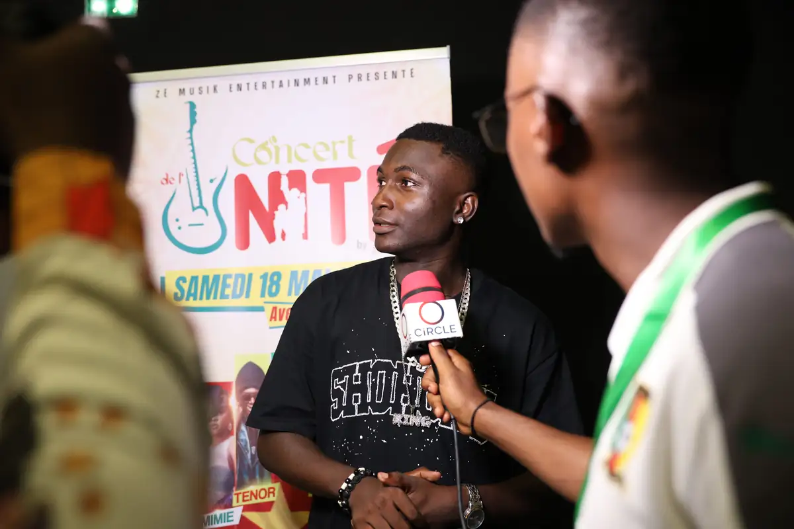
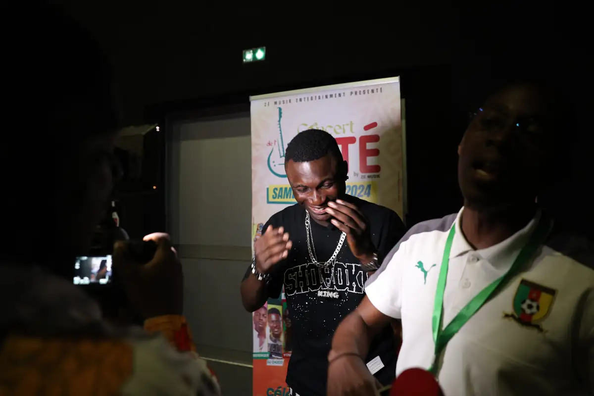
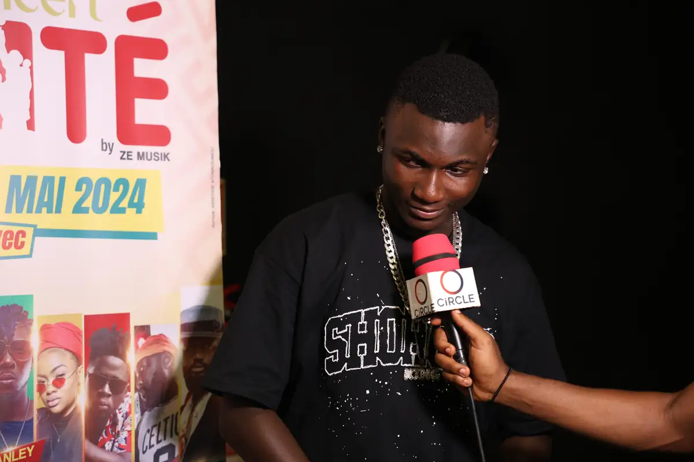

# Concert « Nite » — interviews et spectacle

<!-- wiki:infobox -->

| Concert « Nite » — interviews et spectacle | |
| --- | --- |
| Période | 18 mai 2024 |
| Casquette | Exécution |
| Catégorie | Événement |
| Rôle | Couverture photo et vidéo |
| Folio | _pas encore sur le site_ |
| État de la fiche | À vérifier |
<!-- /wiki:infobox -->

**Concert « Nite » — interviews et spectacle** est un événement couvert en photo et en vidéo par Alexandre « Xtincell » Djengue (18 mai 2024).

## Description

- **Lieu** : salle aux fauteuils rouges (non lisible)
- **Organisateur ou client** : non lisible (bâche « Concert Nite »)
- **Ce que montrent les images** : Interviews au micro devant une bâche « Concert … Nite », public en salle, chorégraphies de groupe sur scène.
- **Identification** : bâche « Concert Nite » ; Canon EOS R8
- **Fiabilité** : à confirmer

## Galerie

<!-- wiki:galerie -->

<!-- /wiki:galerie -->

## Archives

- `_À identifier\P — 2024-05-18 — Concert « Nite » (interviews et scène)` (23 fichiers, disque P:)

## Sources

- Notes « Événements couverts » établies lors du rangement des disques (28/10/2026), à partir des images, des dates de prise de vue et des livrables

<!-- wiki:liens-entrants -->
<!-- /wiki:liens-entrants -->
