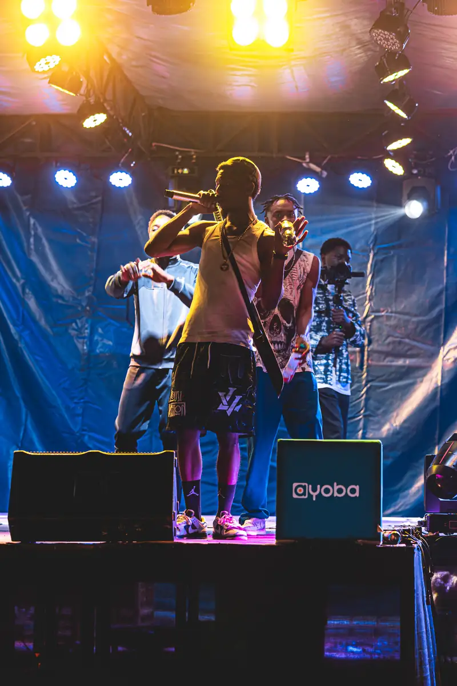
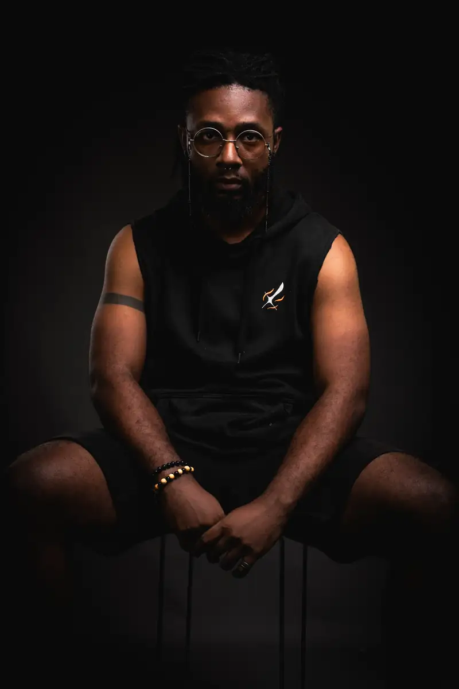
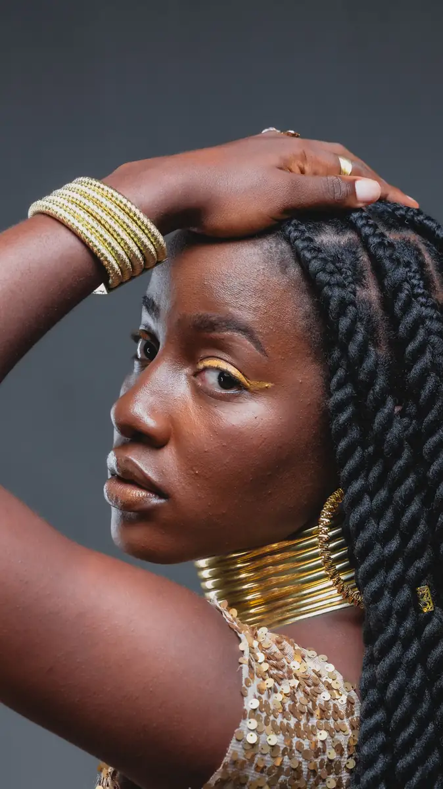
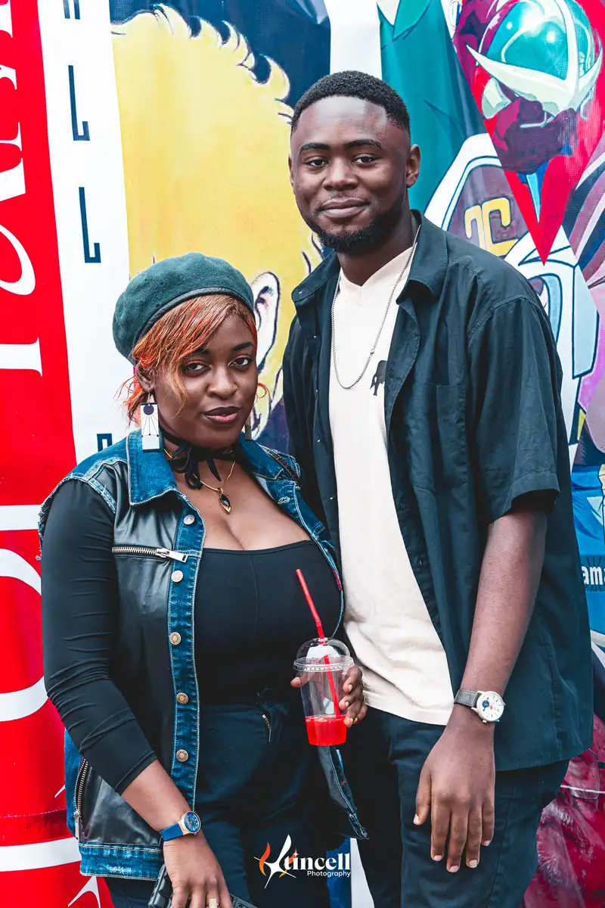
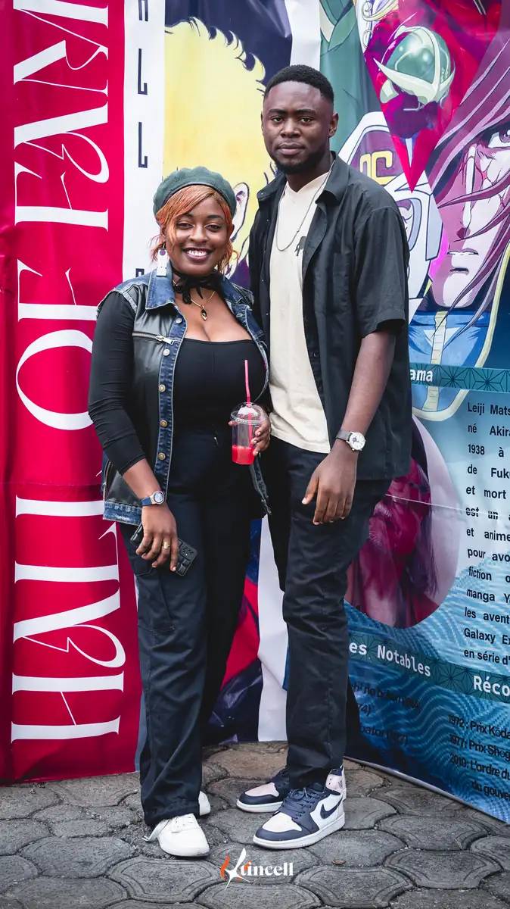
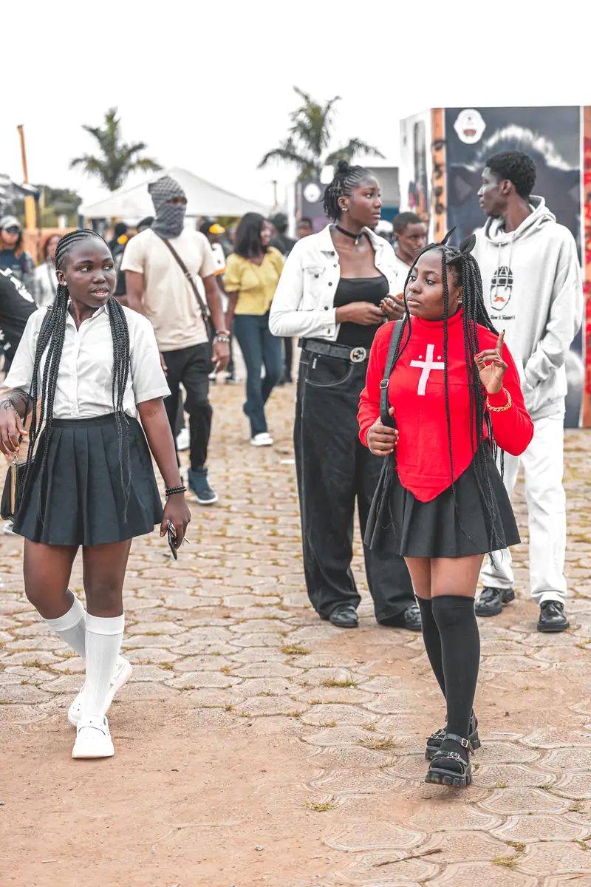

# K-mer Otaku Festival 2024

<!-- wiki:infobox -->

| K-mer Otaku Festival 2024 | |
| --- | --- |
| Client | [Kamer Otaku Festival (KOF)](../organisations/kamer-otaku-festival.md) |
| Via | [UPgraders](../organisations/upgraders.md) |
| Période | 3-5 août 2024 |
| Casquette | Exécution |
| Catégorie | Événement |
| Rôle | Couverture photo et vidéo |
| Fait partie de | [Kamer Otaku Festival — éditions 2022 à 2024](kof-2022-2024.md) |
| Folio | _pas encore sur le site_ |
| État de la fiche | Standard |
<!-- /wiki:infobox -->

**K-mer Otaku Festival 2024** est un événement couvert en photo et en vidéo par Alexandre « Xtincell » Djengue (3-5 août 2024).

## Description

- **Lieu** : site du festival (mur de pages de manga, scène bleue)
- **Organisateur ou client** : KOF — Kamer Otaku Fest (partenaire Yoba)
- **Ce que montrent les images** : Portraits devant le mur de mangas, toise géante de personnages, jury, défilé et couronnement d'une Miss sur scène (cubes Yoba), puis portraits studio du 07/09/2024.
  - 03-05/08/2024 : sélection retouchée du festival (voir le n° 99).
- **Identification** : noms « spark_0308202… » à « 0508202… » ; signature Xtincell ; cubes « Yoba »
- **Fiabilité** : confirmé

## Galerie

<!-- wiki:galerie -->

<!-- /wiki:galerie -->

## Archives

- `KOF - Kamer Otaku Fest\2024\Exports (dossier EXPORT, vrac)` (853 fichiers, disque P:)
- `KOF - Kamer Otaku Fest\2024\Exports photo` (1 521 fichiers, disque P:)

## Sources

- Notes « Événements couverts » établies lors du rangement des disques (28/10/2026), à partir des images, des dates de prise de vue et des livrables

<!-- wiki:liens-entrants -->
<!-- /wiki:liens-entrants -->
