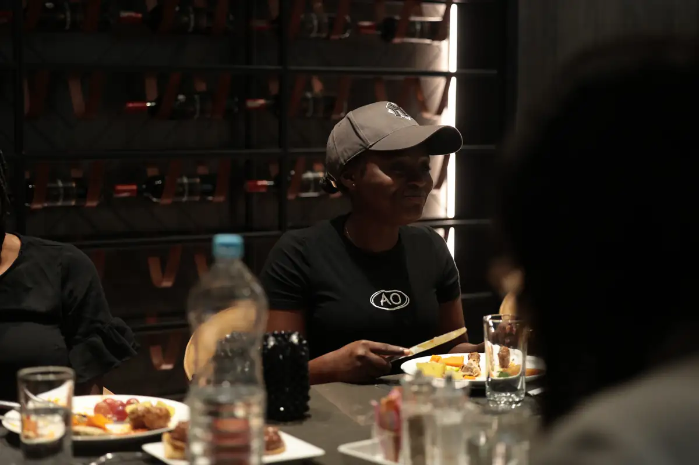
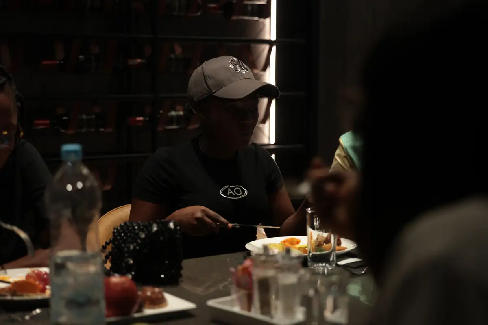
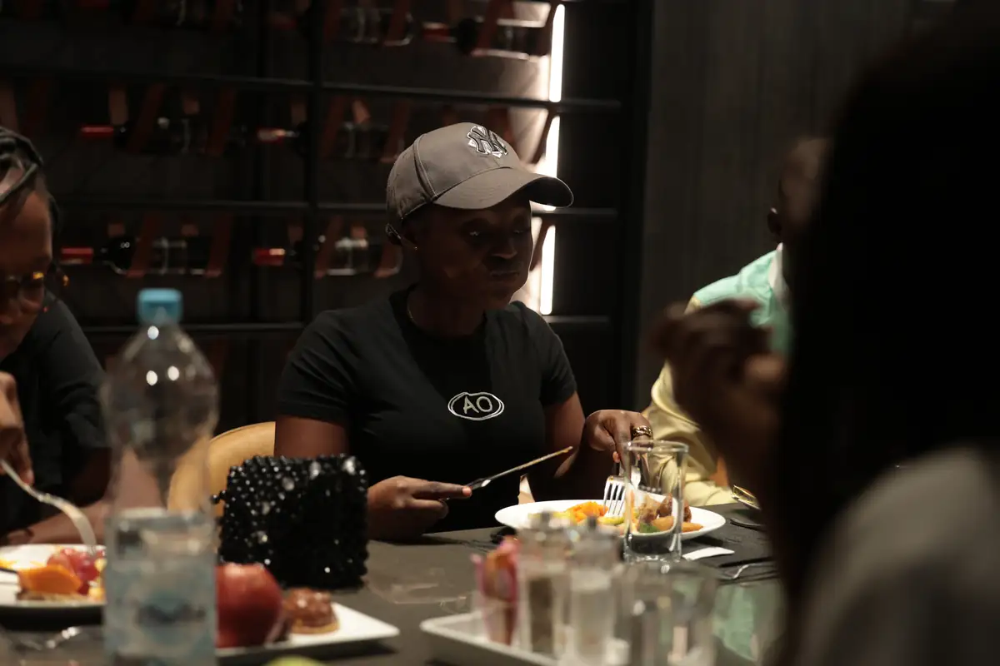
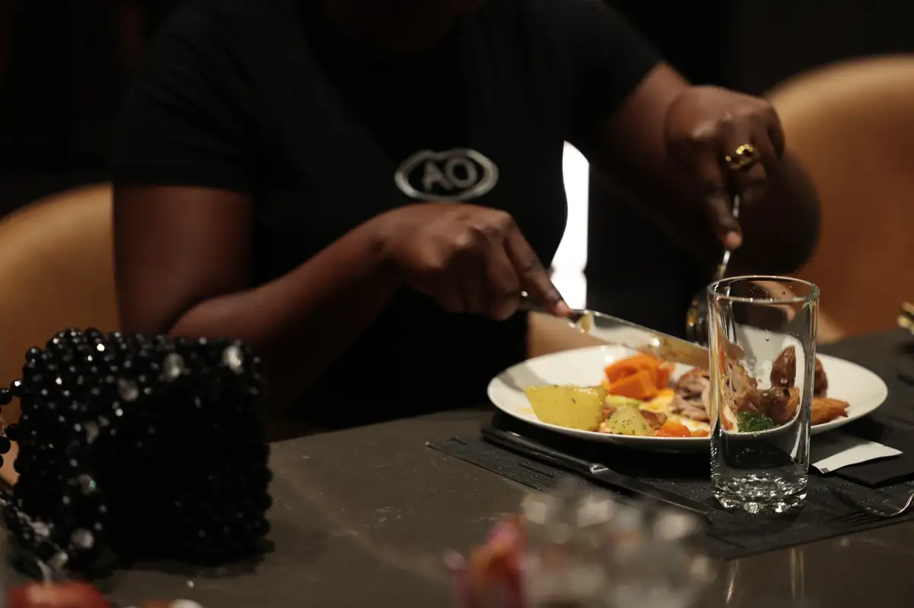
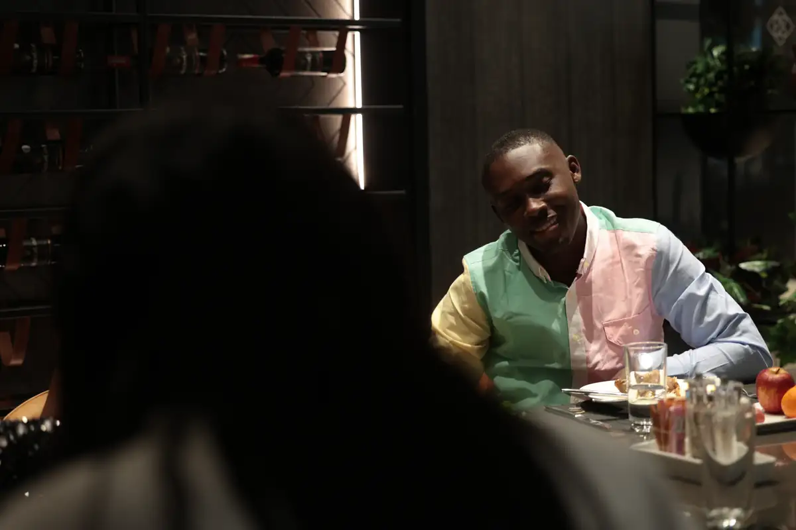
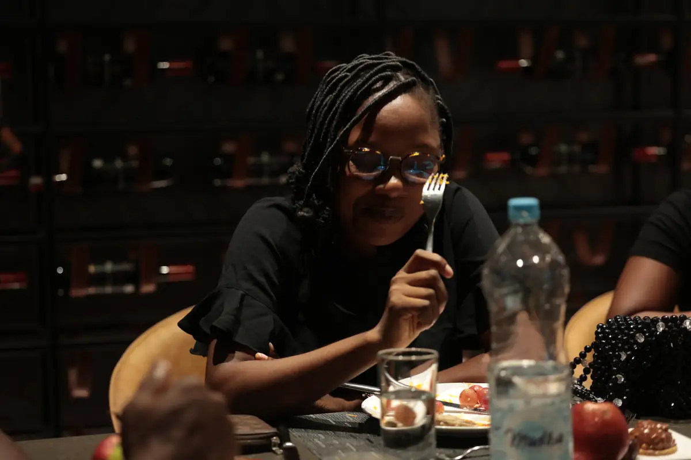

# K Hotel — déjeuner d'équipe « AO » (activation)

<!-- wiki:infobox -->

| K Hotel — déjeuner d'équipe « AO » (activation) | |
| --- | --- |
| Client | [K Hotel](../organisations/k-hotel.md) |
| Via | [UPgraders](../organisations/upgraders.md) |
| Période | 15 février 2025 |
| Casquette | Exécution |
| Catégorie | Événement |
| Rôle | Couverture photo et vidéo |
| Fait partie de | [K Hotel — travaux](k-hotel-travaux.md) |
| Folio | _pas encore sur le site_ |
| État de la fiche | Standard |
<!-- /wiki:infobox -->

**K Hotel — déjeuner d'équipe « AO » (activation)** est un événement couvert en photo et en vidéo par Alexandre « Xtincell » Djengue (15 février 2025).

## Description

- **Lieu** : restaurant du K Hotel (mur de bois gris, cave à vin), Douala
- **Organisateur ou client** : K Hotel
- **Ce que montrent les images** : 15/02/2025 vers 13 h : photos de groupe devant le mur gris, déjeuner au buffet.
- **Identification** : dossier client « K Hotel » ; tee-shirts « AO »
- **Fiabilité** : confirmé (lieu)

## Galerie

<!-- wiki:galerie -->

<!-- /wiki:galerie -->

## Archives

- `K Hotel\2025\Activation` (109 fichiers, disque P:)

## Sources

- Notes « Événements couverts » établies lors du rangement des disques (28/10/2026), à partir des images, des dates de prise de vue et des livrables

<!-- wiki:liens-entrants -->
<!-- /wiki:liens-entrants -->
