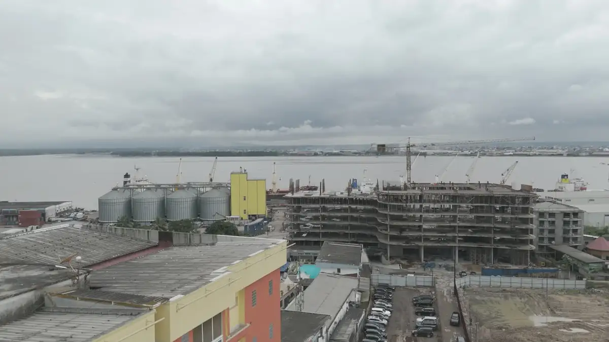
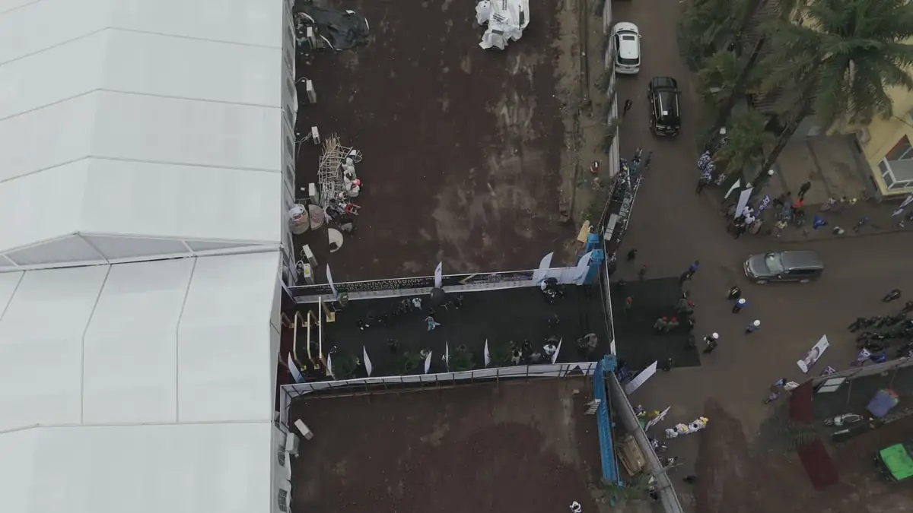
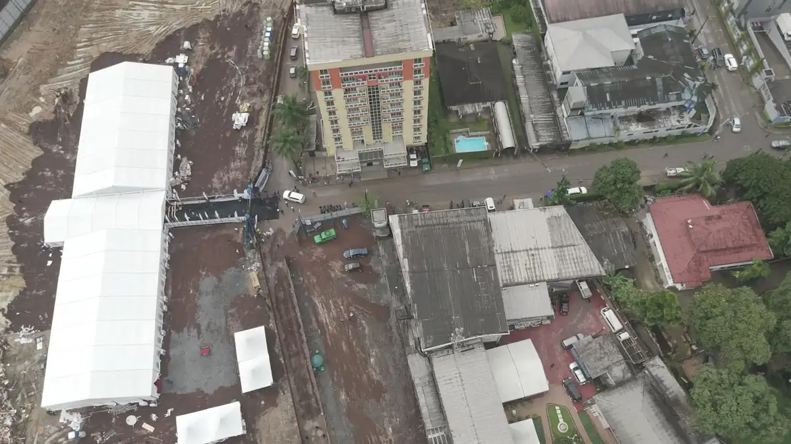
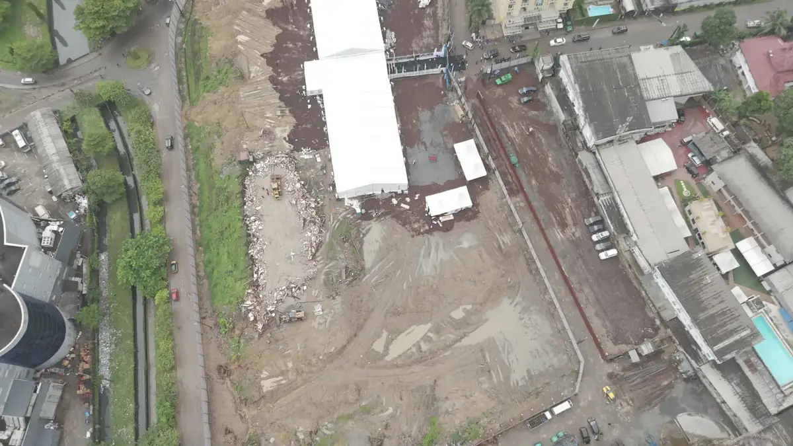
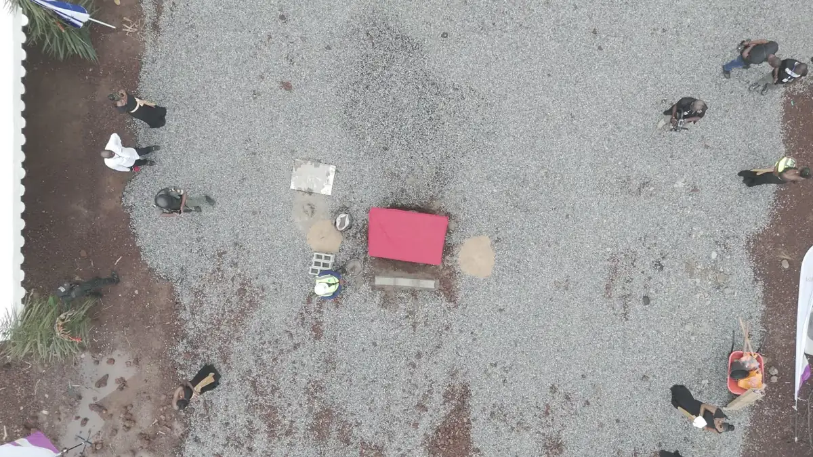
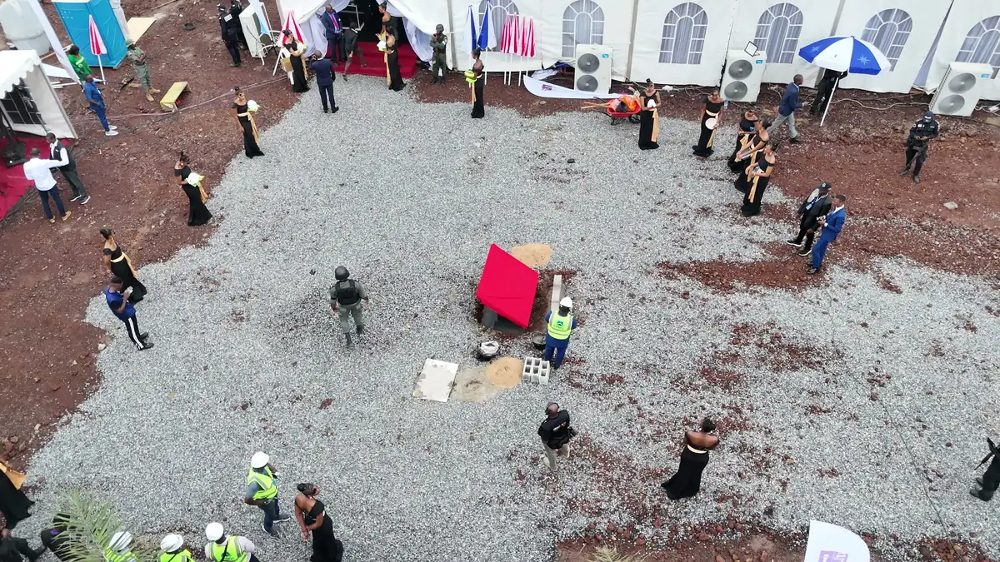

# Cérémonie de pose de la première pierre (vues de drone)

<!-- wiki:infobox -->

| Cérémonie de pose de la première pierre (vues de drone) | |
| --- | --- |
| Période | 25 septembre 2026 |
| Casquette | Exécution |
| Catégorie | Événement |
| Rôle | Couverture photo et vidéo |
| Folio | _pas encore sur le site_ |
| État de la fiche | À vérifier |
<!-- /wiki:infobox -->

**Cérémonie de pose de la première pierre (vues de drone)** est un événement couvert en photo et en vidéo par Alexandre « Xtincell » Djengue (25 septembre 2026).

## Description

- **Lieu** : terrain de chantier en bord de Wouri, près des silos du port, Douala
- **Organisateur ou client** : non identifié (maître d'ouvrage du futur bâtiment)
- **Ce que montrent les images** : Vues aériennes de la tribune, des grandes tentes blanches, de la stèle sous dais rouge et du cercle des invités ; panorama sur le port et un immeuble en construction.
- **Identification** : noms des fichiers DJI_20260925… (25/09/2026) ; aucun logo lisible d'aussi haut
- **Fiabilité** : client inconnu

## Galerie

<!-- wiki:galerie -->

<!-- /wiki:galerie -->

## Archives

- `_À identifier — vidéos\2026-09-25 — Pose de la première pierre (drone)` (39 fichiers, disque C:)

## Sources

- Notes « Événements couverts » établies lors du rangement des disques (28/10/2026), à partir des images, des dates de prise de vue et des livrables

<!-- wiki:liens-entrants -->
<!-- /wiki:liens-entrants -->
