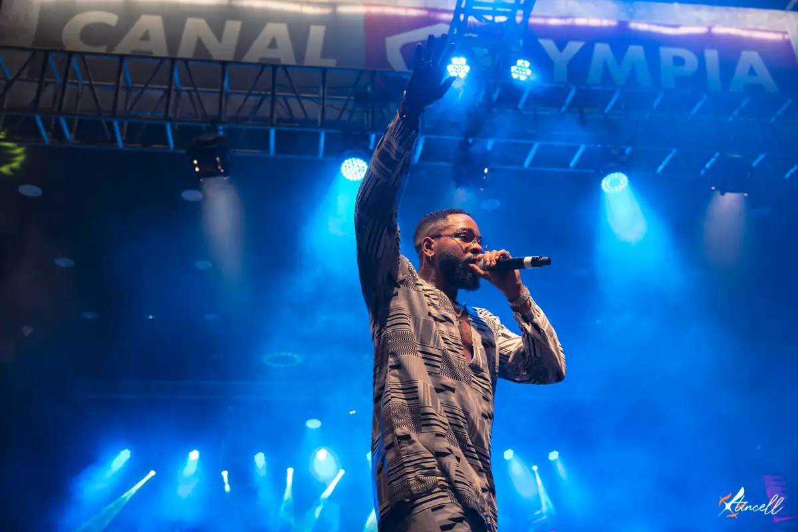
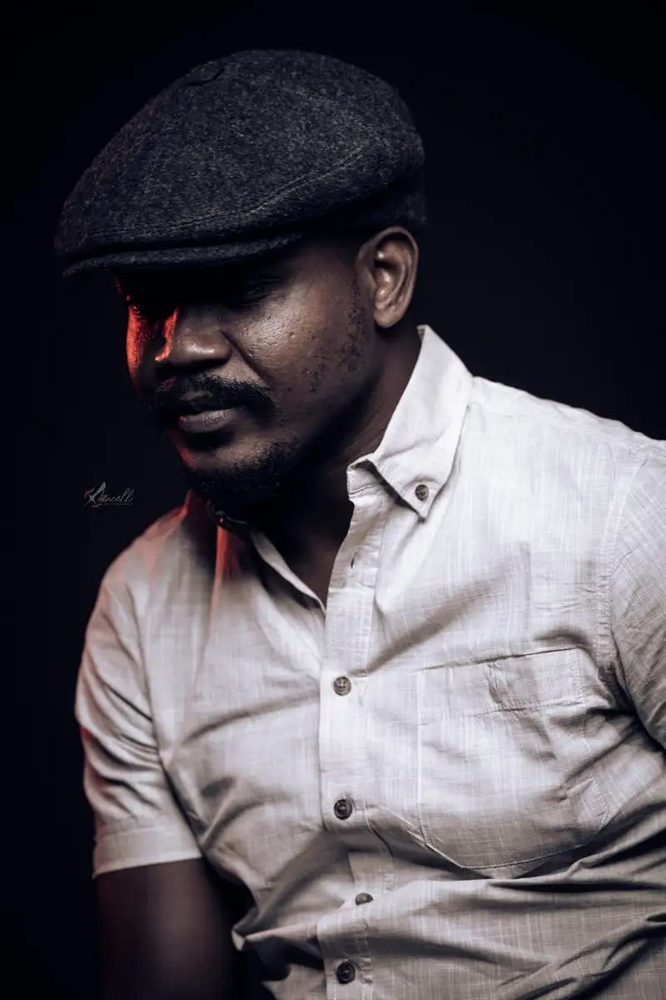
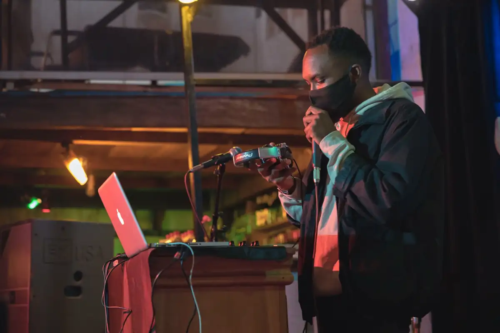
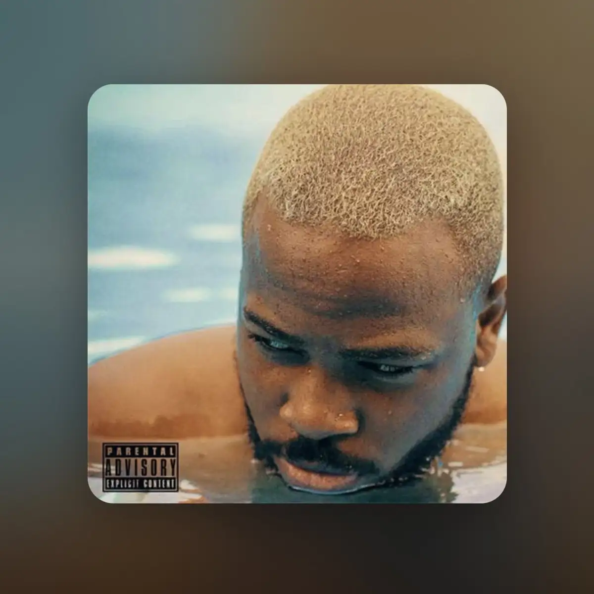
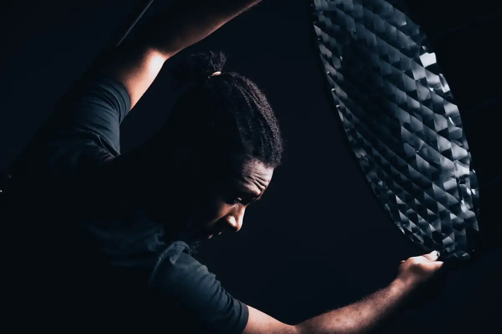
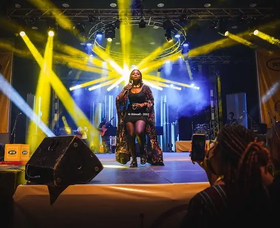

# Concerts à CanalOlympia (exports reçus) et portraits

<!-- wiki:infobox -->

| Concerts à CanalOlympia (exports reçus) et portraits | |
| --- | --- |
| Période | date inconnue |
| Casquette | Exécution |
| Catégorie | Événement |
| Rôle | Couverture photo et vidéo |
| Folio | _pas encore sur le site_ |
| État de la fiche | À vérifier |
<!-- /wiki:infobox -->

**Concerts à CanalOlympia (exports reçus) et portraits** est un événement couvert en photo et en vidéo par Alexandre « Xtincell » Djengue (date inconnue).

## Description

- **Lieu** : CanalOlympia (écran de scène)
- **Organisateur ou client** : non lisible
- **Ce que montrent les images** : Série d'exports retouchés : concerts sur la scène CanalOlympia, portraits d'artistes, une maquette de couverture « Vogue ».
- **Identification** : inscription « CANALOLYMPIA » sur l'écran de scène ; exports en plusieurs versions (2), (3)
- **Fiabilité** : à confirmer

## Galerie

<!-- wiki:galerie -->

<!-- /wiki:galerie -->

## Archives

- `_À identifier\P — Exports IMG_2781-2842 (concerts à CanalOlympia, portraits, couverture « Vogue »)` (46 fichiers, disque P:)

## Sources

- Notes « Événements couverts » établies lors du rangement des disques (28/10/2026), à partir des images, des dates de prise de vue et des livrables

<!-- wiki:liens-entrants -->
<!-- /wiki:liens-entrants -->
