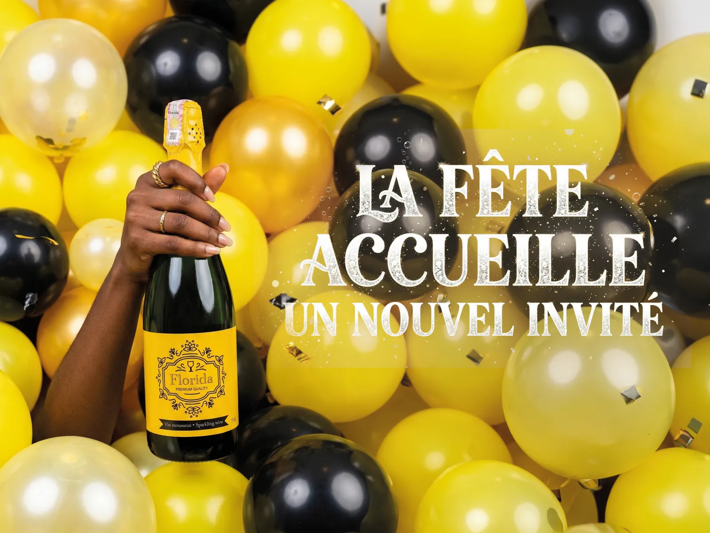
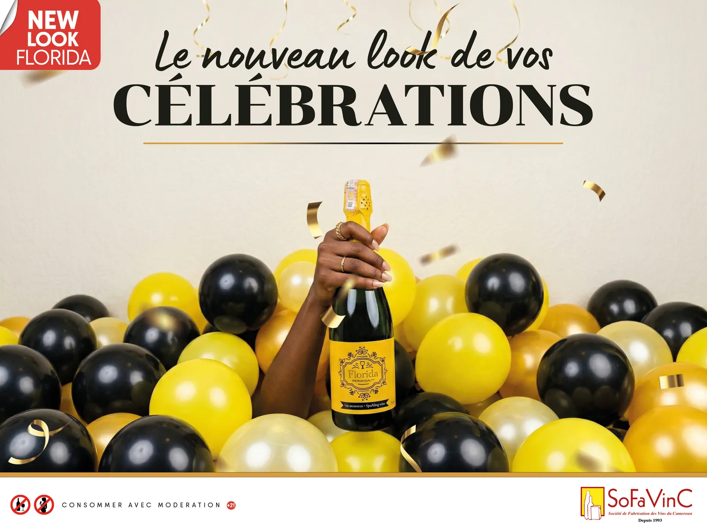
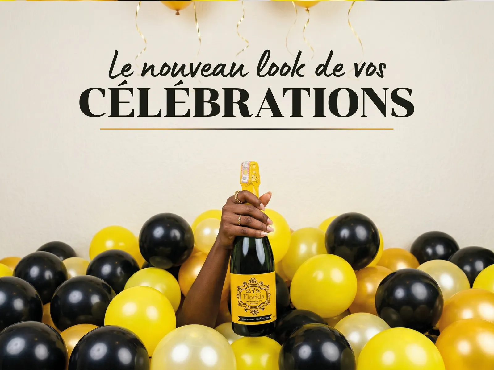

# Florida — Vin pétillant

<!-- wiki:infobox -->

| Florida — Vin pétillant | |
| --- | --- |
| Client | [SoFaVinC](../organisations/sofavinc.md) |
| Période | 2025 |
| Casquette | Direction créative & artistique |
| Catégorie | Campagne |
| Disciplines | KV-OOH · social · branding |
| Folio | [Étude de cas ↗](https://xtincell.powerupgraders.com/work/florida) |
| État de la fiche | Ébauche |
<!-- /wiki:infobox -->

**Florida — Vin pétillant** est une campagne réalisée pour [SoFaVinC](../organisations/sofavinc.md) (2025).

## Contexte

Campagne / key visual pour le vin pétillant Florida (SoFaVinC) : une main brandissant la bouteille hors d'une fosse de ballons or/noir/jaune avec confettis, signatures « La fête accueille un nouvel invité » et « New Look ».

## Galerie

<!-- wiki:galerie -->

<!-- /wiki:galerie -->

## Preuves et médias

- Visuels : `public/work/cases/florida/` (4 fichiers)

## Sources

- Folio — `scripts/cases.spec.json`, entrée `florida`

<!-- wiki:liens-entrants -->
<!-- /wiki:liens-entrants -->
