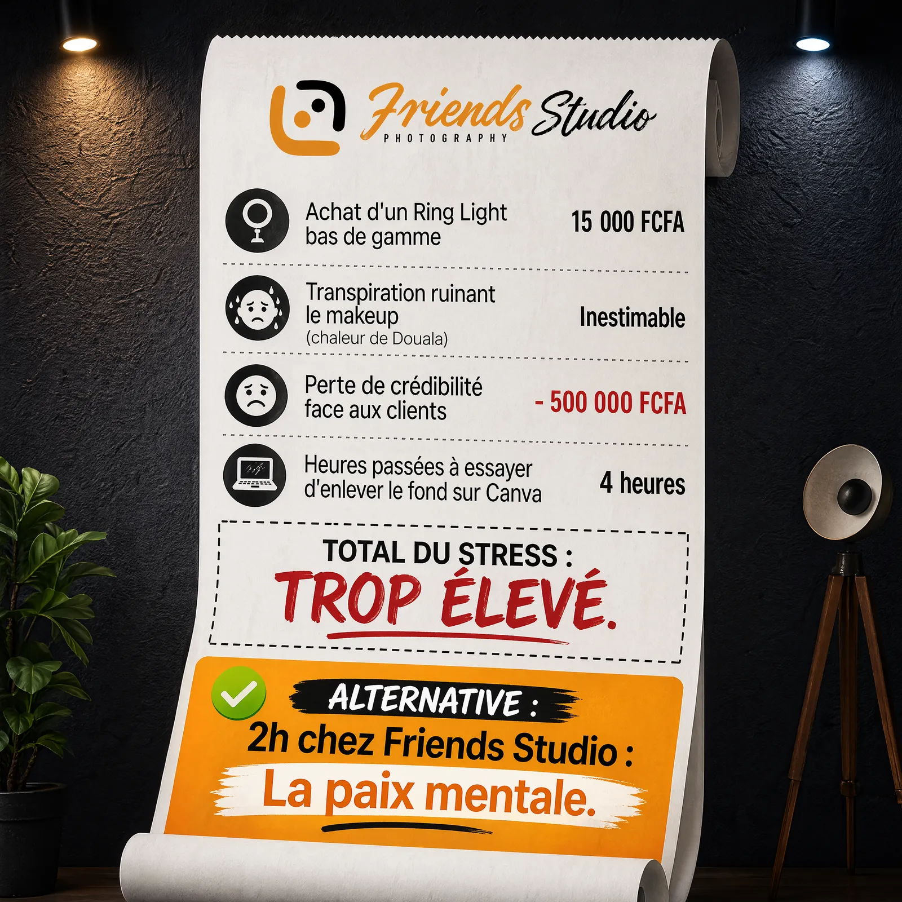
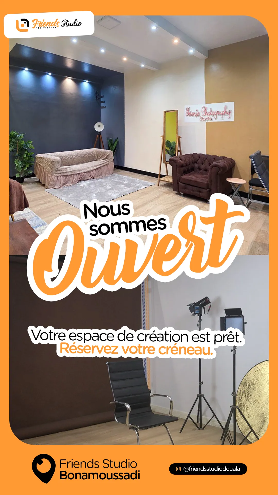
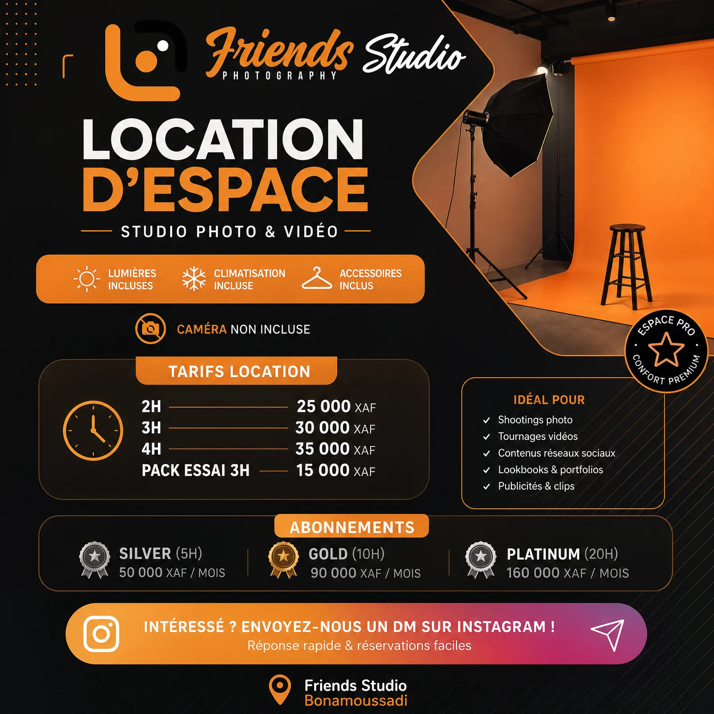
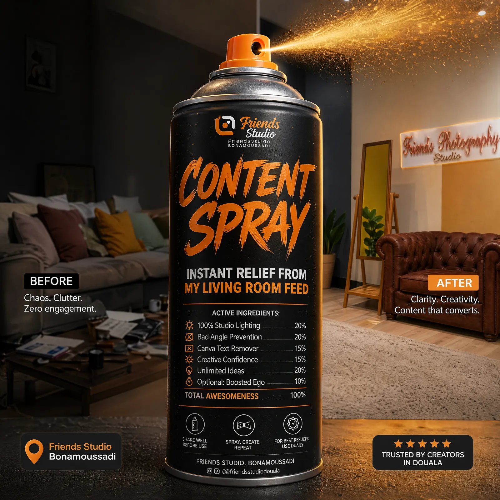

# Friends Studio — Studio photo premium

<!-- wiki:infobox -->

| Friends Studio — Studio photo premium | |
| --- | --- |
| Client | [Friends Photography Studio](../organisations/friends-studio.md) |
| Période | 2026 |
| Casquette | Direction créative & artistique |
| Catégorie | Campagne |
| Disciplines | social · photography · branding |
| Folio | [Étude de cas ↗](https://xtincell.powerupgraders.com/work/friends-studio) |
| État de la fiche | Ébauche |
<!-- /wiki:infobox -->

**Friends Studio — Studio photo premium** est une campagne réalisée pour [Friends Photography Studio](../organisations/friends-studio.md) (2026).

## Contexte

Communication marketing pour Friends Studio, studio photo premium à louer à Bonamoussadi (Douala) : flyers copy-driven, concept « facture du stress », promos et stories de présentation de l'espace.

## Galerie

<!-- wiki:galerie -->

<!-- /wiki:galerie -->

## Preuves et médias

- Visuels : `public/work/cases/friends-studio/` (7 fichiers)

## Sources

- Folio — `scripts/cases.spec.json`, entrée `friends-studio`

<!-- wiki:liens-entrants -->
<!-- /wiki:liens-entrants -->
