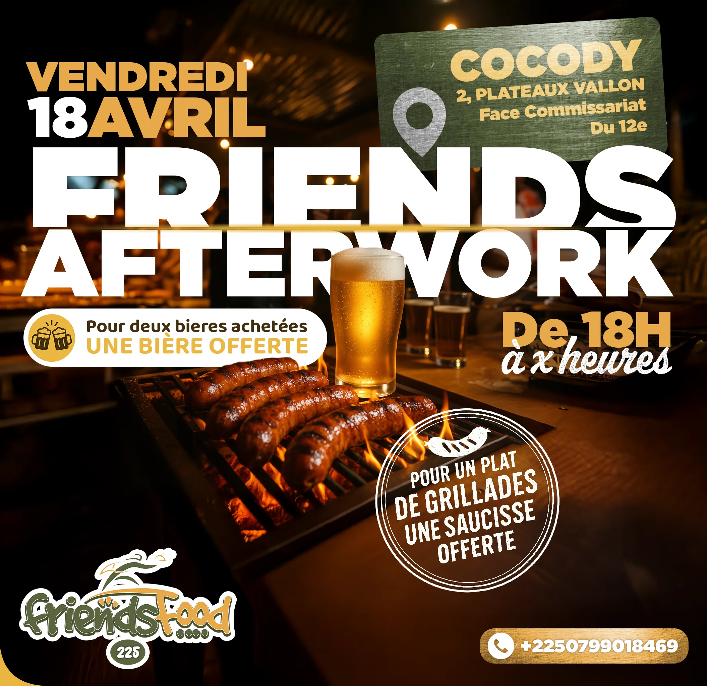
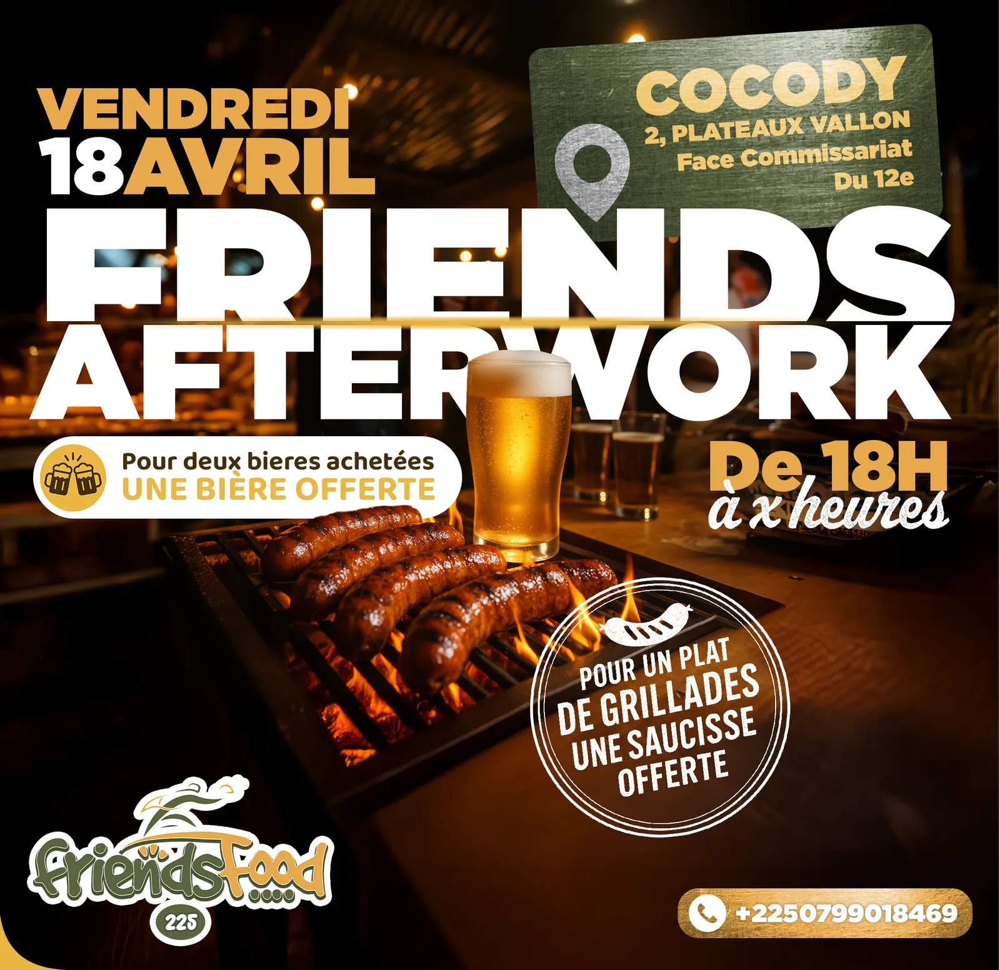
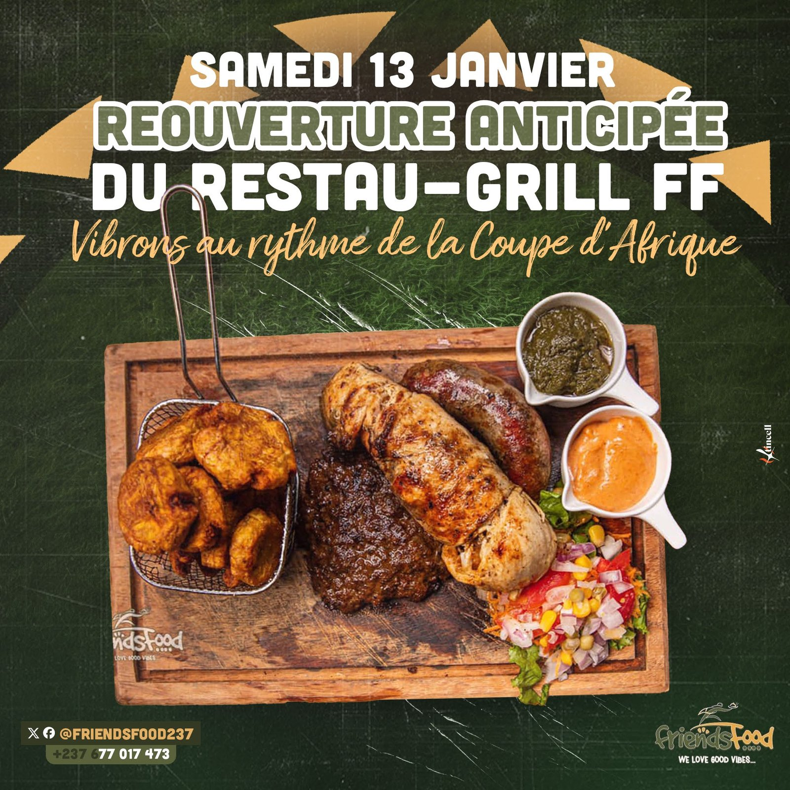
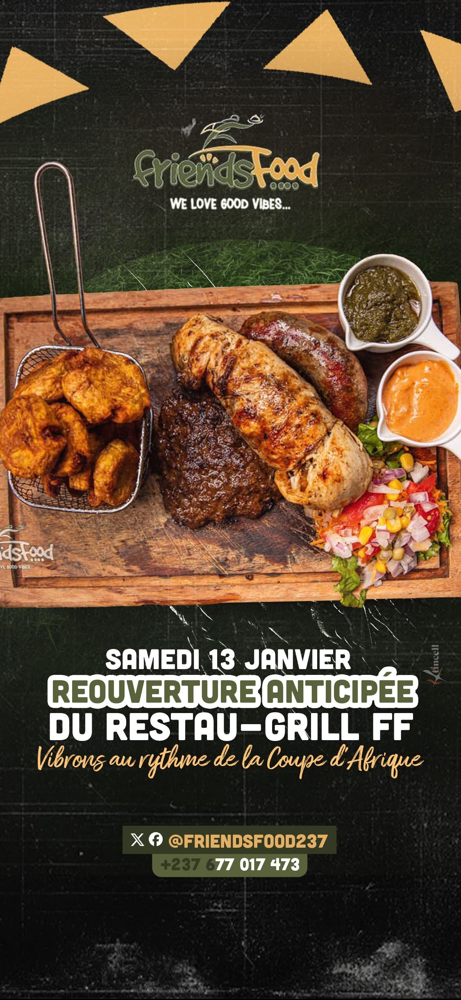

# FriendsFood 225 — Friends Afterwork

<!-- wiki:infobox -->

| FriendsFood 225 — Friends Afterwork | |
| --- | --- |
| Client | [FriendsFood 225](../organisations/friendsfood-225.md) |
| Période | 2025 |
| Casquette | Exécution |
| Catégorie | Campagne |
| Disciplines | social · event · photography |
| Folio | [Étude de cas ↗](https://xtincell.powerupgraders.com/work/friendsfood) |
| État de la fiche | Ébauche |
<!-- /wiki:infobox -->

**FriendsFood 225 — Friends Afterwork** est une campagne réalisée pour [FriendsFood 225](../organisations/friendsfood-225.md) (2025).

## Contexte

Flyer promo social pour l'événement « Friends Afterwork » (Cocody, Abidjan) : photographie de grillades et bière pression, offres promo et signature « FRIENDS AFTERWORK ».

## Galerie

<!-- wiki:galerie -->

<!-- /wiki:galerie -->

## Preuves et médias

- Visuels : `public/work/cases/friendsfood/` (2 fichiers)
- Visuels complémentaires : `public/work/historique/15-friendsfood-restau/` (2 fichiers)

## Sources

- Folio — `scripts/cases.spec.json`, entrée `friendsfood`

<!-- wiki:liens-entrants -->
<!-- /wiki:liens-entrants -->
