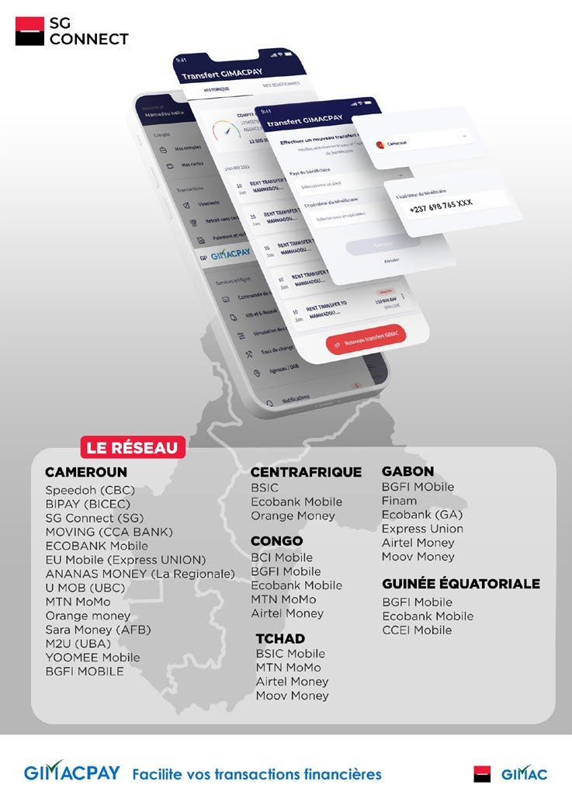

# GimacPay

<!-- wiki:infobox -->

| GimacPay | |
| --- | --- |
| Client | [GimacPay](../organisations/gimacpay.md) |
| Casquette | Direction créative & artistique |
| Catégorie | Projet |
| Folio | _pas encore sur le site_ |
| État de la fiche | Ébauche |
<!-- /wiki:infobox -->

**GimacPay** est un projet réalisé pour [GimacPay](../organisations/gimacpay.md).

## Description

_À documenter : contexte, demande, rôle, résultat._

## Galerie

<!-- wiki:galerie -->

<!-- /wiki:galerie -->

## Preuves et médias

- Visuels : `public/work/historique/08-gimacpay-banking/` (5 fichiers)

## Sources

- Dossier de visuels du folio (`public/work/`)

<!-- wiki:liens-entrants -->
<!-- /wiki:liens-entrants -->
