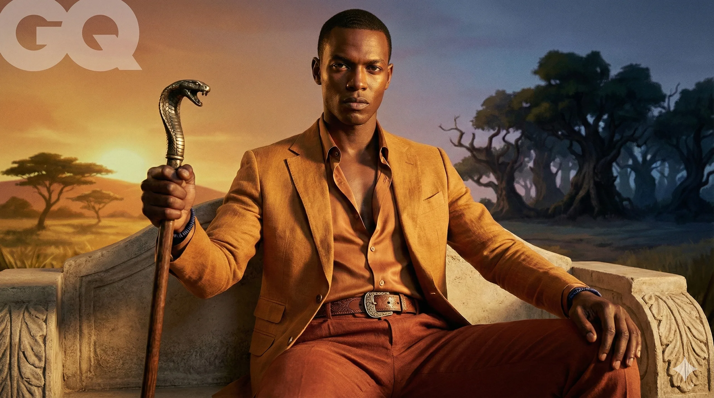
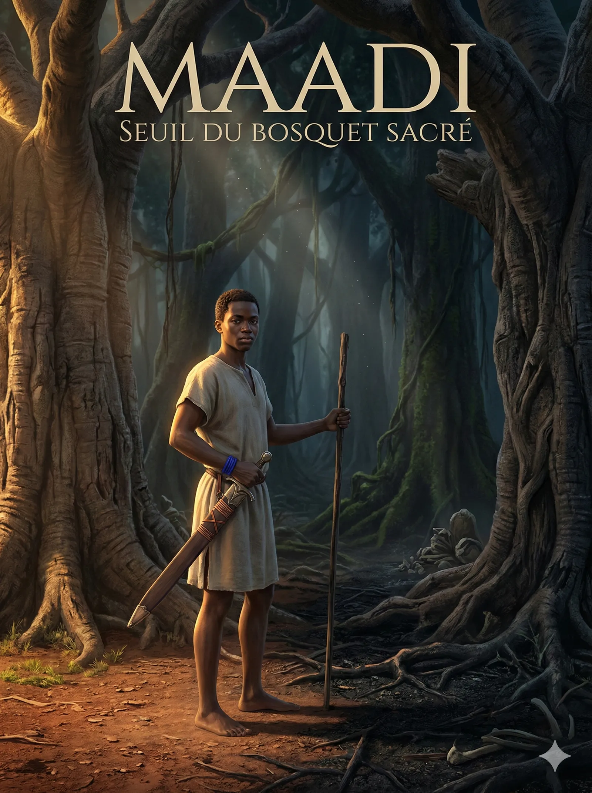
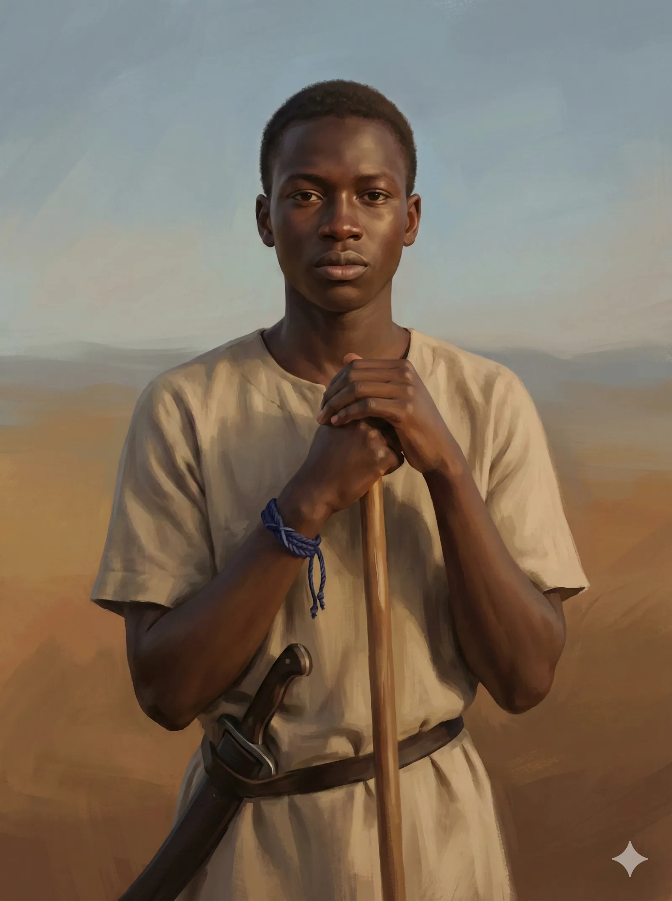
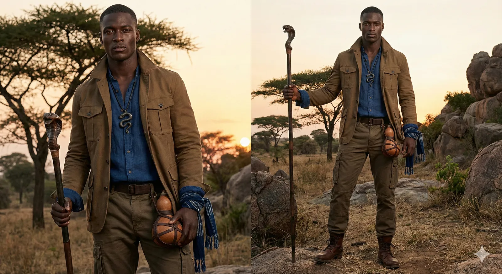
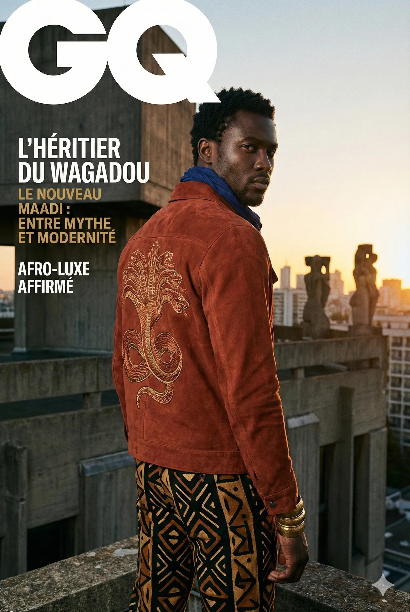
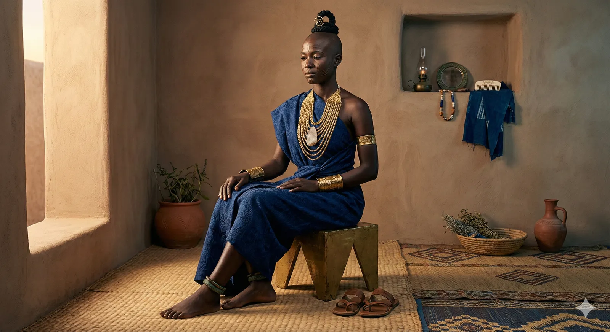
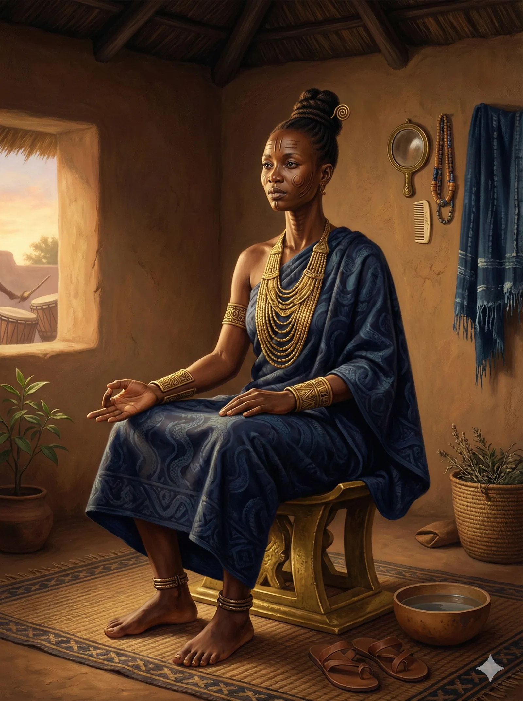
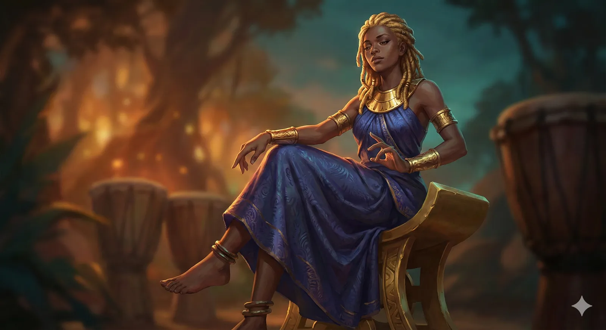

# Hero Shot — Portraits éditoriaux cinématiques

<!-- wiki:infobox -->

| Hero Shot — Portraits éditoriaux cinématiques | |
| --- | --- |
| Client | Projet personnel |
| Période | 2026 |
| Casquette | Direction créative & artistique |
| Catégorie | Collection |
| Disciplines | photography · illustration |
| Folio | [Étude de cas ↗](https://xtincell.powerupgraders.com/work/hero-shot) |
| État de la fiche | Ébauche |
<!-- /wiki:infobox -->

**Hero Shot — Portraits éditoriaux cinématiques** est une collection personnelle d’Alexandre « Xtincell » Djengue (2026).

## Contexte

Série de portraits « cover-star » cinématiques à thème royal afro : fausses couvertures Vanity Fair / GQ, trônes-serpents, penthouses brutalistes et couchers de soleil de savane, palette terre/or.

## Galerie

<!-- wiki:galerie -->

<!-- /wiki:galerie -->

## Preuves et médias

- Visuels : `public/work/cases/hero-shot/` (11 fichiers)

## Sources

- Folio — `scripts/cases.spec.json`, entrée `hero-shot`

<!-- wiki:liens-entrants -->
<!-- /wiki:liens-entrants -->
