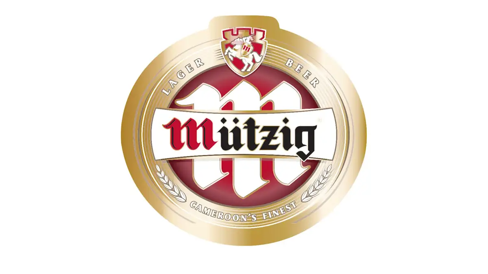
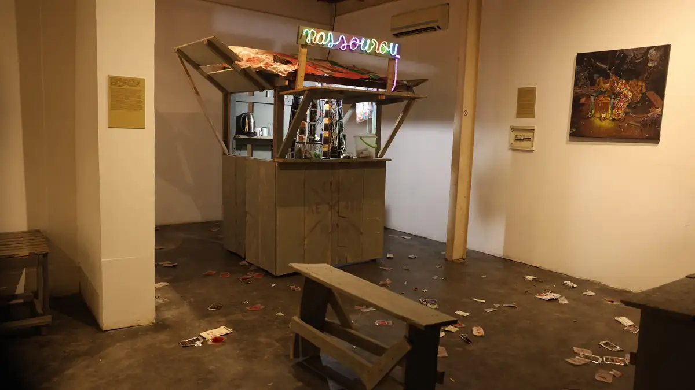
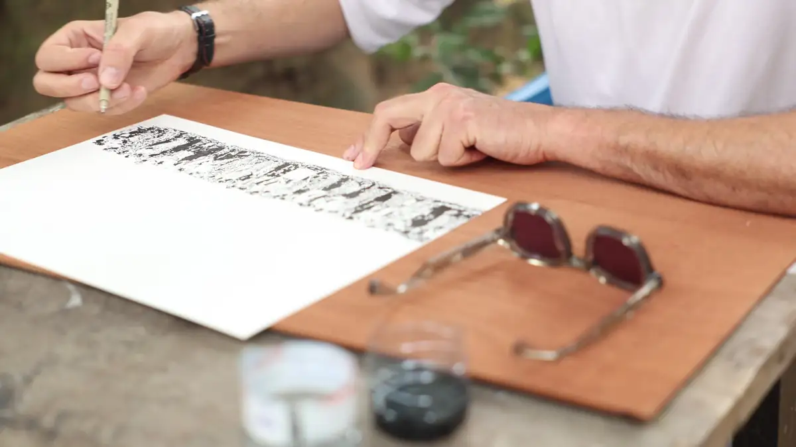
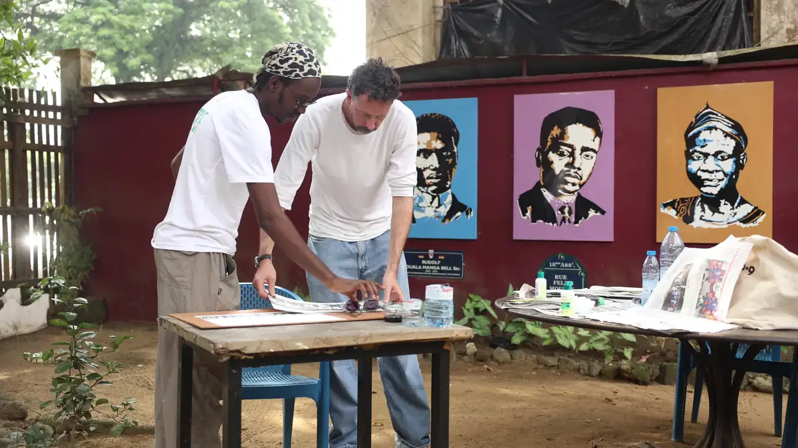
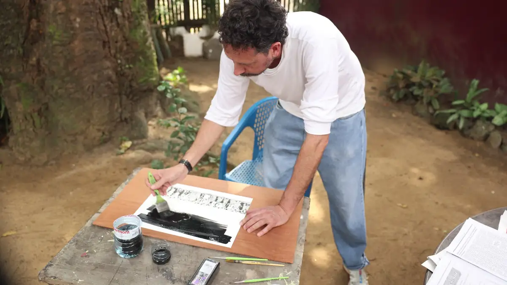
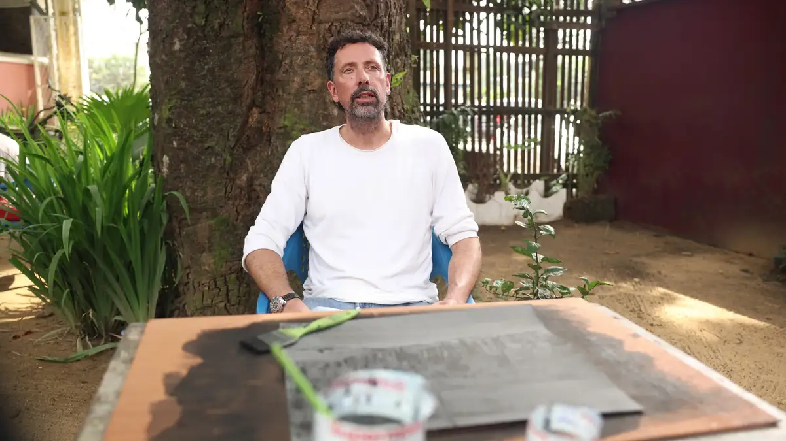

# IFC Douala — travaux

<!-- wiki:infobox -->

| IFC Douala — travaux | |
| --- | --- |
| Client | [IFC Douala](../organisations/ifc-douala.md) |
| Via | [UPgraders](../organisations/upgraders.md) |
| Période | 2021–2026 |
| Casquette | Exécution |
| Catégorie | Production |
| Sous-projets | [Vernissage et résidence d'artistes (janvier 2026)](evt-2026-01-29-vernissage-et-residence-d-artistes-janvier-2026.md) |
| Folio | _pas encore sur le site_ |
| État de la fiche | Ébauche |
<!-- /wiki:infobox -->

**IFC Douala — travaux** regroupe le travail réalisé pour [IFC Douala](../organisations/ifc-douala.md) avec [UPgraders](../organisations/upgraders.md) (2021–2026).

## Description

_À documenter : demande, rôle, livrables._ Les dossiers et opérations retrouvés sur les disques sont détaillés sur la fiche [IFC Douala](../organisations/ifc-douala.md#archives-de-travail).

## Galerie

<!-- wiki:galerie -->

<!-- /wiki:galerie -->

## Sources

- Archives de travail rangées sur les disques (2026-11-09)

<!-- wiki:liens-entrants -->
---
**Pages liées** : [Vernissage et résidence d'artistes (janvier 2026)](evt-2026-01-29-vernissage-et-residence-d-artistes-janvier-2026.md)
<!-- /wiki:liens-entrants -->
