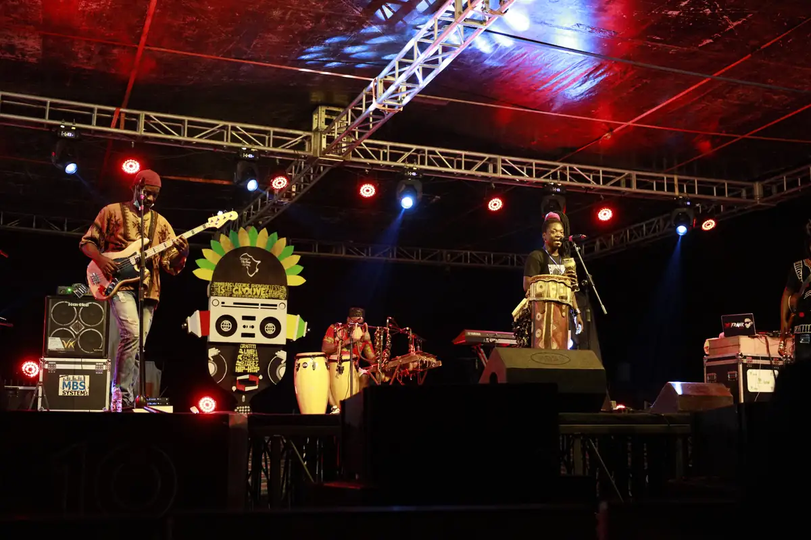

# KACOD Urban 237 — travaux

<!-- wiki:infobox -->

| KACOD Urban 237 — travaux | |
| --- | --- |
| Client | [KACOD Urban 237](../organisations/kacod-urban-237.md) |
| Via | [UPgraders](../organisations/upgraders.md) |
| Période | 2021 |
| Casquette | Exécution |
| Catégorie | Production |
| Sous-projets | [Festival urbain présenté par KACOD Urban 237](evt-2021-11-25-festival-urbain-presente-par-kacod-urban-237.md) |
| Folio | _pas encore sur le site_ |
| État de la fiche | Ébauche |
<!-- /wiki:infobox -->

**KACOD Urban 237 — travaux** regroupe le travail réalisé pour [KACOD Urban 237](../organisations/kacod-urban-237.md) avec [UPgraders](../organisations/upgraders.md) (2021).

## Description

_À documenter : demande, rôle, livrables._ Les dossiers et opérations retrouvés sur les disques sont détaillés sur la fiche [KACOD Urban 237](../organisations/kacod-urban-237.md#archives-de-travail).

## Galerie

<!-- wiki:galerie -->

<!-- /wiki:galerie -->

## Sources

- Archives de travail rangées sur les disques (2026-11-09)

<!-- wiki:liens-entrants -->
---
**Pages liées** : [Festival urbain présenté par KACOD Urban 237](evt-2021-11-25-festival-urbain-presente-par-kacod-urban-237.md)
<!-- /wiki:liens-entrants -->
