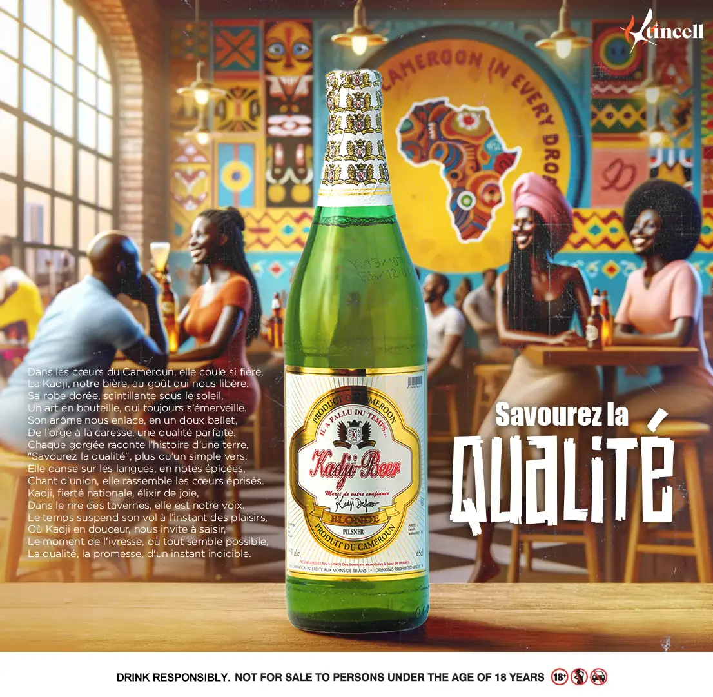
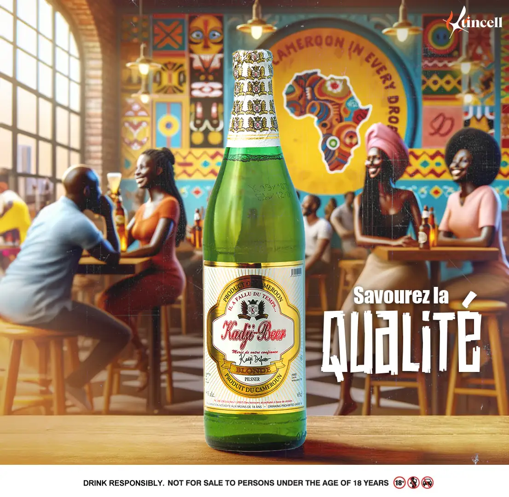

# Kadji by Spark

<!-- wiki:infobox -->

| Kadji by Spark | |
| --- | --- |
| Client | Projet personnel |
| Casquette | Direction créative & artistique |
| Catégorie | Campagne |
| Folio | _pas encore sur le site_ |
| État de la fiche | Ébauche |
<!-- /wiki:infobox -->

**Kadji by Spark** est un projet personnel d’Alexandre « Xtincell » Djengue.

## Description

_À documenter._

## Galerie

<!-- wiki:galerie -->

<!-- /wiki:galerie -->

## Archives

- 2 fichiers dans les dossiers « Xtincell » des disques de travail (2 photos).

## Sources

- Archives personnelles rangées sur les disques (2026-11-09), dossier « Créations graphiques/Kadji by Spark »

<!-- wiki:liens-entrants -->
<!-- /wiki:liens-entrants -->
