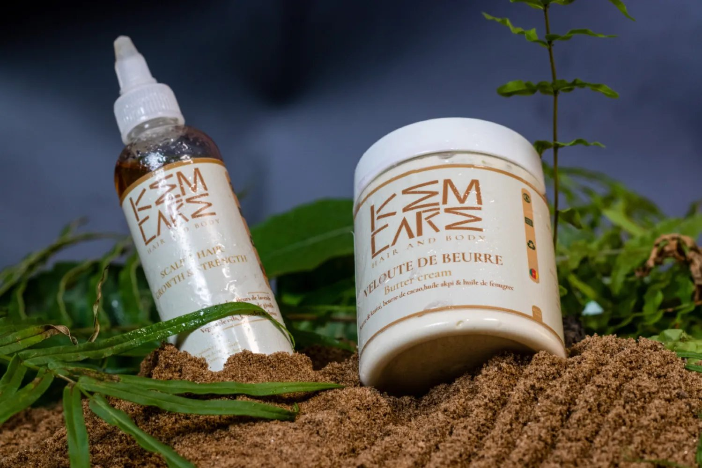
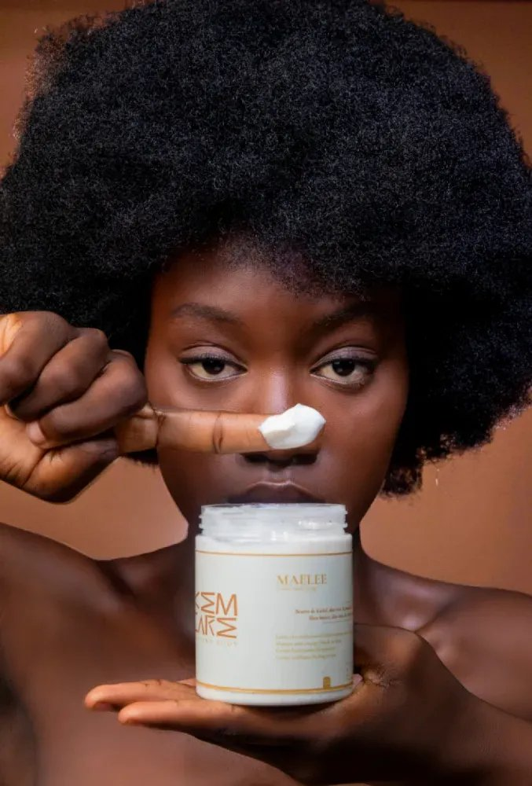
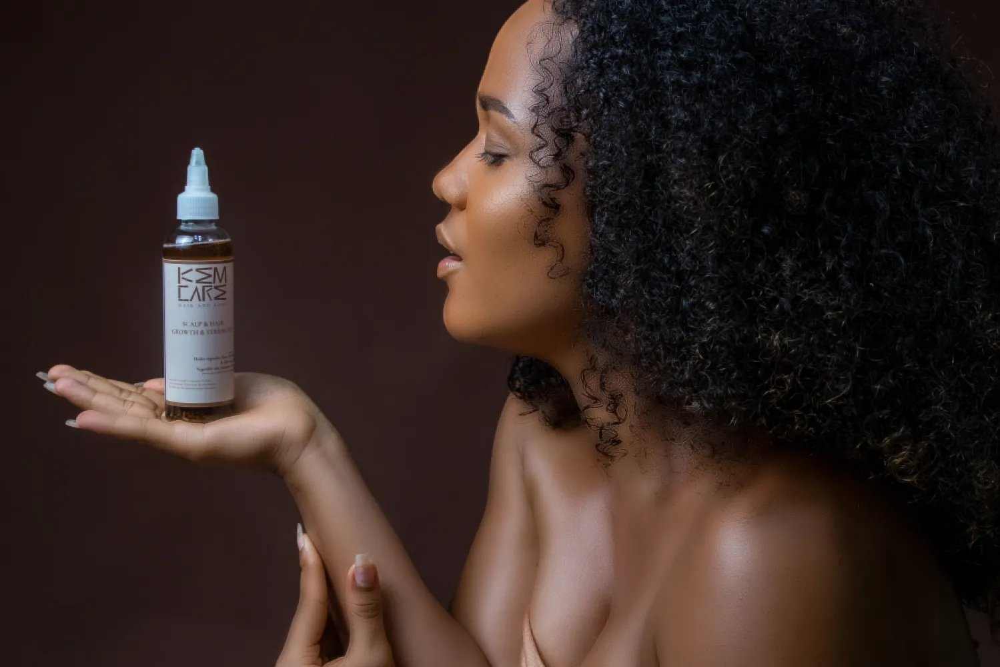

# Kemcare — stratégie de marque & lancement

<!-- wiki:infobox -->

| Kemcare — stratégie de marque & lancement | |
| --- | --- |
| Client | [Kemcare](../organisations/kemcare.md) |
| Via | [Her Media](../organisations/her-media.md) |
| Période | 2021–… |
| Casquette | Stratégie |
| Catégorie | Mission |
| Rôle | Stratégie de marque & lancement |
| Disciplines | Lancement · DNA · FMCG |
| Folio | [Folio ↗](https://xtincell.powerupgraders.com/work) _(cité, sans page dédiée)_ |
| État de la fiche | Standard |
<!-- /wiki:infobox -->

**Kemcare — stratégie de marque & lancement** est une mission réalisée pour [Kemcare](../organisations/kemcare.md), via [Her Media](../organisations/her-media.md) (2021–…).

## Description

Marque haircare 100% Cameroun pour cheveux crépus — « Preserve our HAIRITAGE ». Positionnement produit, mise en marché, identité — opéré via Her Media.

## Rôle

Stratégie de marque & lancement. Repère d’origine : « depuis 2021 · Douala ».

## Galerie

<!-- wiki:galerie -->

<!-- /wiki:galerie -->

## Preuves et médias

- Visuels : `public/work/tier23/kemcare-haircare/` (5 fichiers)

## Sources

- Folio — `src/components/folio/data/practices.ts`, entrée « KEMCARE »

<!-- wiki:liens-entrants -->
---
**Pages liées** : [Alexandre « Xtincell » Djengue](../personnes/alexandre-djengue.md)
<!-- /wiki:liens-entrants -->
