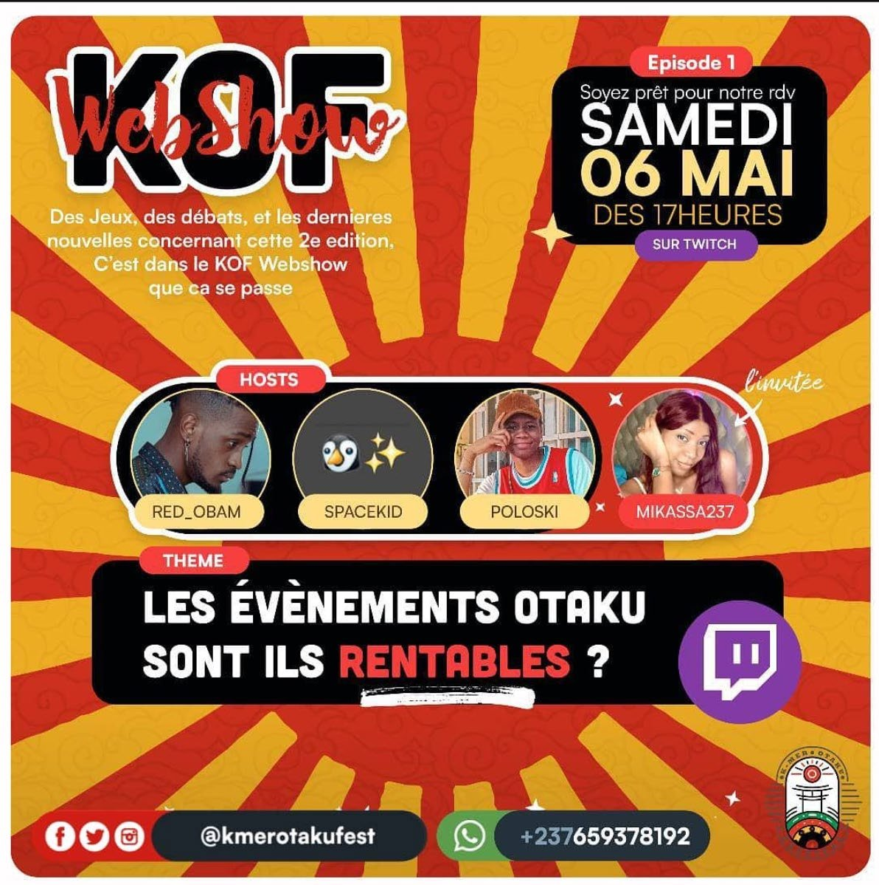
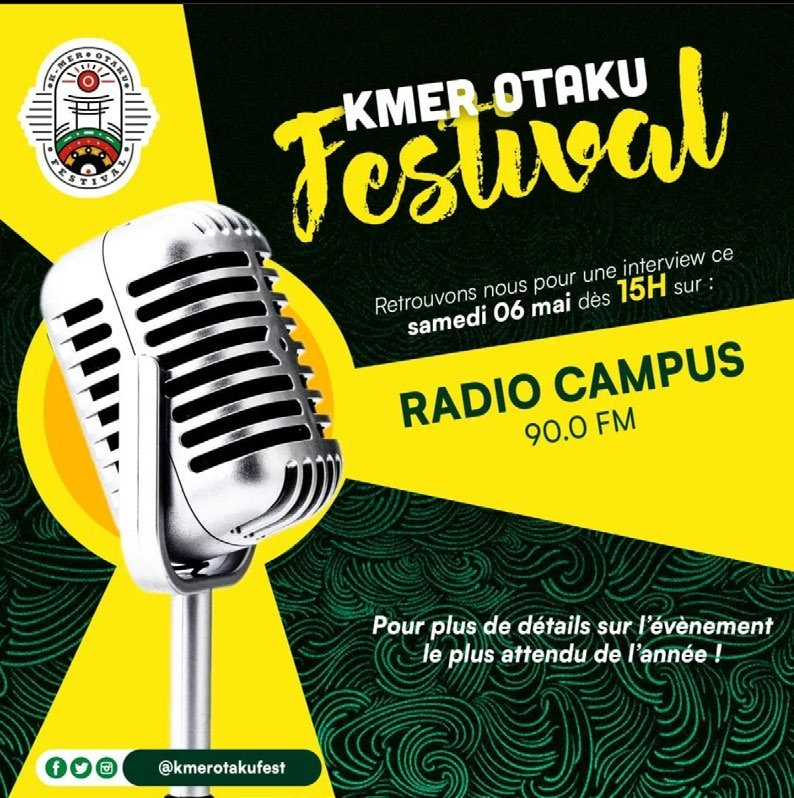
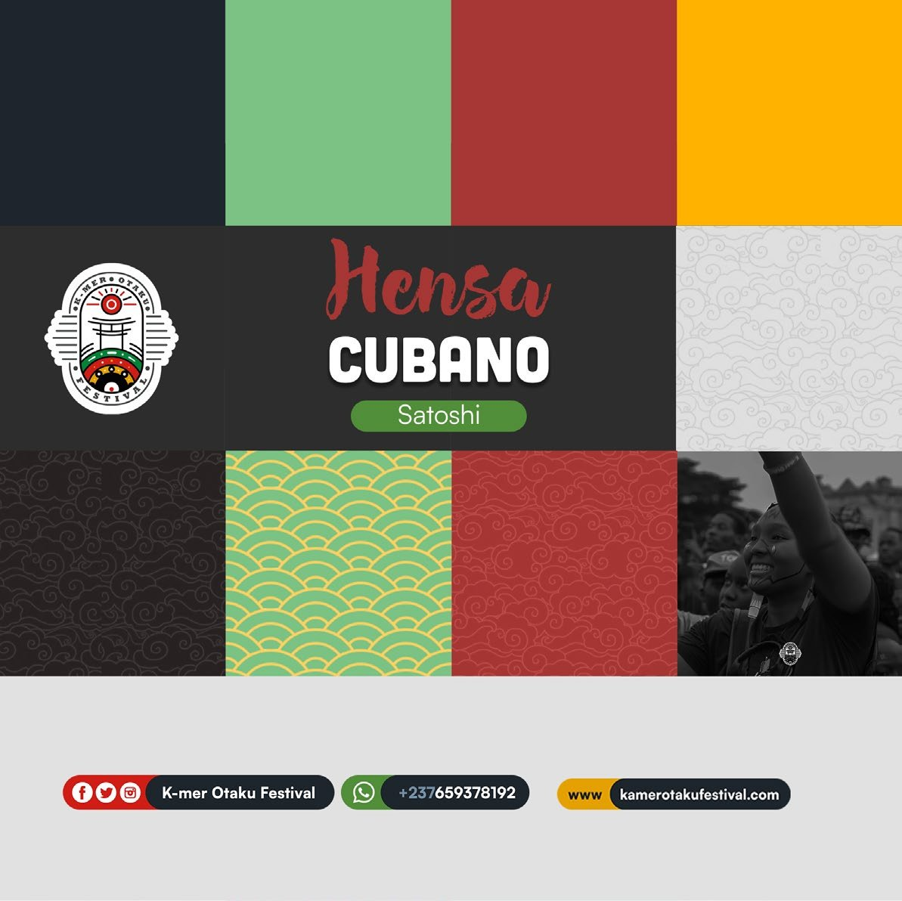
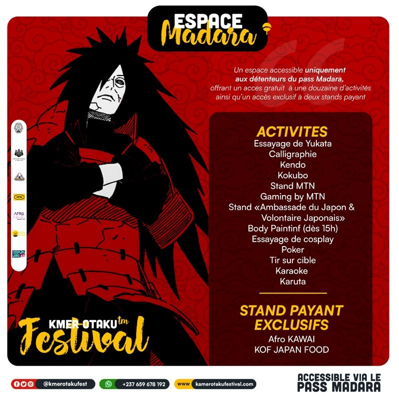
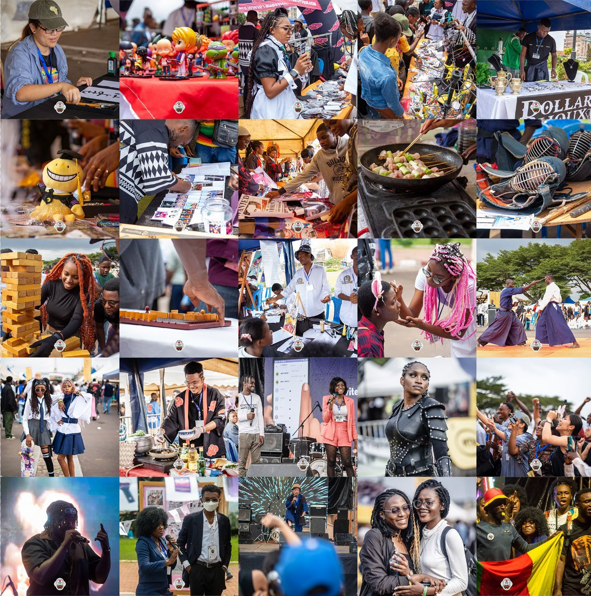
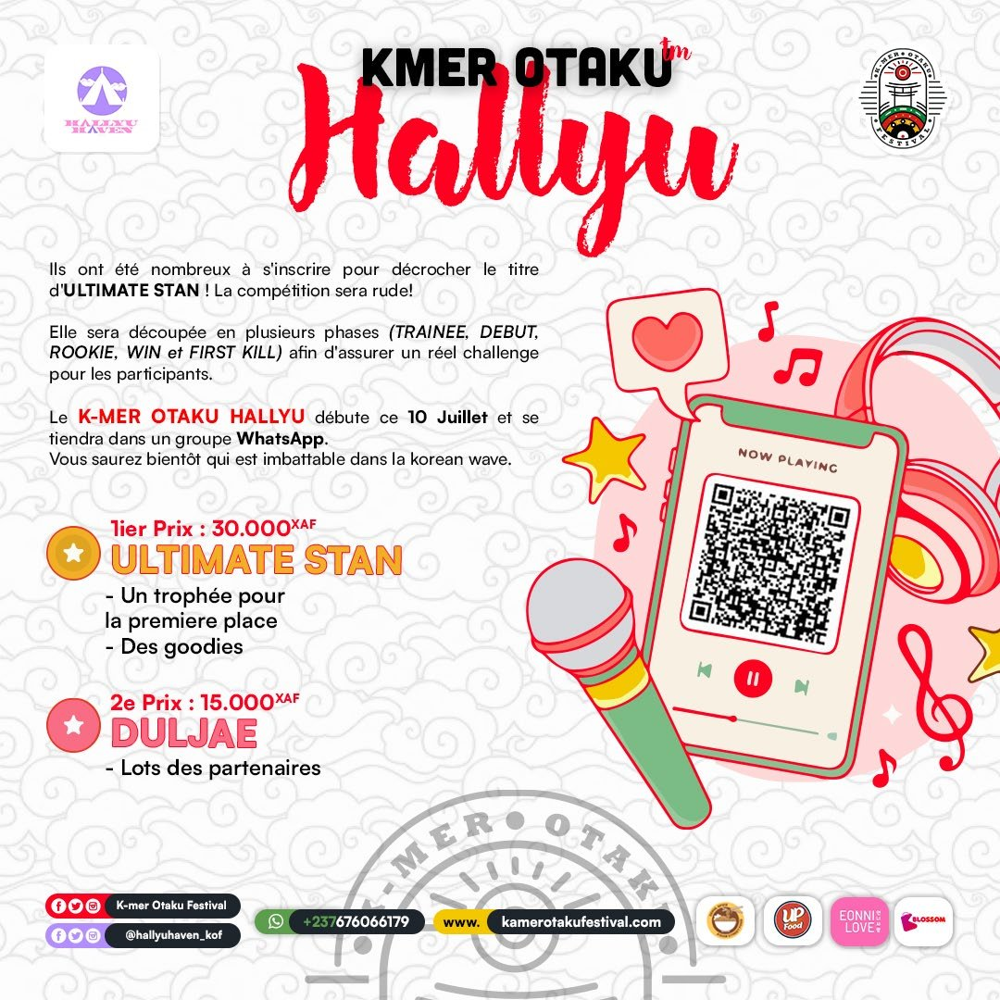
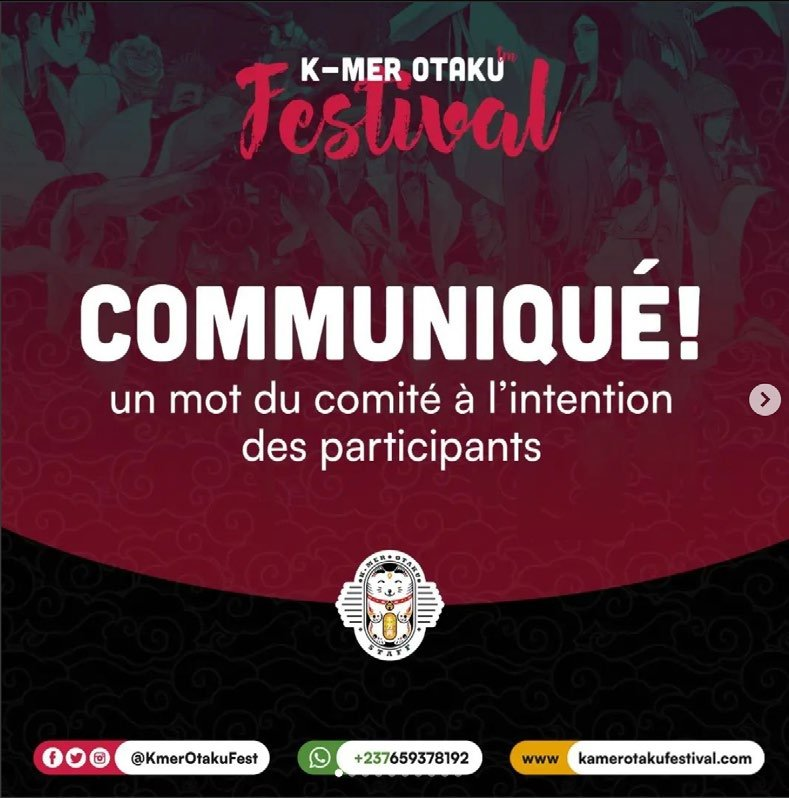

# Kamer Otaku Festival — éditions 2022 à 2024

<!-- wiki:infobox -->

| Kamer Otaku Festival — éditions 2022 à 2024 | |
| --- | --- |
| Client | [Kamer Otaku Festival (KOF)](../organisations/kamer-otaku-festival.md) |
| Via | [UPgraders](../organisations/upgraders.md) |
| Période | 2022–2024 |
| Casquette | Direction créative & artistique |
| Catégorie | Mission |
| Rôle | Directeur artistique (depuis 2023) |
| Disciplines | Festival · Identité visuelle · Pop culture |
| Sous-projets | [K-mer Otaku Festival — édition de Douala avec MTN (Y'ello Hub, 25 ans de MTN)](evt-2024-09-24-k-mer-otaku-festival-edition-de-douala-avec-mtn-y-ello-hu.md) · [K-mer Otaku Festival 2024](evt-2024-08-03-k-mer-otaku-festival-2024.md) · [Cosplay Land 237 — concours cosplay en extérieur](evt-2023-11-25-cosplay-land-237-concours-cosplay-en-exterieur.md) · [K-mer Otaku Festival 2023](evt-2023-08-05-k-mer-otaku-festival-2023.md) · [K-mer Otaku Festival 2022](evt-2022-08-06-k-mer-otaku-festival-2022.md) |
| Folio | [Folio ↗](https://xtincell.powerupgraders.com/work) _(cité, sans page dédiée)_ |
| Liens | [Galerie Pixieset — KOF '22](https://xtincell.pixieset.com/kmerotakufestival22/) · [Galerie Pixieset — KOF '23](https://xtincell.pixieset.com/kmerotakufestival23/) · [Galerie Pixieset — KOF 2024 (3 août 2024)](https://xtincell.pixieset.com/kmerotakufestival24/) |
| État de la fiche | Standard |
<!-- /wiki:infobox -->

**Kamer Otaku Festival — éditions 2022 à 2024** est une mission réalisée pour [Kamer Otaku Festival (KOF)](../organisations/kamer-otaku-festival.md), via [UPgraders](../organisations/upgraders.md) (2022–2024).

## Description

Festival pop-culture (manga, cosplay, gaming, BD) — Yaoundé. Photo de la 1ʳᵉ édition, puis DA à partir de la 2ᵉ. 3ᵉ édition : Musée National + Mairie 6ᵉ, 5 000 billets, partenaires Infinix, Zebra Comics.

## Rôle

Photographe de la 1ʳᵉ édition (2022), puis directeur artistique et de la communication à partir de la 2ᵉ (2023), jusqu’à la 3ᵉ (août 2024).

## Dates

La première édition du festival, en 2022, est couverte en photographie. En 2023, Alexandre est directeur artistique et directeur de la communication du festival. Le CV de 2026 parle de photographie « depuis la 1ʳᵉ édition » et de direction artistique « depuis la 2ᵉ » : les deux versions concordent. _Sources : [disques](../sources.md#disques), [cv-2023-05](../sources.md#cv-2023-05)._

## Galerie

<!-- wiki:galerie -->

<!-- /wiki:galerie -->

## Preuves et médias

- Archives de travail rangées sur les disques — voir [disques](../sources.md#disques)
- CV « Dircom », 16 mai 2023 — voir [cv-2023-05](../sources.md#cv-2023-05)
- [Galerie Pixieset — KOF '22](https://xtincell.pixieset.com/kmerotakufestival22/)
- [Galerie Pixieset — KOF '23](https://xtincell.pixieset.com/kmerotakufestival23/)
- [Galerie Pixieset — KOF 2024 (3 août 2024)](https://xtincell.pixieset.com/kmerotakufestival24/)
- Visuels : `public/work/historique/05-kof-da-historique/` (6 fichiers)
- Visuels : `public/work/historique/06-kof-photographie/` (5 fichiers)

## Sources

- Folio — `src/components/folio/data/practices.ts`, entrée « KOF — Kamer Otaku Festival »

<!-- wiki:liens-entrants -->
---
**Pages liées** : [Cosplay Land 237 — concours cosplay en extérieur](evt-2023-11-25-cosplay-land-237-concours-cosplay-en-exterieur.md) · [K-mer Otaku Festival — édition de Douala avec MTN (Y'ello Hub, 25 ans de MTN)](evt-2024-09-24-k-mer-otaku-festival-edition-de-douala-avec-mtn-y-ello-hu.md) · [K-mer Otaku Festival 2022](evt-2022-08-06-k-mer-otaku-festival-2022.md) · [K-mer Otaku Festival 2023](evt-2023-08-05-k-mer-otaku-festival-2023.md) · [K-mer Otaku Festival 2024](evt-2024-08-03-k-mer-otaku-festival-2024.md)
<!-- /wiki:liens-entrants -->
