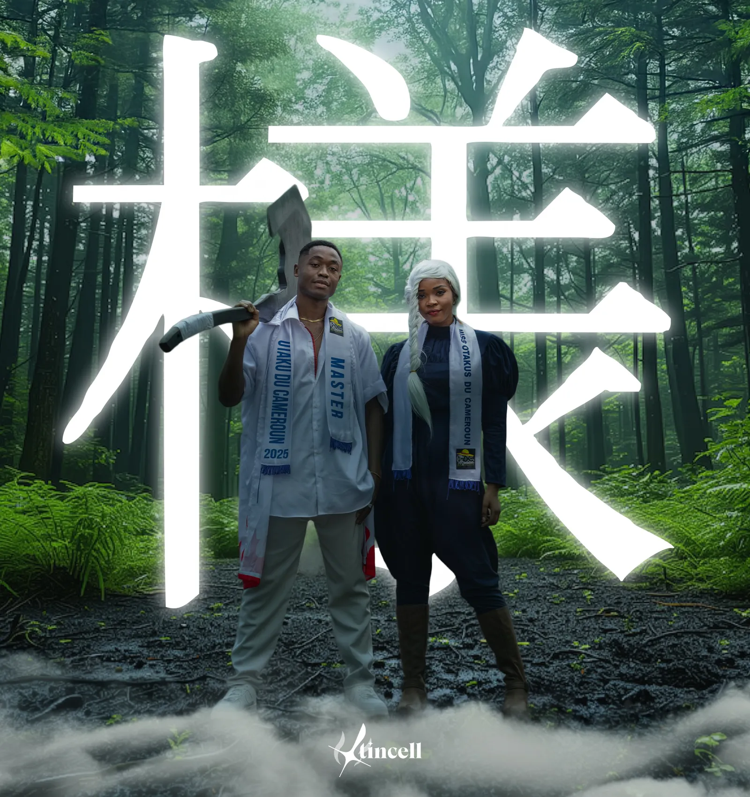
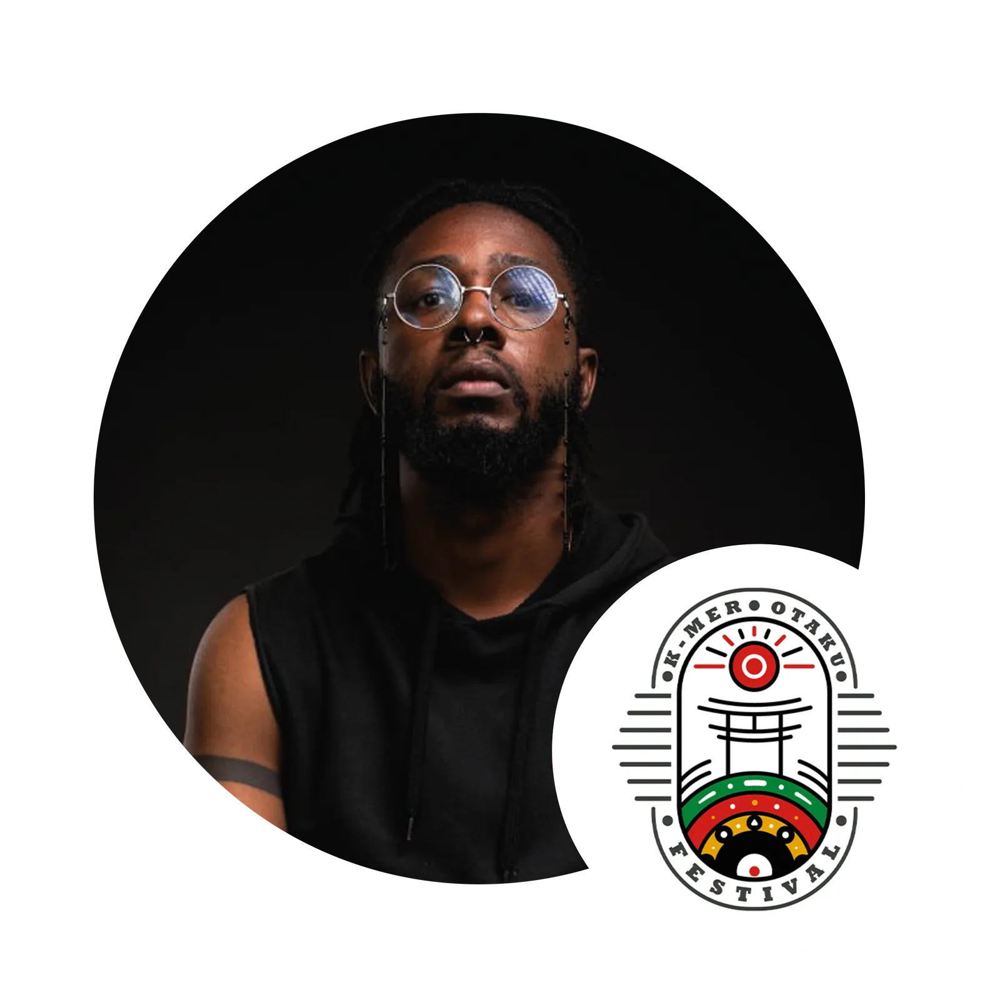
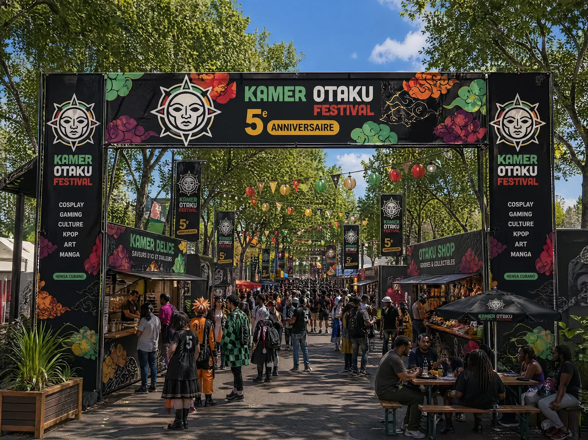
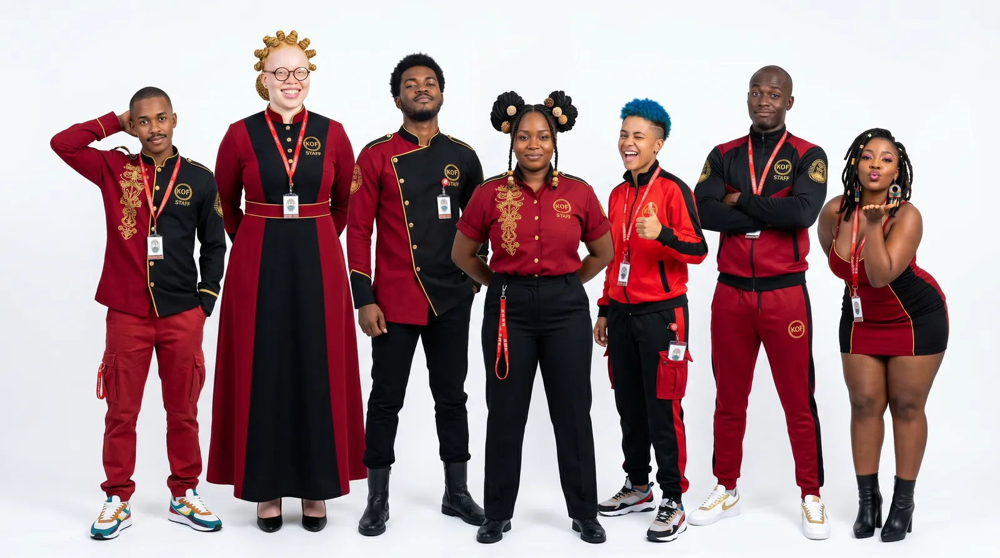
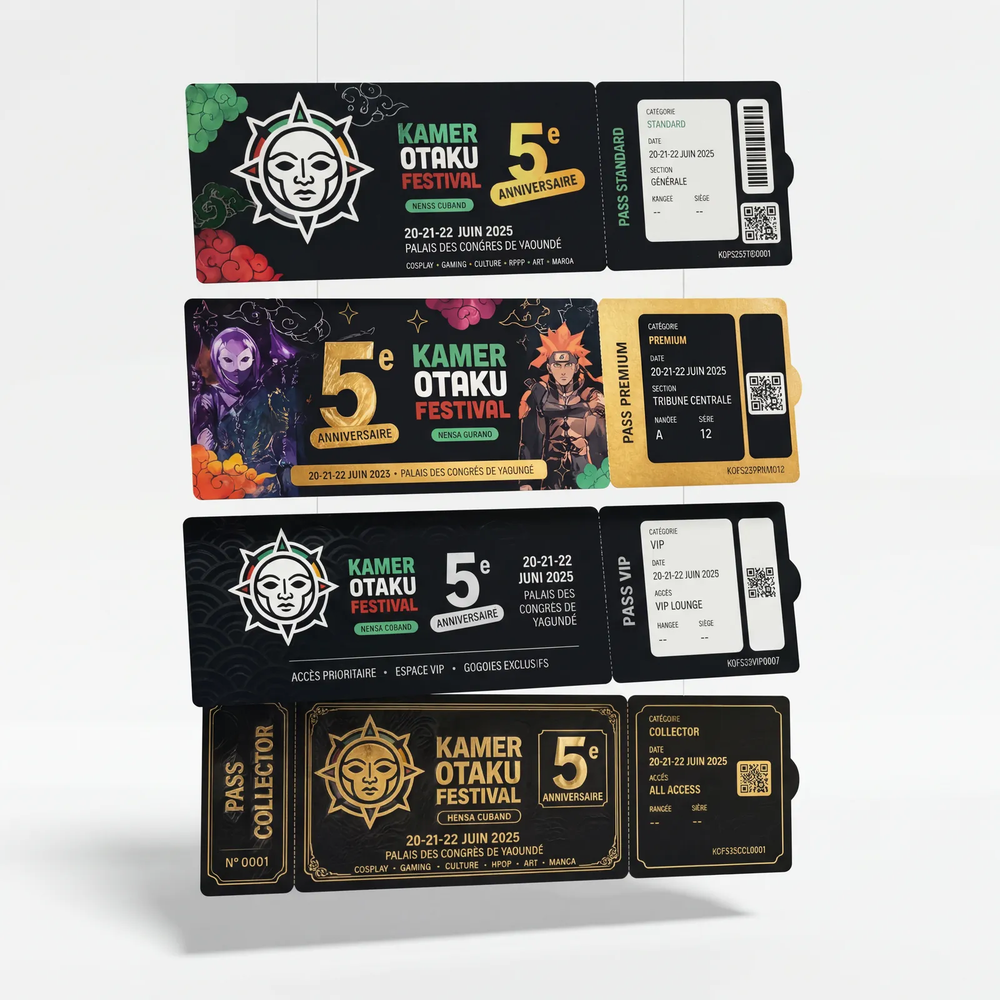
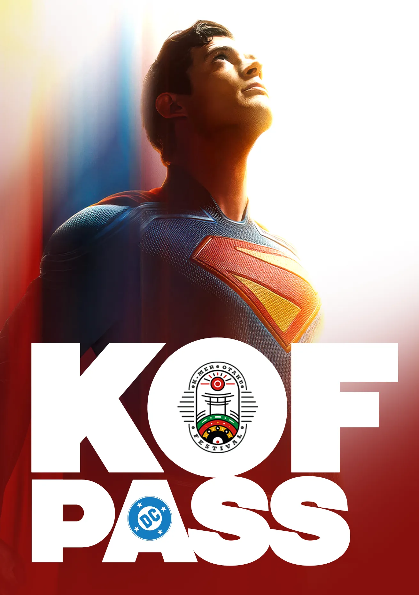
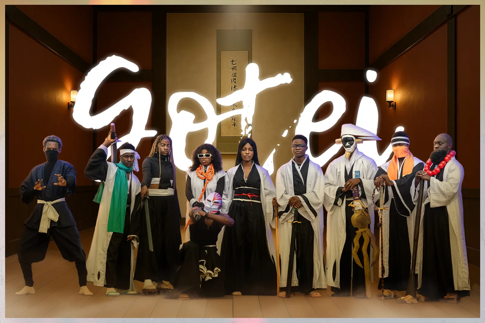

# KOF — Kamer Otaku Festival

<!-- wiki:infobox -->

| KOF — Kamer Otaku Festival | |
| --- | --- |
| Client | [Kamer Otaku Festival (KOF)](../organisations/kamer-otaku-festival.md) |
| Période | 2025 |
| Casquette | Direction créative & artistique |
| Catégorie | Campagne |
| Disciplines | event · branding · KV-OOH · photography |
| Sous-projets | [K-mer Otaku Festival 2025 (KOF4)](evt-2025-08-02-k-mer-otaku-festival-2025-kof4.md) |
| Folio | [Étude de cas ↗](https://xtincell.powerupgraders.com/work/kof-festival) |
| Liens | [Galerie Pixieset — KOF '25](https://xtincell.pixieset.com/kmerotakufestival25/) |
| État de la fiche | Standard |
<!-- /wiki:infobox -->

**KOF — Kamer Otaku Festival** est une campagne réalisée pour [Kamer Otaku Festival (KOF)](../organisations/kamer-otaku-festival.md) (2025).

## Contexte

Branding et campagne du Kamer Otaku Festival (KOF), convention pop-culture/anime camerounaise (5e anniversaire, Yaoundé) : logo torii, KV cinématographique « Miss & Master », rendus d'ambiance, tenues équipe et mockups de pass.

## Rôle

Photographe sur la première édition, puis directeur artistique à partir de la deuxième, avec UPgraders. Cette sélection présente le travail d’identité et de communication du festival en 2025.

## Résultat

Un ensemble de supports autour du festival : identité au torii, visuel « Miss & Master », pass, tenues d’équipe et représentations de l’espace événementiel. Les images réunissent créations graphiques et mises en situation.

## Galerie

<!-- wiki:galerie -->

<!-- /wiki:galerie -->

## Preuves et médias

- [Galerie Pixieset — KOF '25](https://xtincell.pixieset.com/kmerotakufestival25/)
- Visuels : `public/work/cases/kof-festival/` (8 fichiers)

## Sources

- Folio — `scripts/cases.spec.json`, entrée `kof-festival`

<!-- wiki:liens-entrants -->
---
**Pages liées** : [Alexandre « Xtincell » Djengue](../personnes/alexandre-djengue.md) · [K-mer Otaku Festival 2025 (KOF4)](evt-2025-08-02-k-mer-otaku-festival-2025-kof4.md)
<!-- /wiki:liens-entrants -->
