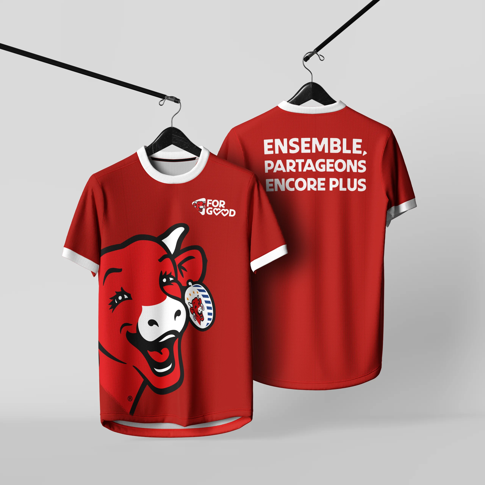
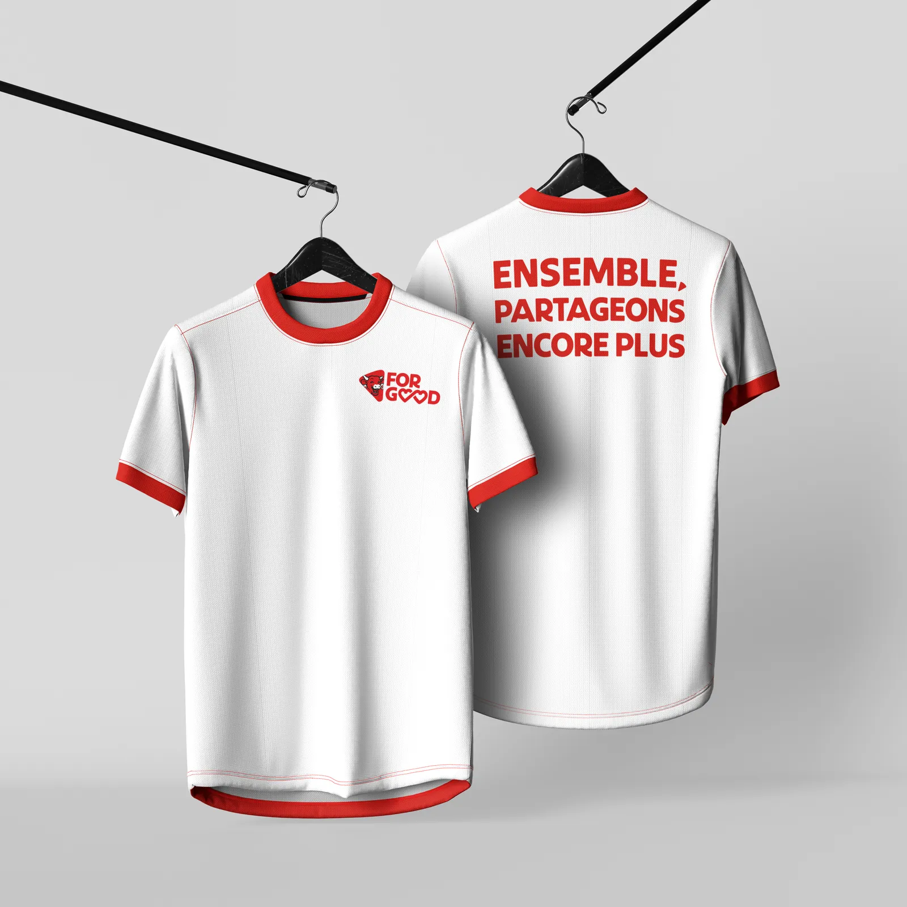

# La Vache qui rit — Merch « For Good »

<!-- wiki:infobox -->

| La Vache qui rit — Merch « For Good » | |
| --- | --- |
| Client | [Groupe Bel](../organisations/groupe-bel.md) |
| Via | [MATANGA Agency](../organisations/matanga-agency.md) |
| Période | 2026 |
| Casquette | Exécution |
| Catégorie | Campagne |
| Disciplines | branding · packaging |
| Folio | [Étude de cas ↗](https://xtincell.powerupgraders.com/work/la-vache-qui-rit) |
| État de la fiche | Ébauche |
<!-- /wiki:infobox -->

**La Vache qui rit — Merch « For Good »** est une campagne réalisée pour [Groupe Bel](../organisations/groupe-bel.md) (2026).

## Contexte

Merchandising textile (t-shirts) pour la plateforme « For Good » de La Vache qui rit, mascotte vache stylisée et signature « Ensemble, partageons encore plus ».

## Galerie

<!-- wiki:galerie -->

<!-- /wiki:galerie -->

## Preuves et médias

- Visuels : `public/work/cases/la-vache-qui-rit/` (3 fichiers)

## Sources

- Archives de travail rangées sous « MATANGA — EXPORT DU TRAVAIL » sur les disques (relevé du 2026-11-09)
- Folio — `scripts/cases.spec.json`, entrée `la-vache-qui-rit`

<!-- wiki:liens-entrants -->
---
**Pages liées** : [Alexandre « Xtincell » Djengue](../personnes/alexandre-djengue.md)
<!-- /wiki:liens-entrants -->
