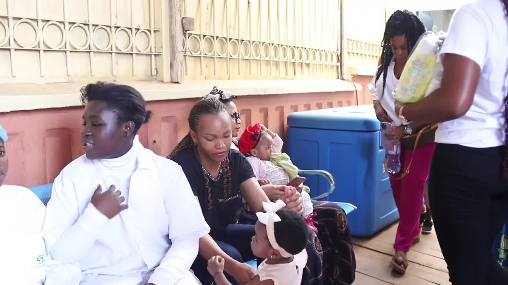
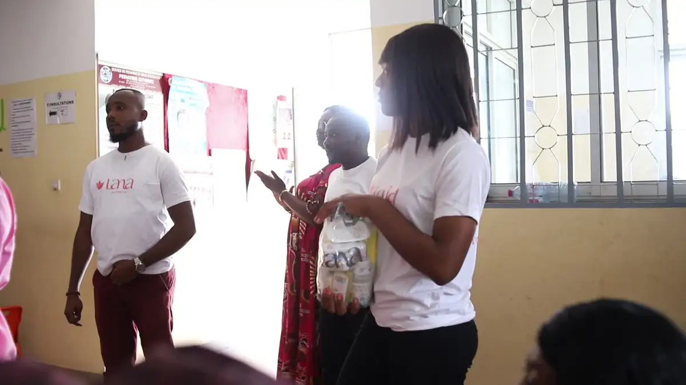
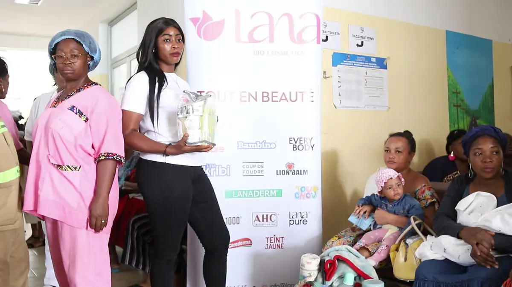
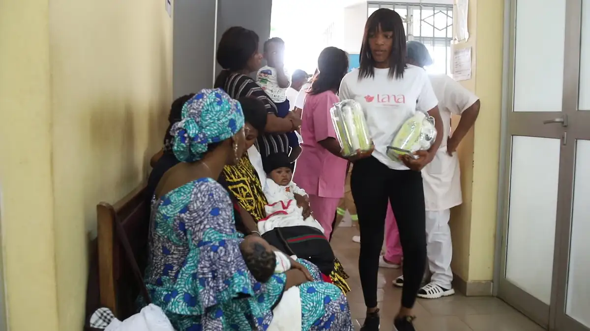
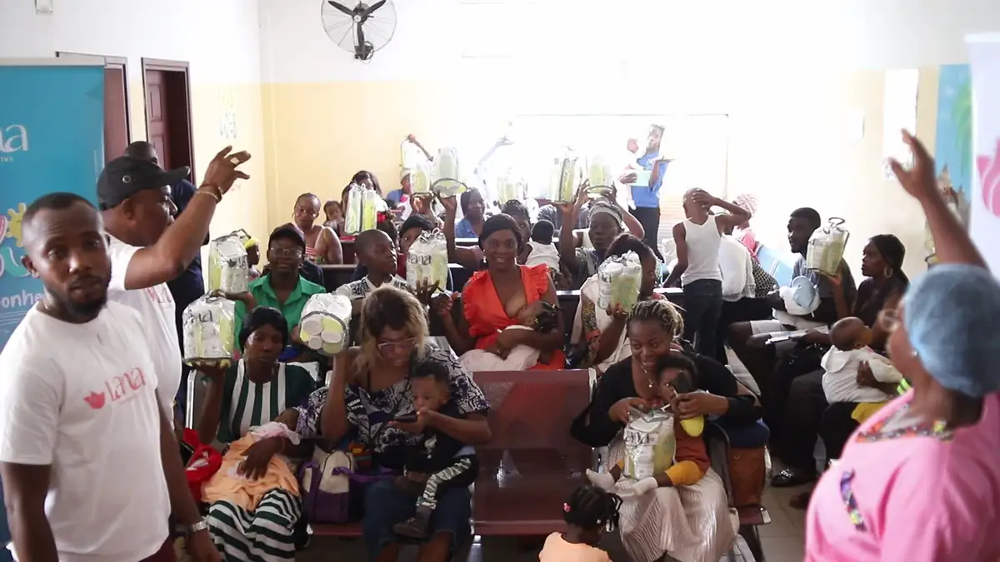
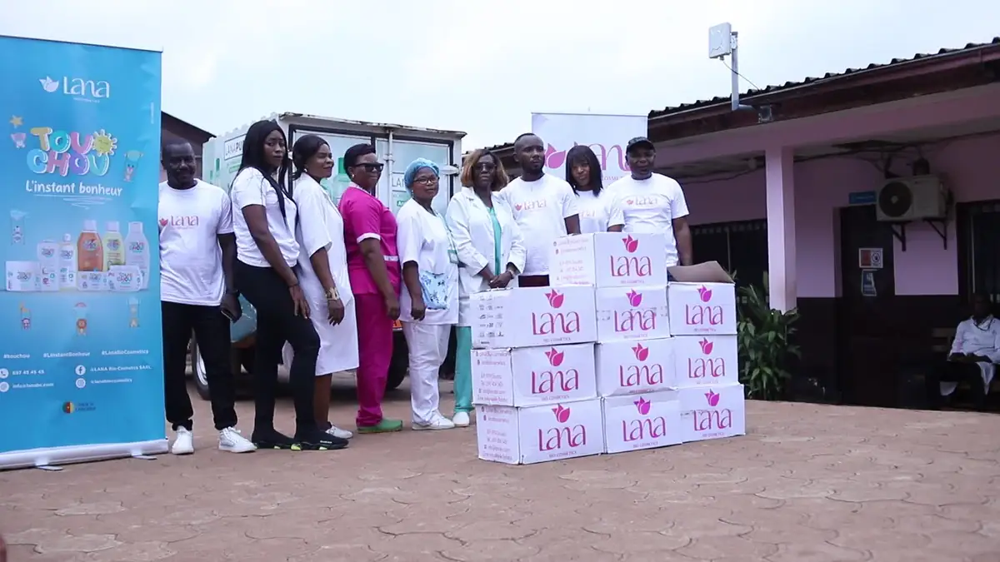

# Lana — travaux

<!-- wiki:infobox -->

| Lana — travaux | |
| --- | --- |
| Client | [Lana](../organisations/lana.md) |
| Via | [UPgraders](../organisations/upgraders.md) |
| Période | 2024 |
| Casquette | Exécution |
| Catégorie | Production |
| Sous-projets | [Lana « Tout en beauté » — dons de produits pour bébés à l'hôpital de district de la Cité-Verte](evt-2024-04-09-lana-tout-en-beaute-dons-de-produits-pour-bebes-a-l-hopit.md) |
| Folio | _pas encore sur le site_ |
| État de la fiche | Ébauche |
<!-- /wiki:infobox -->

**Lana — travaux** regroupe le travail réalisé pour [Lana](../organisations/lana.md) avec [UPgraders](../organisations/upgraders.md) (2024).

## Description

_À documenter : demande, rôle, livrables._ Les dossiers et opérations retrouvés sur les disques sont détaillés sur la fiche [Lana](../organisations/lana.md#archives-de-travail).

## Galerie

<!-- wiki:galerie -->

<!-- /wiki:galerie -->

## Sources

- Archives de travail rangées sur les disques (2026-11-09)

<!-- wiki:liens-entrants -->
---
**Pages liées** : [Lana « Tout en beauté » — dons de produits pour bébés à l'hôpital de district de la Cité-Verte](evt-2024-04-09-lana-tout-en-beaute-dons-de-produits-pour-bebes-a-l-hopit.md)
<!-- /wiki:liens-entrants -->
