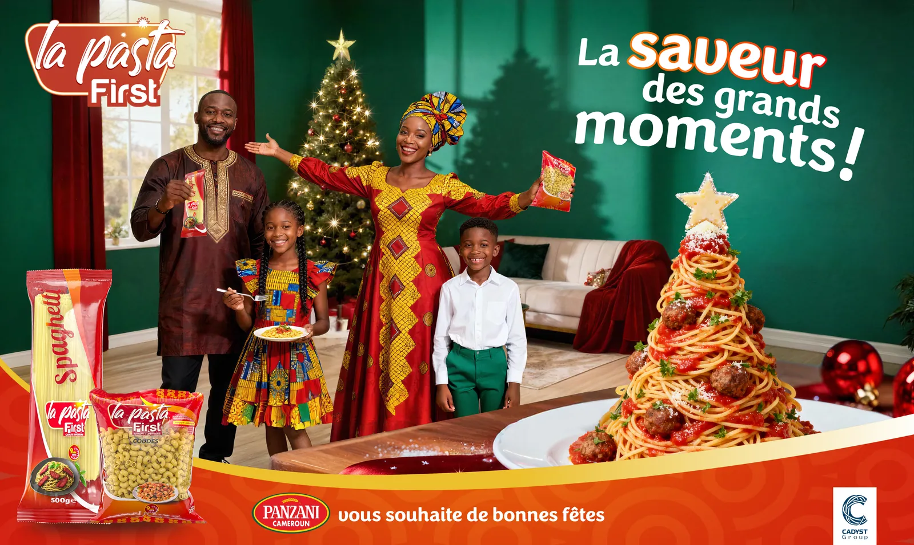
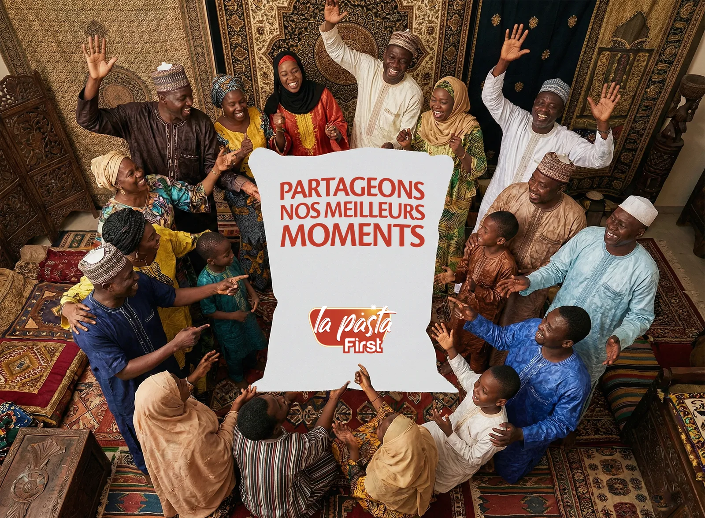
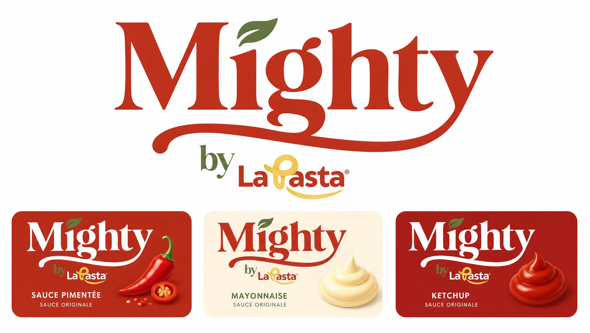
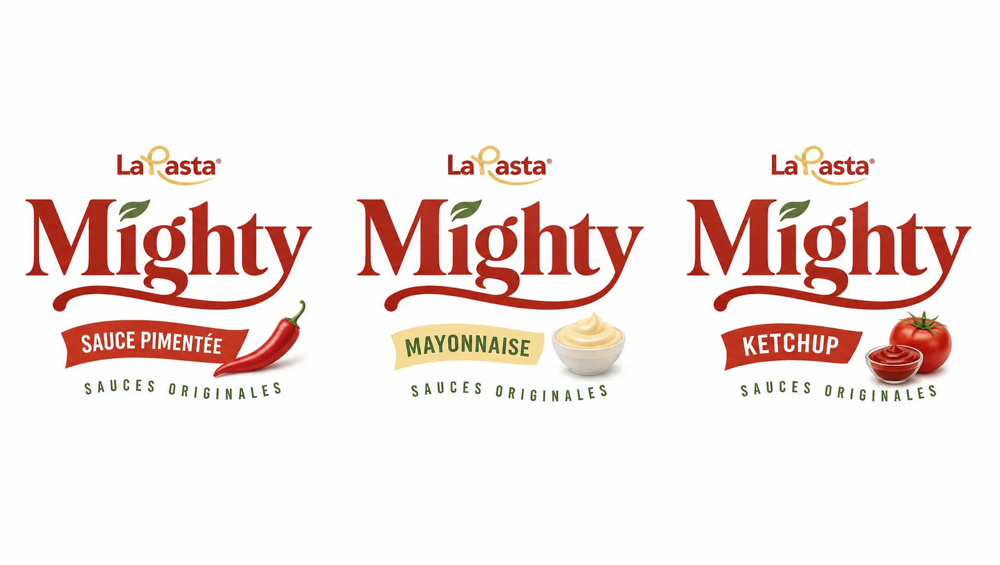
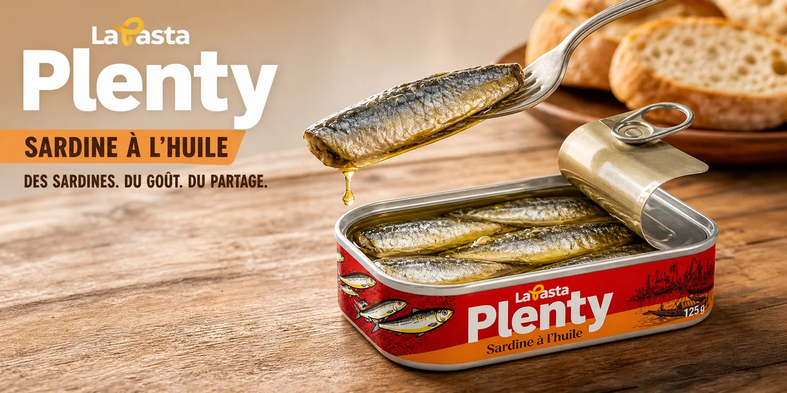
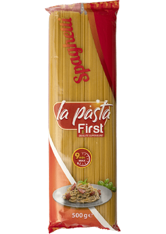
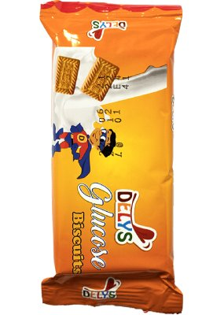
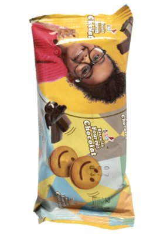
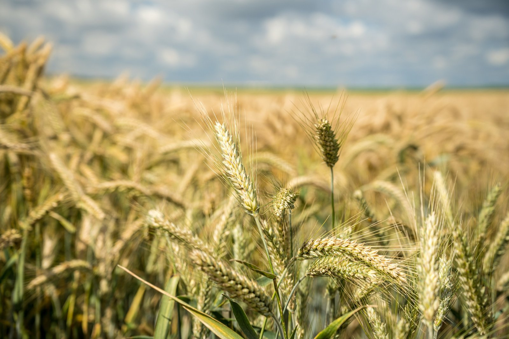
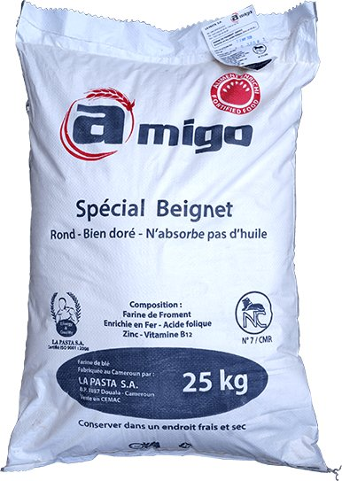

# La Pasta — Saisons & Mighty

<!-- wiki:infobox -->

| La Pasta — Saisons & Mighty | |
| --- | --- |
| Client | [Panzani Cameroun](../organisations/panzani-cameroun.md) |
| Via | [MATANGA Agency](../organisations/matanga-agency.md) |
| Période | 2025–2026 |
| Casquette | Direction créative & artistique |
| Catégorie | Campagne |
| Disciplines | KV-OOH · social · branding · packaging |
| Folio | [Étude de cas ↗](https://xtincell.powerupgraders.com/work/lapasta) |
| État de la fiche | À vérifier |
<!-- /wiki:infobox -->

**La Pasta — Saisons & Mighty** est une campagne réalisée pour [Panzani Cameroun](../organisations/panzani-cameroun.md), via [MATANGA Agency](../organisations/matanga-agency.md) (2025–2026).

## Contexte

Key visuals saisonniers (Noël, Ramadan) pour les pâtes La Pasta et création de la sous-marque de sauces « Mighty by La Pasta » (logo et gamme d'étiquettes).

## Galerie

<!-- wiki:galerie -->

<!-- /wiki:galerie -->

## Preuves et médias

- Visuels : `public/work/cases/lapasta/` (6 fichiers)
- Visuels complémentaires : `public/work/panzani/` (5 fichiers)

## Sources

- Folio — `scripts/cases.spec.json`, entrée `lapasta`

<!-- wiki:liens-entrants -->
---
**Pages liées** : [Alexandre « Xtincell » Djengue](../personnes/alexandre-djengue.md)
<!-- /wiki:liens-entrants -->
