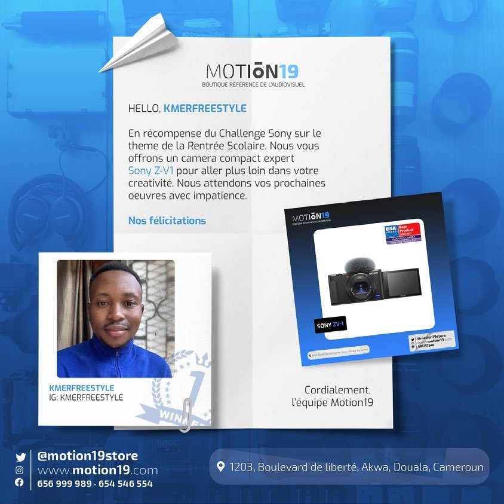

# Motion19 — construction de marque

<!-- wiki:infobox -->

| Motion19 — construction de marque | |
| --- | --- |
| Client | [Motion19](../organisations/motion19.md) |
| Via | [UPgraders](../organisations/upgraders.md) |
| Période | 2021–2023 |
| Casquette | Stratégie |
| Catégorie | Mission |
| Rôle | Chef de projet · Directeur marketing |
| Disciplines | Brand build · Go-to-market · E-commerce · Community |
| Folio | [Folio ↗](https://xtincell.powerupgraders.com/work) _(cité, sans page dédiée)_ |
| État de la fiche | À vérifier |
<!-- /wiki:infobox -->

**Motion19 — construction de marque** est une mission réalisée pour [Motion19](../organisations/motion19.md), via [UPgraders](../organisations/upgraders.md) (2021–2023).

## Description

Projet créé de A à Z par UPgraders sur 30 mois. Architecture du système de vente (Shopify × Quanta Hive), construction de l'équipe (7 personnes), lancement du programme communautaire « Aventurier » (#feelfreetocreate). Positionnement : leader du matériel audiovisuel en Afrique Centrale.

## Rôle

Chef de projet · Directeur marketing, puis Brand Manager de Motion19.

## Dates

Le CV de mai 2023 date le poste de Brand Manager d’avril 2021 à février 2023, et Motion19 est ajouté au profil Facebook d’Alexandre en mai 2021. `practices.ts` situe le projet de 2019 à 2022 et parle de « 30 mois ». Le wiki retient **avril 2021 – février 2023** ([confrontation des sources](../sources.md#confrontation-élément-par-élément)). _Sources : [cv-2023-05](../sources.md#cv-2023-05), [facebook](../sources.md#facebook)._

## Galerie

<!-- wiki:galerie -->

<!-- /wiki:galerie -->

## Preuves et médias

- Visuels : `public/work/historique/07-motion19-historique/` (6 fichiers)

## Sources

- Folio — `src/components/folio/data/practices.ts`, entrée « MOTION19 »
- CV « Dircom », 16 mai 2023 — voir [cv-2023-05](../sources.md#cv-2023-05)
- Export du compte Facebook (2023) — voir [facebook](../sources.md#facebook)

<!-- wiki:liens-entrants -->
---
**Pages liées** : [Alexandre « Xtincell » Djengue](../personnes/alexandre-djengue.md)
<!-- /wiki:liens-entrants -->
