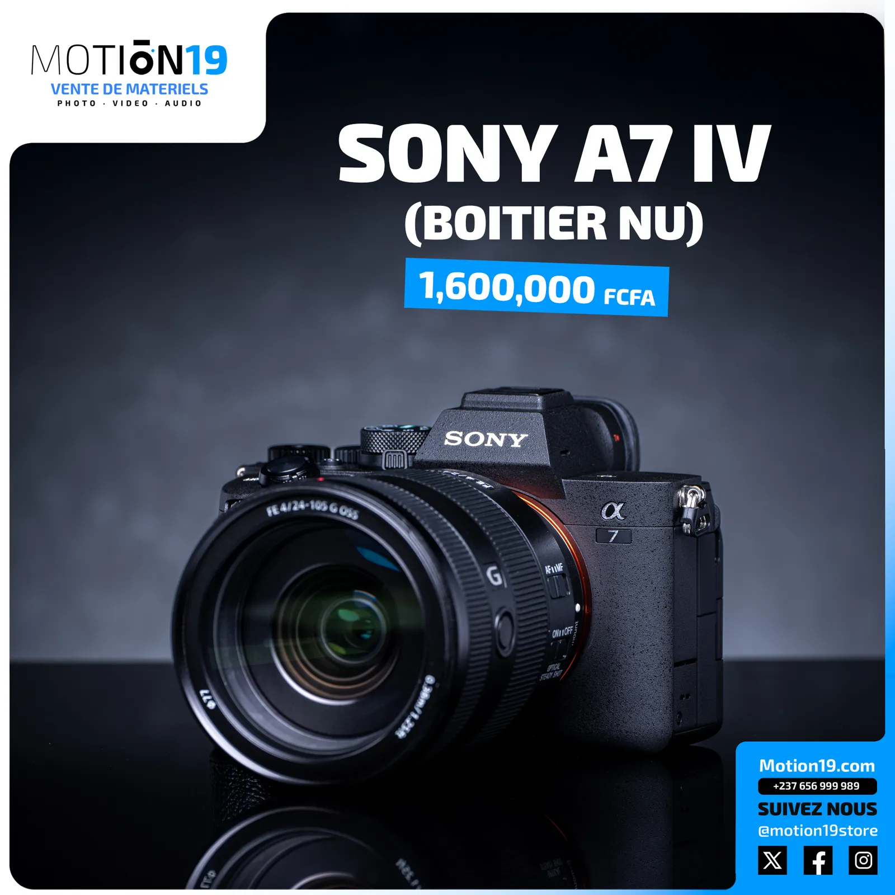
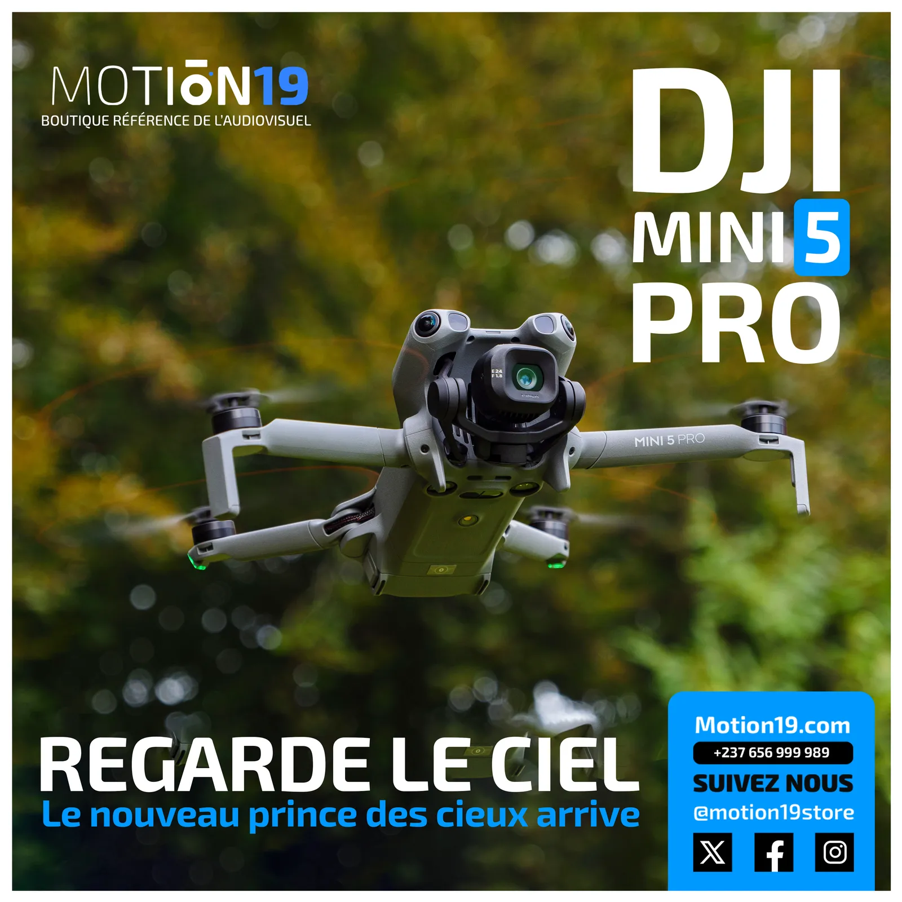
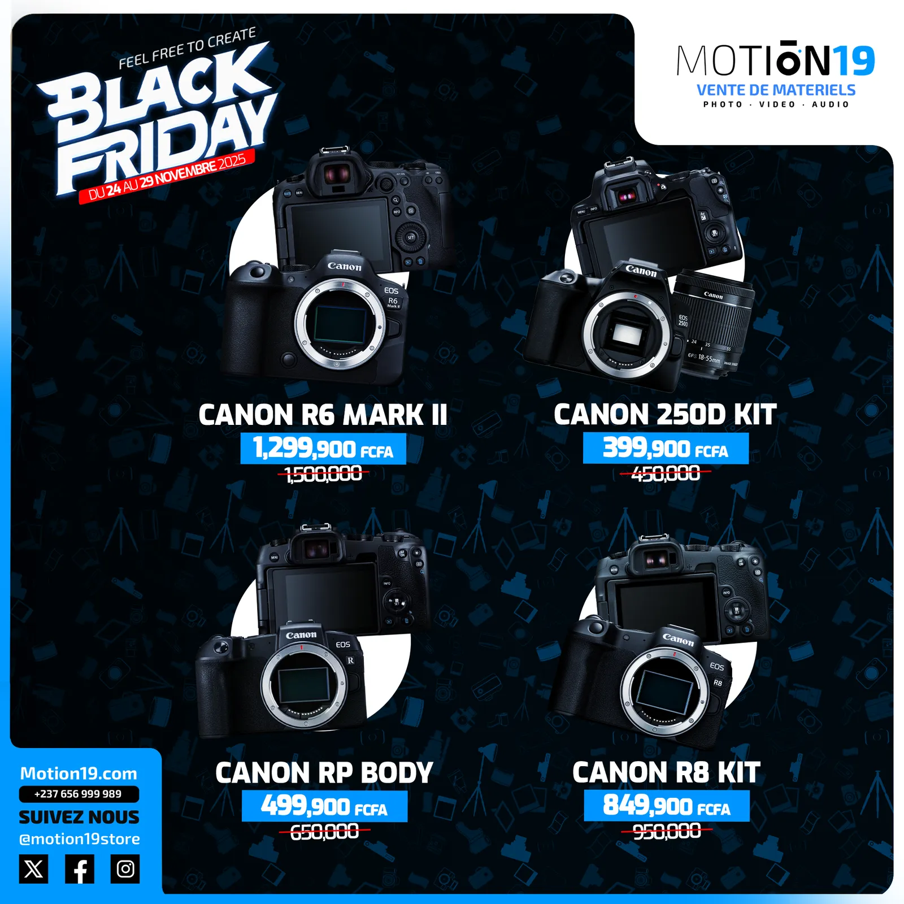
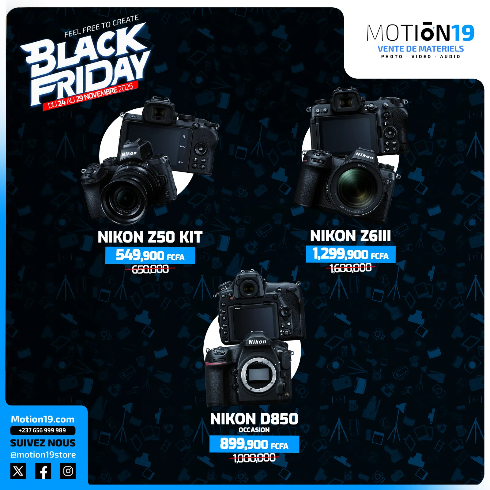
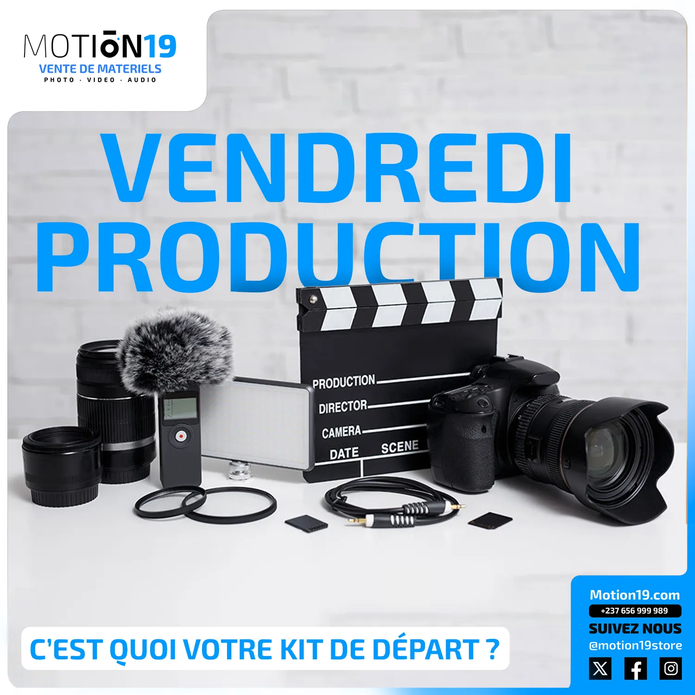
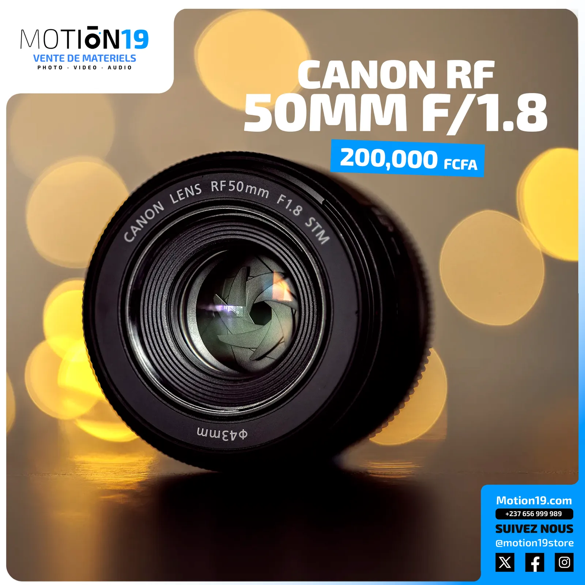
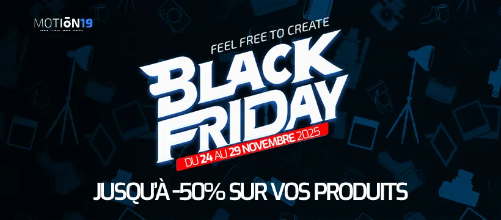

# MOTION19 — Boutique audiovisuelle

<!-- wiki:infobox -->

| MOTION19 — Boutique audiovisuelle | |
| --- | --- |
| Client | [Motion19](../organisations/motion19.md) |
| Période | 2025 |
| Casquette | Direction créative & artistique |
| Catégorie | Campagne |
| Disciplines | social · photography · branding |
| Folio | [Étude de cas ↗](https://xtincell.powerupgraders.com/work/motion19-store) |
| État de la fiche | Standard |
<!-- /wiki:infobox -->

**MOTION19 — Boutique audiovisuelle** est une campagne réalisée pour [Motion19](../organisations/motion19.md) (2025).

## Contexte

Système de contenu retail pour MOTION19, boutique de matériel audiovisuel (caméras, drones, kits) au Cameroun : posts produit e-commerce, grilles Black Friday et key visuals de lancement (DJI Mini 5, Sony A7 IV).

## Rôle

Direction artistique et création de contenus pour la boutique de matériel audiovisuel. Ce dossier rassemble les pièces retail de 2025, distinctes de mon précédent poste de Brand Manager chez MOTION19.

## Résultat

Une série de visuels pour présenter caméras, objectifs, drones et kits : annonces produit, publications e-commerce et formats promotionnels. Les pièces montrent le travail de présentation de l’offre et de déclinaison graphique.

## Galerie

<!-- wiki:galerie -->

<!-- /wiki:galerie -->

## Preuves et médias

- Visuels : `public/work/cases/motion19-store/` (8 fichiers)

## Sources

- Folio — `scripts/cases.spec.json`, entrée `motion19-store`

<!-- wiki:liens-entrants -->
<!-- /wiki:liens-entrants -->
