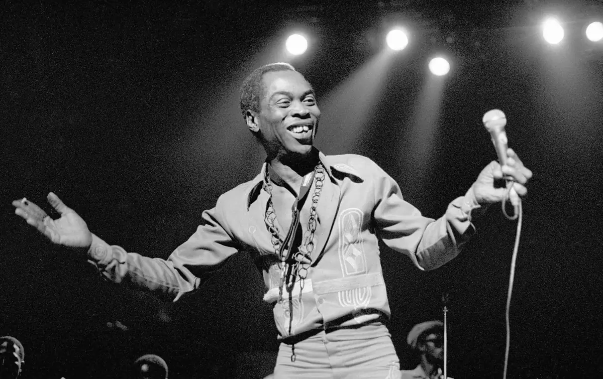
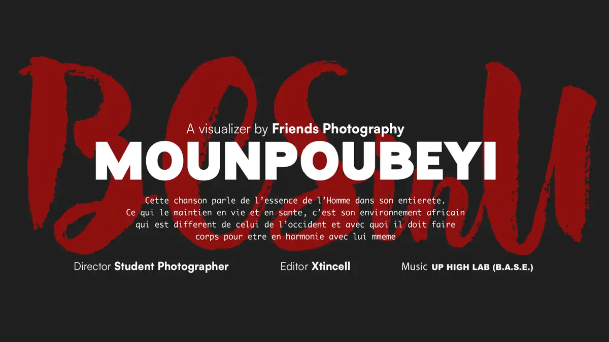

# Mounpoubeyi — travaux

<!-- wiki:infobox -->

| Mounpoubeyi — travaux | |
| --- | --- |
| Client | [Mounpoubeyi](../organisations/mounpoubeyi.md) |
| Via | [UPgraders](../organisations/upgraders.md) |
| Période | 2023–2024 |
| Casquette | Exécution |
| Catégorie | Production |
| Sous-projets | [Mounpoubeyi — séance photo en studio (« Moun 2009 »)](evt-2023-09-19-mounpoubeyi-seance-photo-en-studio-moun-2009.md) · [Mounpoubeyi en concert à l'IFC Douala, première partie Lucille Meneng](evt-2023-04-14-mounpoubeyi-en-concert-a-l-ifc-douala-premiere-partie-luc.md) |
| Folio | _pas encore sur le site_ |
| État de la fiche | Ébauche |
<!-- /wiki:infobox -->

**Mounpoubeyi — travaux** regroupe le travail réalisé pour [Mounpoubeyi](../organisations/mounpoubeyi.md) avec [UPgraders](../organisations/upgraders.md) (2023–2024).

## Description

_À documenter : demande, rôle, livrables._ Les dossiers et opérations retrouvés sur les disques sont détaillés sur la fiche [Mounpoubeyi](../organisations/mounpoubeyi.md#archives-de-travail).

## Galerie

<!-- wiki:galerie -->

<!-- /wiki:galerie -->

## Sources

- Archives de travail rangées sur les disques (2026-11-09)

<!-- wiki:liens-entrants -->
---
**Pages liées** : [Mounpoubeyi — séance photo en studio (« Moun 2009 »)](evt-2023-09-19-mounpoubeyi-seance-photo-en-studio-moun-2009.md) · [Mounpoubeyi en concert à l'IFC Douala, première partie Lucille Meneng](evt-2023-04-14-mounpoubeyi-en-concert-a-l-ifc-douala-premiere-partie-luc.md)
<!-- /wiki:liens-entrants -->
