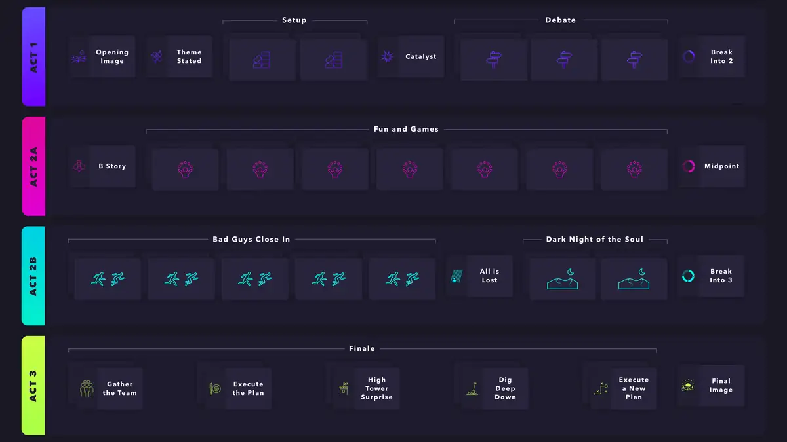
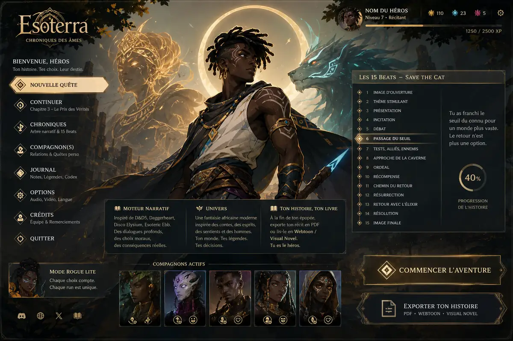
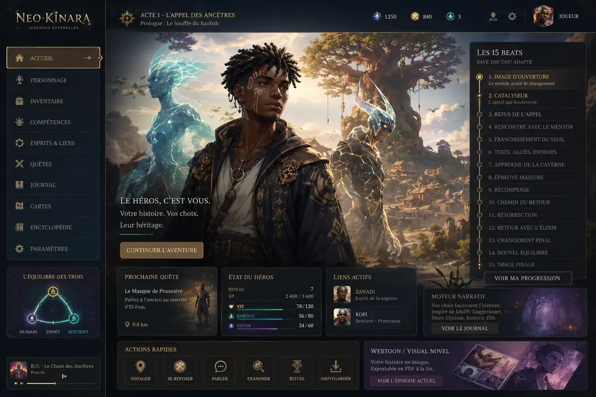

# NEO-KINARA : Le Tambour des Egun

<!-- wiki:infobox -->

| NEO-KINARA : Le Tambour des Egun | |
| --- | --- |
| Client | Projet personnel |
| Période | 2026–… |
| Casquette | Direction créative & artistique |
| Catégorie | Jeu |
| Folio | _pas encore sur le site_ |
| Code | `neo-kinara` |
| État de la fiche | Ébauche |
<!-- /wiki:infobox -->

**NEO-KINARA : Le Tambour des Egun** est un projet de jeu personnel d’Alexandre « Xtincell » Djengue (2026–…).

## Description

*NEO-KINARA : Le Tambour des Égun* est un jeu de rôle narratif *rogue-lite* situé à Neo-Kinara, une mégalopole afrofuturiste où « la magie ancestrale d’Afrique centrale bat sous les néons de la haute technologie ». Chaque partie est contée en direct par un griot-maître du jeu, piloté par un modèle de langage, doté d’une mémoire persistante et d’un monde qui vit en coulisse. Devise du jeu : « Aucune bagarre obligatoire : la parole, la mémoire, la communauté et la justice sont tes vraies armes. » _Source : [imac-2026-11](../sources.md#imac-2026-11)._

## Système de jeu

- **Structure** : chaque récit suit les quinze « battements » du modèle *Save the Cat*.
- **Résolution** : le système « Ngoma », dérivé de *Daggerheart*, oppose deux dés à douze faces, les Ancêtres et le Tumulte.
- **Valeurs** : quatre valeurs africaines (*ubuntu*, *sankofa*, *nommo*, *maat*) servent de voix intérieures, à la manière de *Disco Elysium*, et permettent d’éviter les affrontements ; la fin dépend de la valeur dominante.
- **Texte libre** : le joueur tape ses actions, que le maître du jeu interprète.
- **Mondes partagés** : un mode « Universe » réunit jusqu’à dix joueurs dans le même monde.

Le jeu reprend un document d’univers antérieur (castes, classes, Plan astral, factions). Une version complète, jouable en terminal et dans un navigateur, est terminée le 3 juillet 2026. _Source : [imac-2026-11](../sources.md#imac-2026-11)._

## Dépôt

| Dépôt | Créé | Dernière activité | Visibilité | Langage | Description |
| --- | --- | --- | --- | --- | --- |
| neo-kinara | 2026-07-03 | 2026-10-07 | privé | Python | NEO-KINARA : Le Tambour des Egun — cRPG narratif rogue-lite |

## Galerie

<!-- wiki:galerie -->

<!-- /wiki:galerie -->

## Archives de travail

<!-- wiki:archives -->
_Relevé en lecture seule des disques de travail, 2026-11-09. Les pièces administratives et les commandes privées ne sont pas détaillées._

| | |
| --- | --- |
| Structure | UPgraders |
| Disques | C:, P: |
| Fichiers | 4 912 (0,1 Go) |
| Contenu | 4 094 autres · 803 documents · 14 photos · 1 vidéos |
| Années | 2023–2025 |

**Dossiers**

- **2023** (5 fichiers)
- **2024** (4 fichiers)
- **2025** (18 fichiers)
- **DEmo** (1 177 fichiers) : Cahier des Charges MVP Neo-Kinara (1 129) · neo-kinara (10) · neo-kinara-game-v3-complete (22) · neo-kinara-package (1) · neo-kinara-react (15)
- **KIN REACT** (10 fichiers)
- **Neokin** (29 fichiers) : Interfaces (images générées) (5)
- **PROJETS** (1 fichiers)
- **Univers et jeu de rôle (documents)** (16 fichiers)
- **neo kinara csv** (60 fichiers)
- **neo-kinara-final-v4** (1 137 fichiers) : css (3) · js (10) · node_modules (1 116)
- **neo-kinara-game** (2 418 fichiers) : css (1) · js (12) · node_modules (2 391)

**Opérations repérées lors du rangement**

- Neo-Kinara : univers, lore, démos (structure d'origine conservée)
- Instructions du maître de jeu Neo-Kinara
- Neo-Kinara : maître de jeu, API, modules
- Image sans nom identifiée sur la planche (n° 2)
- Image sans nom identifiée sur la planche (n° 28)
- Image sans nom identifiée sur la planche (n° 29)
- Image sans nom identifiée sur la planche (n° 31)
- Image sans nom identifiée sur la planche (n° 16)
- Neo-Kinara (assets, client D&D)
- Archive Kinara
<!-- /wiki:archives -->

## Sources

- Métadonnées GitHub (`gh repo list xtincell`), relevé du 2026-11-09
- Dépôts et dossiers de projets de l’iMac, relevé du 10 novembre 2026 — voir [imac-2026-11](../sources.md#imac-2026-11)

<!-- wiki:liens-entrants -->
---
**Pages liées** : [Alexandre « Xtincell » Djengue](../personnes/alexandre-djengue.md) · [Dawn of the Unchained — nouvelle](dawn-of-the-unchained.md)
<!-- /wiki:liens-entrants -->
