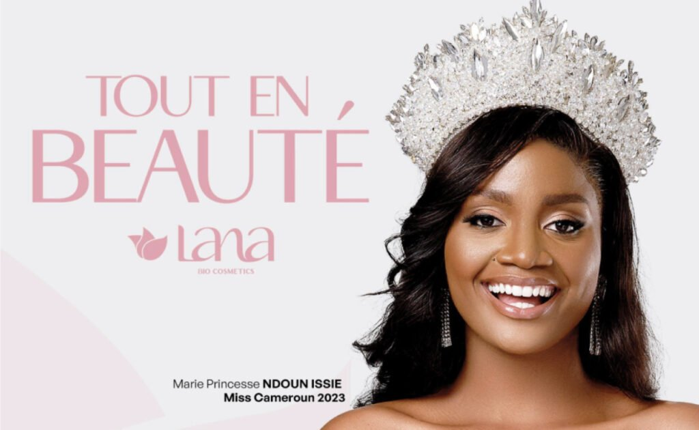
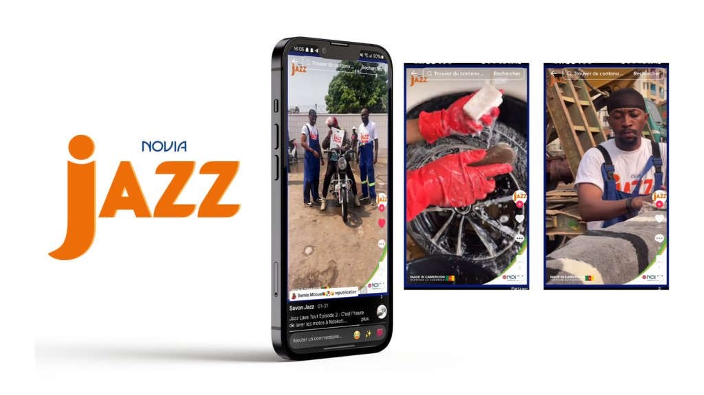
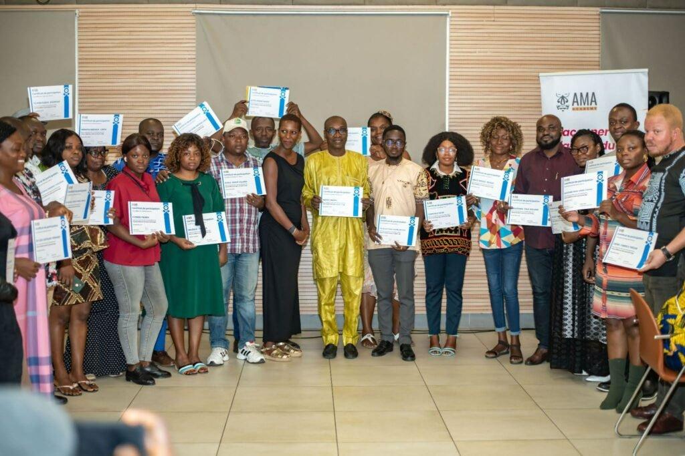

# OmenKart — direction artistique déléguée

<!-- wiki:infobox -->

| OmenKart — direction artistique déléguée | |
| --- | --- |
| Client | [OmenKart](../organisations/omenkart.md) |
| Période | 2022–2024 |
| Casquette | Exécution |
| Catégorie | Production |
| Rôle | DA déléguée |
| Disciplines | Diaspoassur · DDS · Ambitieuse |
| Folio | [Folio ↗](https://xtincell.powerupgraders.com/work) _(cité, sans page dédiée)_ |
| État de la fiche | À vérifier |
<!-- /wiki:infobox -->

**OmenKart — direction artistique déléguée** est une production réalisée pour [OmenKart](../organisations/omenkart.md) (2022–2024).

## Description

Collaboration en marque blanche avec l'agence pan-africaine de Diane Audrey Ngako (Douala · Abidjan · Cotonou). Capsules Diaspoassur, Douala Digital Show, événement Ambitieuse.

## Rôle

DA déléguée.

## Dates

Le CV de mai 2023 date cette collaboration « depuis 2021 » ; les premiers événements retrouvés dans les archives datent de décembre 2022. Son début reste à trancher ([confrontation des sources](../sources.md#confrontation-élément-par-élément)). _Sources : [cv-2023-05](../sources.md#cv-2023-05), [disques](../sources.md#disques)._

## Galerie

<!-- wiki:galerie -->

<!-- /wiki:galerie -->

## Preuves et médias

- Visuels : `public/work/tier23/omenkart-clients/` (5 fichiers)

## Sources

- Folio — `src/components/folio/data/practices.ts`, entrée « OMENKART — marque blanche »
- CV « Dircom », 16 mai 2023 — voir [cv-2023-05](../sources.md#cv-2023-05)
- Archives de travail rangées sur les disques — voir [disques](../sources.md#disques)

<!-- wiki:liens-entrants -->
<!-- /wiki:liens-entrants -->
