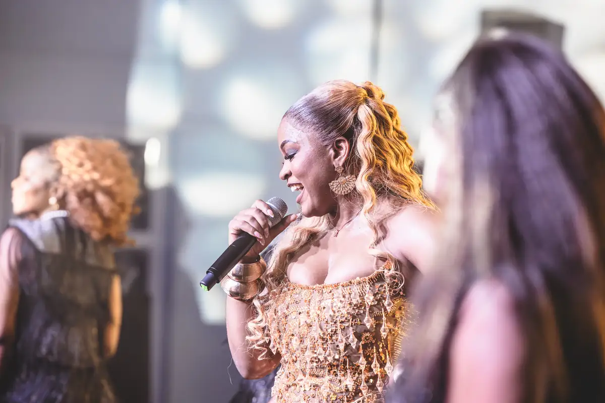
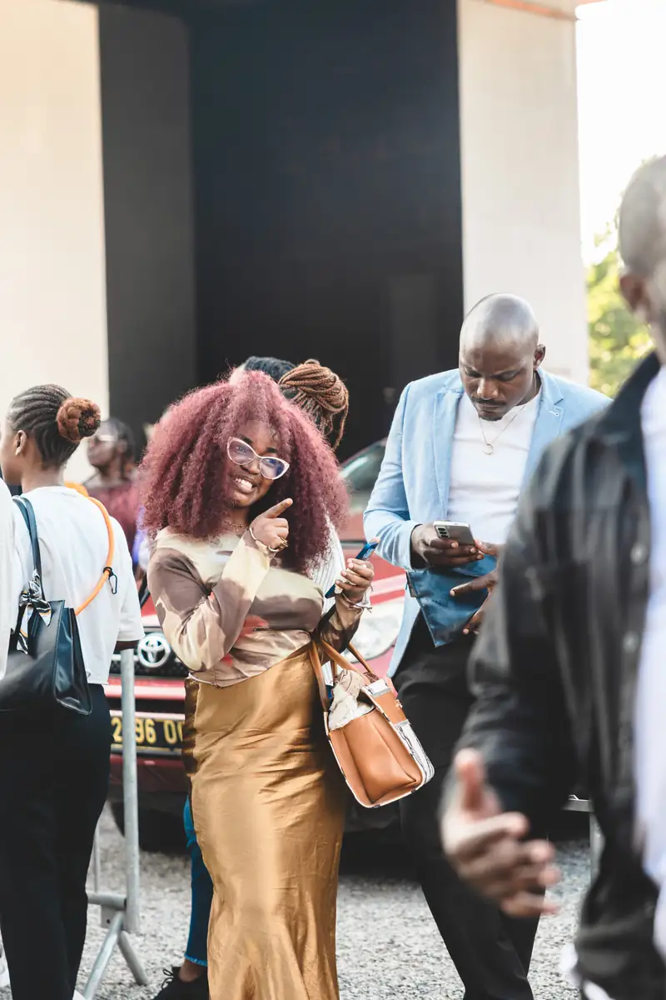
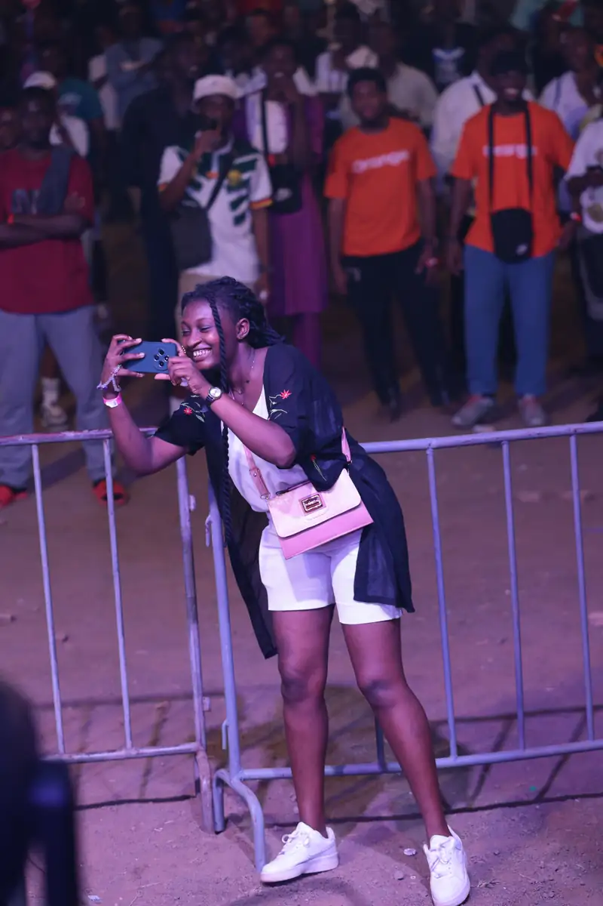
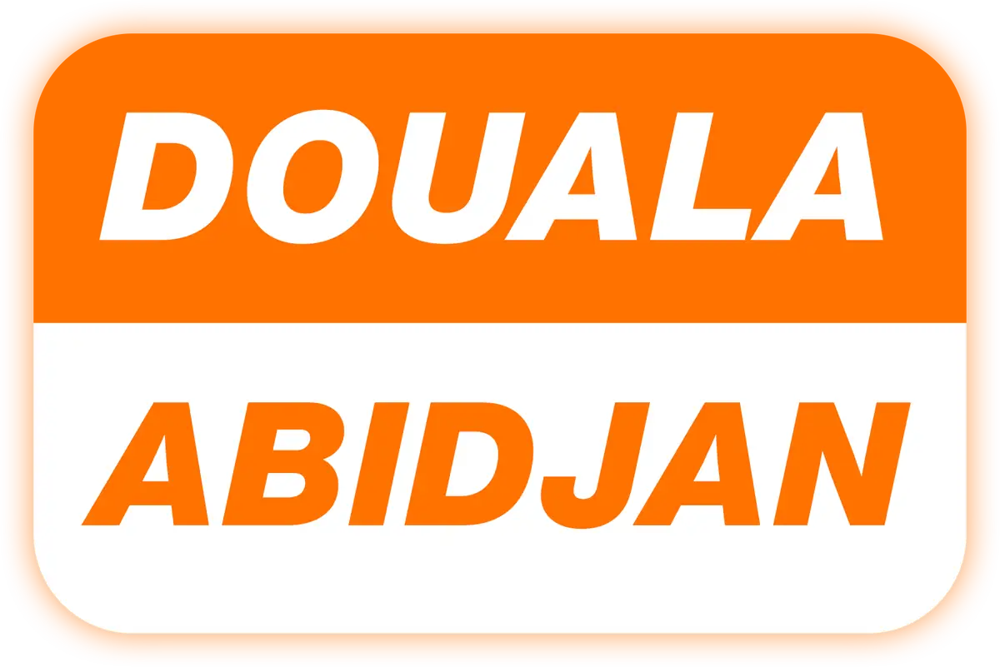

# Orange Cameroun — événements 2025–2026

<!-- wiki:infobox -->

| Orange Cameroun — événements 2025–2026 | |
| --- | --- |
| Client | [Orange Cameroun](../organisations/orange-cameroun.md) |
| Via | [Publicis / McCann](../organisations/publicis-mccann.md) · [Friends Photography Studio](../organisations/friends-studio.md) |
| Période | 2025–2026 |
| Casquette | Exécution |
| Catégorie | Événement |
| Rôle | Couverture photo et vidéo |
| Folio | _pas encore sur le site_ |
| État de la fiche | Ébauche |
<!-- /wiki:infobox -->

**Orange Cameroun — événements 2025–2026** regroupe les couvertures photo et vidéo d’événements Orange réalisées avec [Friends Photography Studio](../organisations/friends-studio.md), le plus souvent via [McCann](../organisations/publicis-mccann.md) (2025–2026).

## Description

_À documenter._ Liste des opérations dans la section archives ci-dessous.

## Galerie

<!-- wiki:galerie -->

<!-- /wiki:galerie -->

## Archives de travail

<!-- wiki:archives -->
_Relevé en lecture seule des disques de travail, 2026-11-09. Les pièces administratives et les commandes privées ne sont pas détaillées._

| | |
| --- | --- |
| Structure | UPgraders |
| Disques | C:, P: |
| Fichiers | 3 525 (33 Go) |
| Contenu | 3 480 photos · 18 documents · 15 fichiers de création · 10 autres · 2 vidéos |
| Années | 2025–2026 |

**Dossiers**

- **Orange Cameroun** (3 525 fichiers) : 2025 (43) · 2025 — ANAFOOT Draft (via McCann) (18) · 2025 — Atelier & Talk (Orange Money) (2) · 2025 — Concert Mimie (via McCann) (153) · 2025 — Live Pulse Excellence (via McCann) (2) · 2025 — Orange Excellence (via McCann) (4) · 2025 — Projection Indomptable (via McCann) (265) · 2025-02-10 — Événement Orange (scène, gaming, remise de prix) (2 933) · 2026 (1) · 2026-02-14 — Saint-Valentin Orange (94) · Quiz Cameroun – Côte d'Ivoire (10)
<!-- /wiki:archives -->

## Sources

- Archives de travail rangées sur les disques

<!-- wiki:liens-entrants -->
---
**Pages liées** : [Alexandre « Xtincell » Djengue](../personnes/alexandre-djengue.md) · [Orange Cameroun — photographie de campagnes](orange-campagnes-photo.md)
<!-- /wiki:liens-entrants -->
