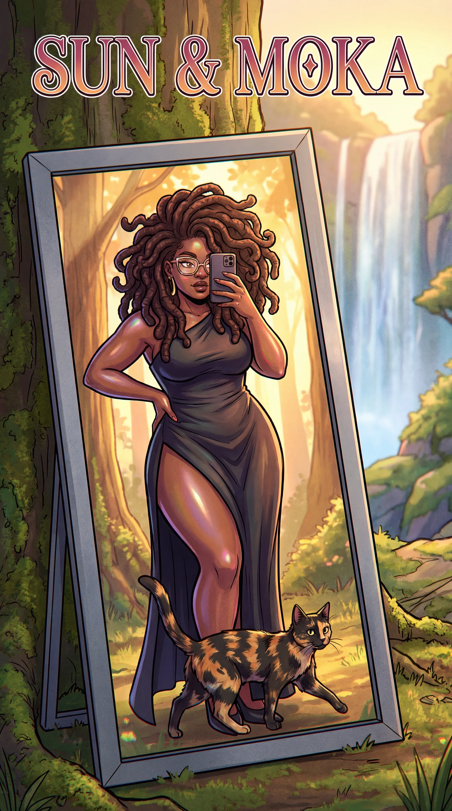
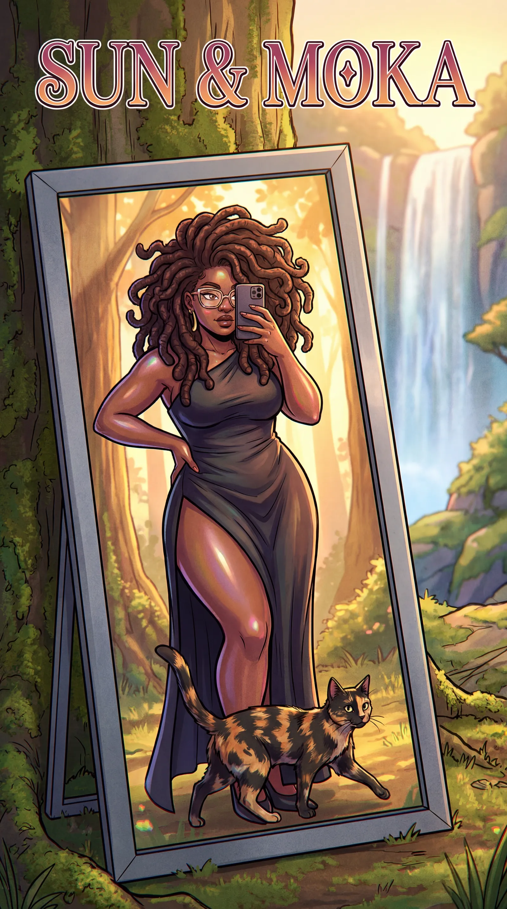
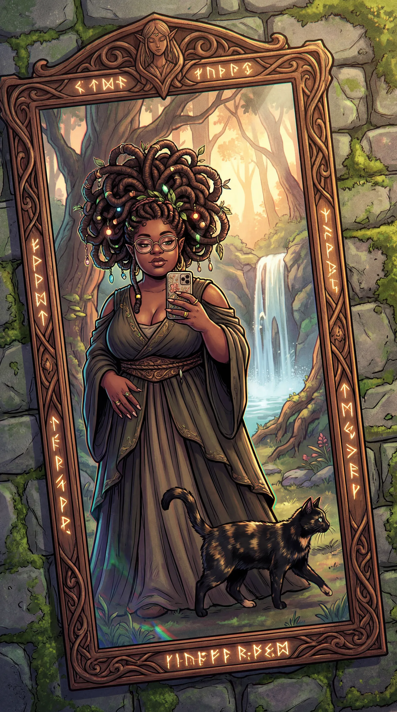
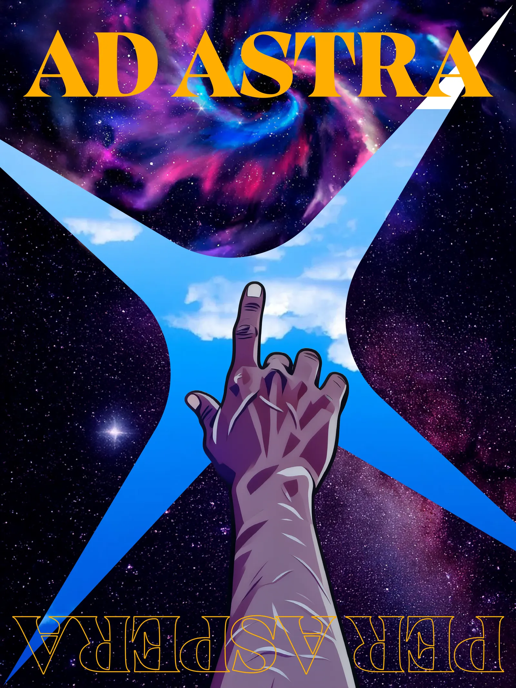
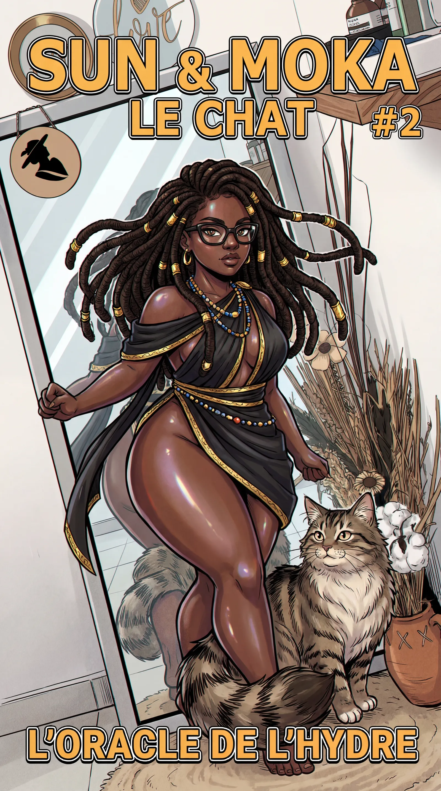
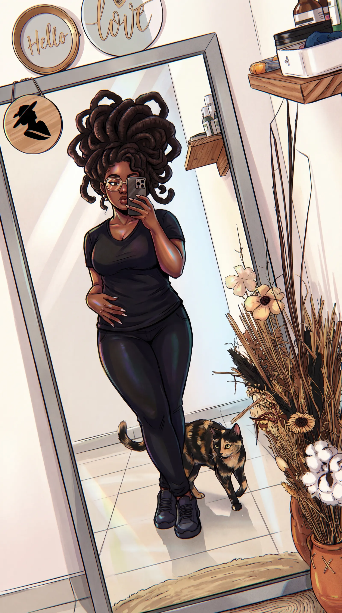
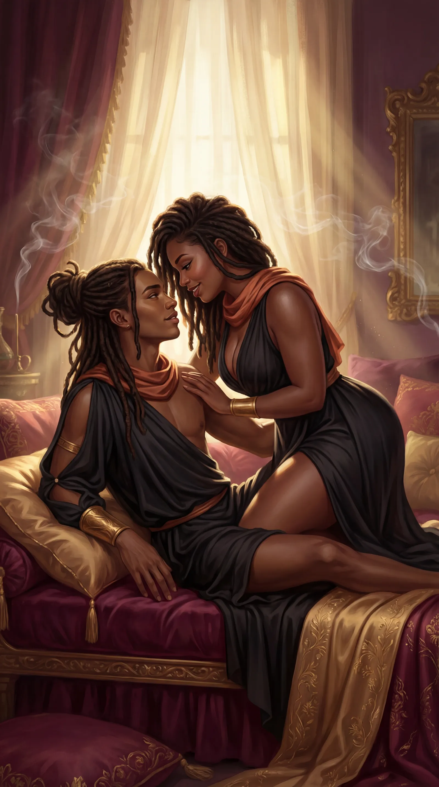

# Perso — Carnet d'art personnel

<!-- wiki:infobox -->

| Perso — Carnet d'art personnel | |
| --- | --- |
| Client | Projet personnel |
| Période | 2026 |
| Casquette | Direction créative & artistique |
| Catégorie | Collection |
| Disciplines | illustration · photography |
| Folio | _masqué sur le site_ |
| État de la fiche | Ébauche |
<!-- /wiki:infobox -->

**Perso — Carnet d'art personnel** est une collection personnelle d’Alexandre « Xtincell » Djengue (2026).

## Contexte

Carnet d'art personnel mixte : portraits fantastiques « selfie au miroir » (personnage Medusa/locs « Sun & Moka » et son chat), affiche « Ad Astra Per Aspera » et natures mortes beauté (mains au henné, bagues or).

## Galerie

<!-- wiki:galerie -->

<!-- /wiki:galerie -->

## Preuves et médias

- Visuels : `public/work/cases/perso-sketchbook/` (11 fichiers)

## Sources

- Folio — `scripts/cases.spec.json`, entrée `perso-sketchbook`

<!-- wiki:liens-entrants -->
<!-- /wiki:liens-entrants -->
