# The Popcorn Man — Série éditoriale

<!-- wiki:infobox -->
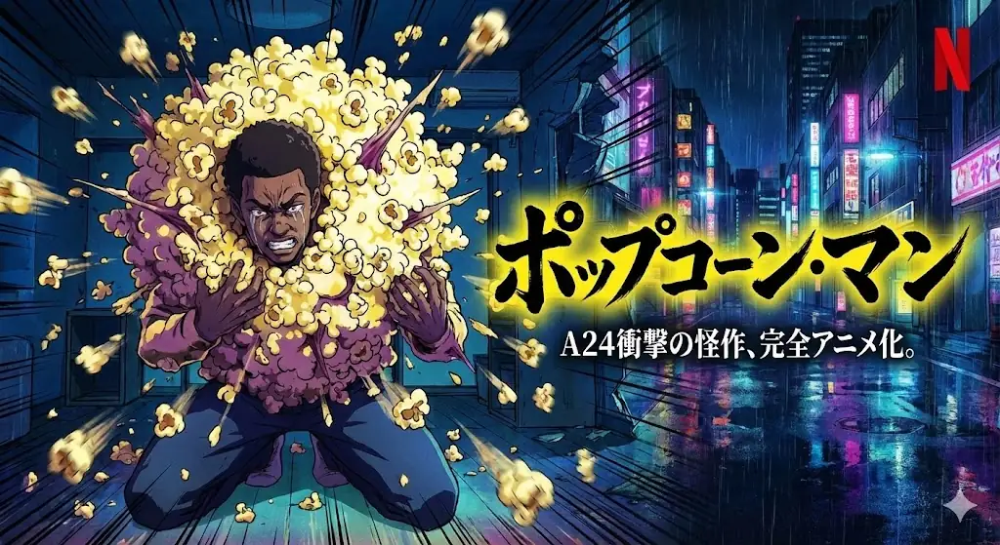

| The Popcorn Man — Série éditoriale | |
| --- | --- |
| Client | Projet personnel |
| Période | 2025 |
| Casquette | Direction créative & artistique |
| Catégorie | Collection |
| Disciplines | illustration · photography |
| Folio | [Étude de cas ↗](https://xtincell.powerupgraders.com/work/popcorn-man) |
| État de la fiche | Ébauche |
<!-- /wiki:infobox -->

**The Popcorn Man — Série éditoriale** est une collection personnelle d’Alexandre « Xtincell » Djengue (2025).

## Contexte

Série conceptuelle « The Popcorn Man » : un homme en costume entièrement fait de popcorn, en fausse campagne presse de film culte A24, avec couvertures magazine factices Empire et GQ.

## Galerie

<!-- wiki:galerie -->
<a href="../../public/medias-wiki/projets/popcorn-man/02.webp">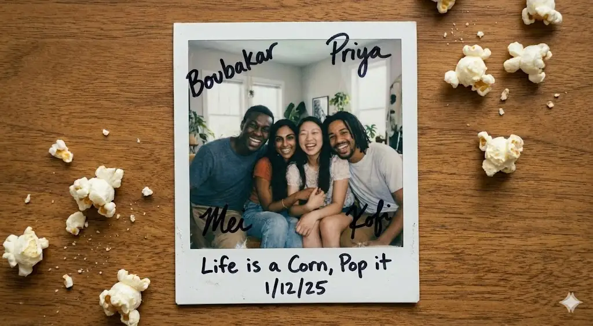</a>

<a href="../../public/medias-wiki/projets/popcorn-man/04.webp">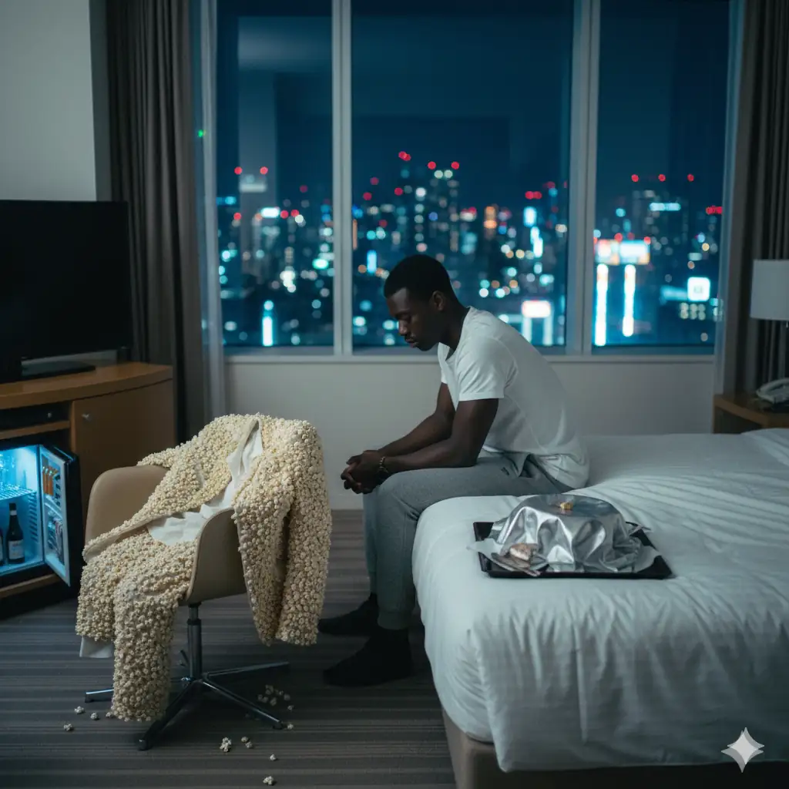</a>

<a href="../../public/work/cases/popcorn-man/01.webp">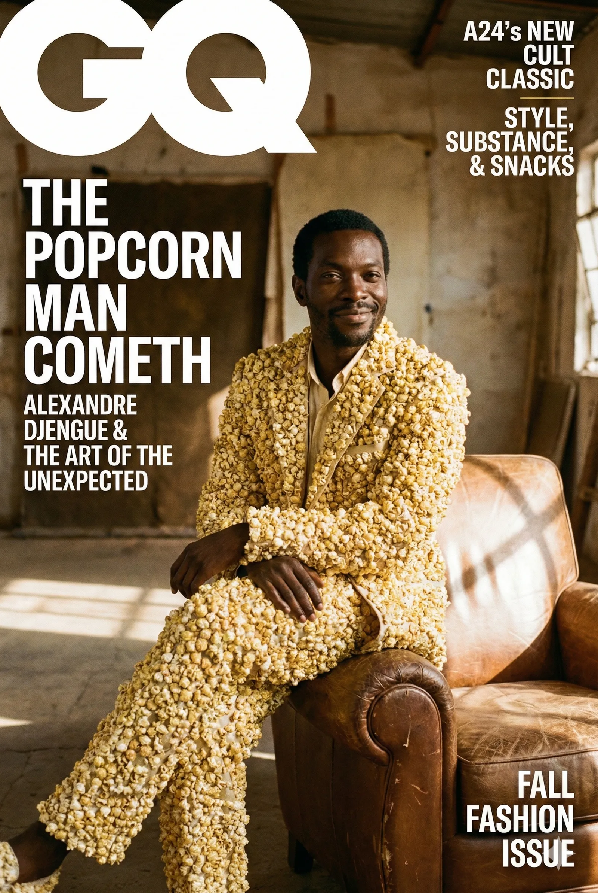</a>

<a href="../../public/work/cases/popcorn-man/03.webp">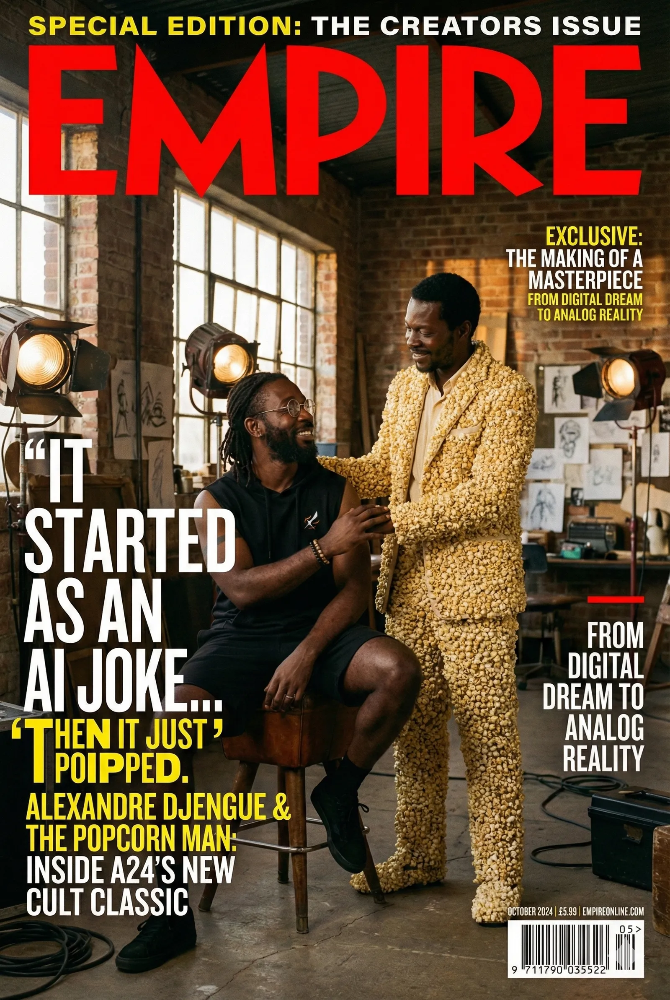</a>

<a href="../../public/work/cases/popcorn-man/05.webp">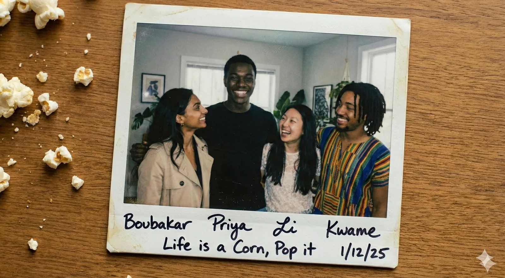</a>
<a href="../../public/work/cases/popcorn-man/06.webp">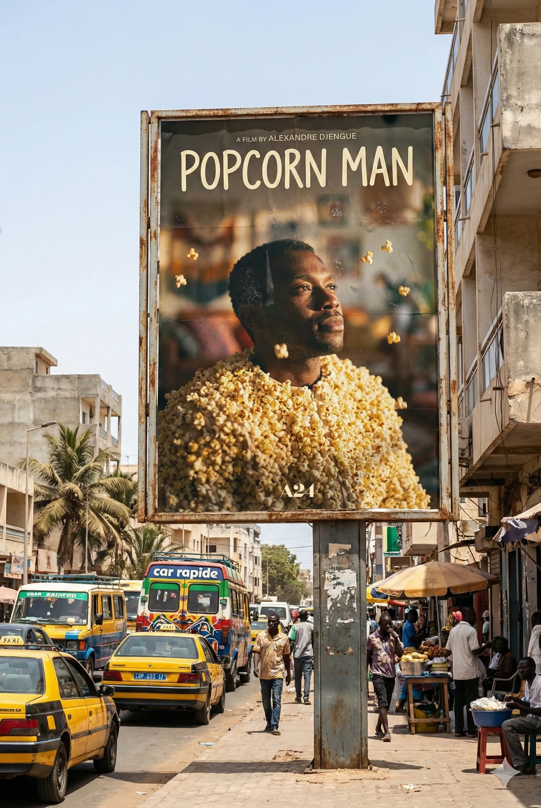</a>
<a href="../../public/work/cases/popcorn-man/07.webp">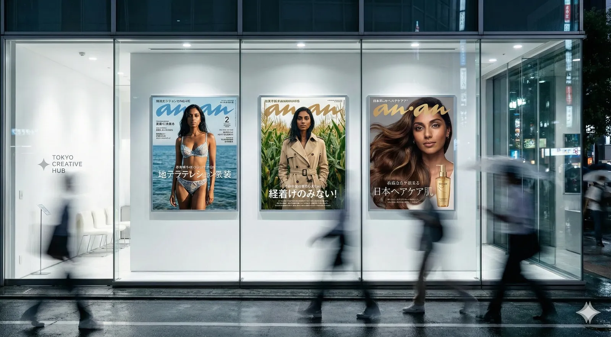</a>
<a href="../../public/work/cases/popcorn-man/08.webp">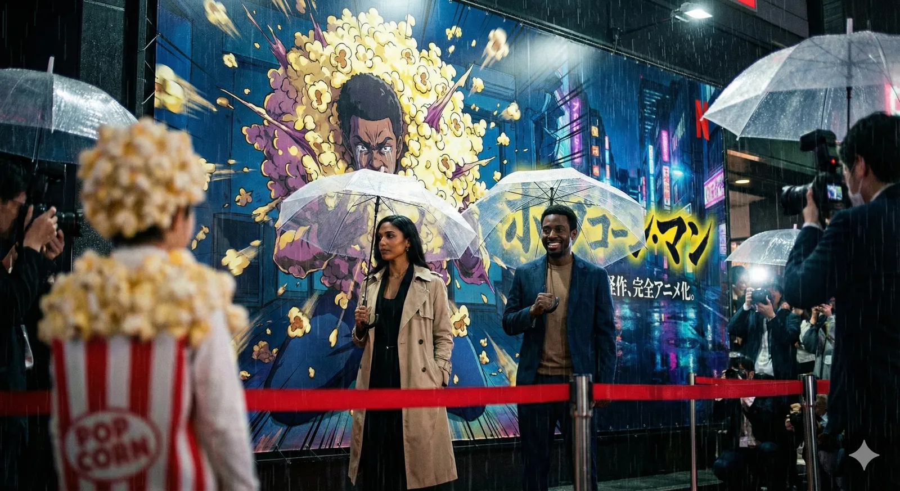</a>
<a href="../../public/work/cases/popcorn-man/09.webp">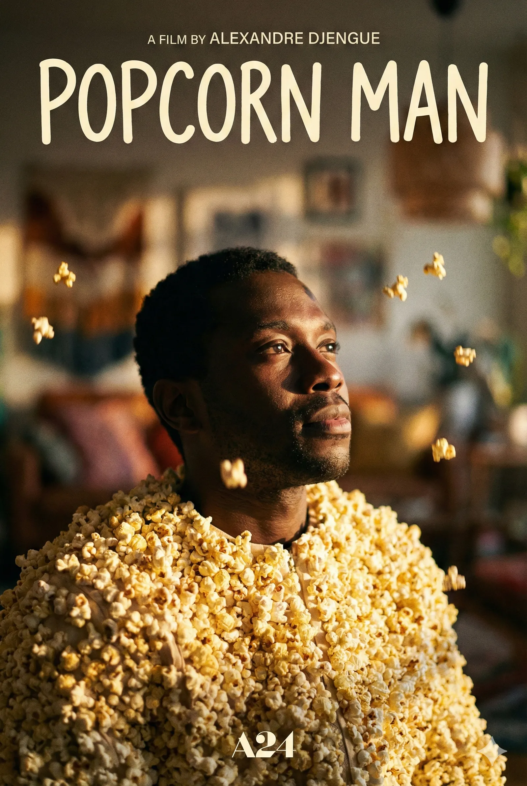</a>
<a href="../../public/work/cases/popcorn-man/10.webp">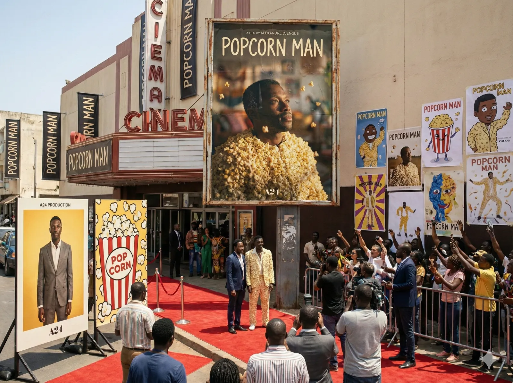</a>
<!-- /wiki:galerie -->

## Preuves et médias

- Visuels : `public/work/cases/popcorn-man/` (11 fichiers)

## Sources

- Folio — `scripts/cases.spec.json`, entrée `popcorn-man`

<!-- wiki:liens-entrants -->
---
**Pages liées** : [Alexandre « Xtincell » Djengue](../personnes/alexandre-djengue.md)
<!-- /wiki:liens-entrants -->
