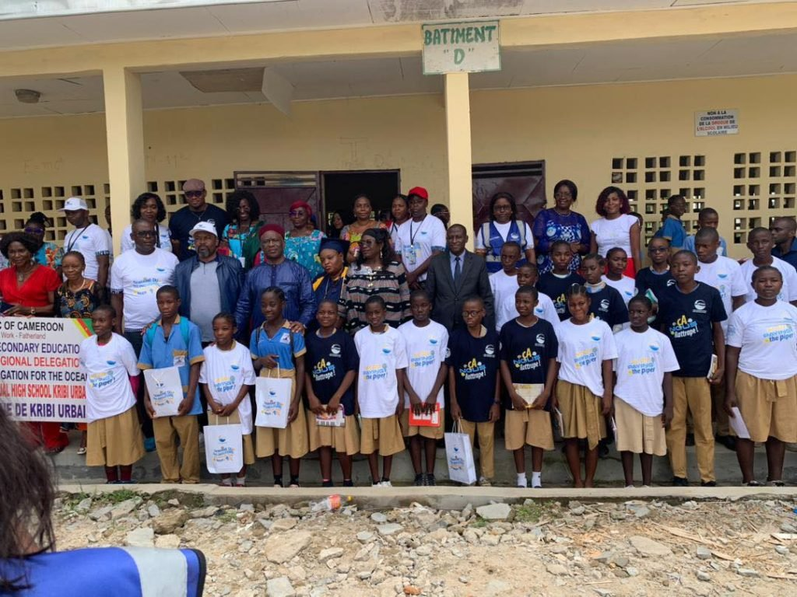

# Port Autonome de Kribi — Octobre Rose

<!-- wiki:infobox -->

| Port Autonome de Kribi — Octobre Rose | |
| --- | --- |
| Client | [Port Autonome de Kribi](../organisations/port-autonome-de-kribi.md) |
| Via | [Her Media](../organisations/her-media.md) |
| Casquette | Exécution |
| Catégorie | Production |
| Rôle | DA & Exécution |
| Disciplines | Institutionnel · Octobre Rose · Campagne |
| Folio | [Folio ↗](https://xtincell.powerupgraders.com/work) _(cité, sans page dédiée)_ |
| État de la fiche | À vérifier |
<!-- /wiki:infobox -->

**Port Autonome de Kribi — Octobre Rose** est une production réalisée pour [Port Autonome de Kribi](../organisations/port-autonome-de-kribi.md), via [Her Media](../organisations/her-media.md).

## Description

Direction artistique et exécution des contenus de la campagne Octobre Rose pour le Port Autonome de Kribi — opéré via Her Media.

## Rôle

DA & Exécution. Repère d’origine : « Octobre Rose ».

## Galerie

<!-- wiki:galerie -->

<!-- /wiki:galerie -->

## Preuves et médias

- Visuels : `public/work/tier23/port-autonome-kribi/` (7 fichiers)

## Sources

- Folio — `src/components/folio/data/practices.ts`, entrée « PORT AUTONOME DE KRIBI »

<!-- wiki:liens-entrants -->
<!-- /wiki:liens-entrants -->
