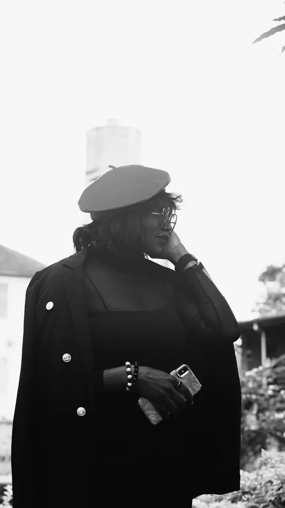
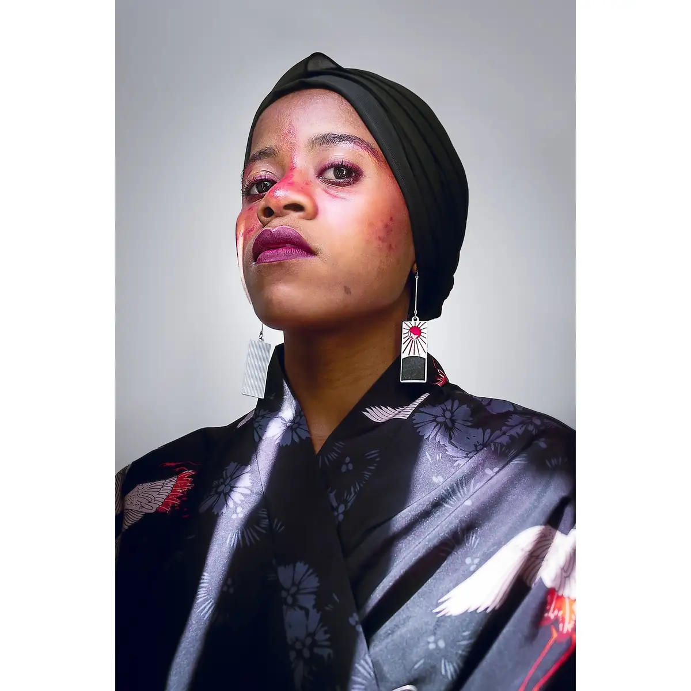

# Portfolio photo personnel

<!-- wiki:infobox -->

| Portfolio photo personnel | |
| --- | --- |
| Client | Projet personnel |
| Casquette | Exécution |
| Catégorie | Collection |
| Folio | _pas encore sur le site_ |
| État de la fiche | Ébauche |
<!-- /wiki:infobox -->

**Portfolio photo personnel** est un projet personnel d’Alexandre « Xtincell » Djengue.

## Description

_À documenter._

## Galerie

<!-- wiki:galerie -->

<!-- /wiki:galerie -->

## Archives

- 10 359 fichiers dans les dossiers « Xtincell » des disques de travail (10 110 photos · 188 vidéos · 33 fichiers de création · 26 autres · 1 documents · 1 sons).

## Sources

- Archives personnelles rangées sur les disques (2026-11-09), dossier « Portfolio photo »

<!-- wiki:liens-entrants -->
<!-- /wiki:liens-entrants -->
