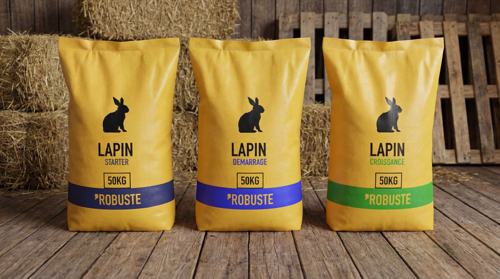
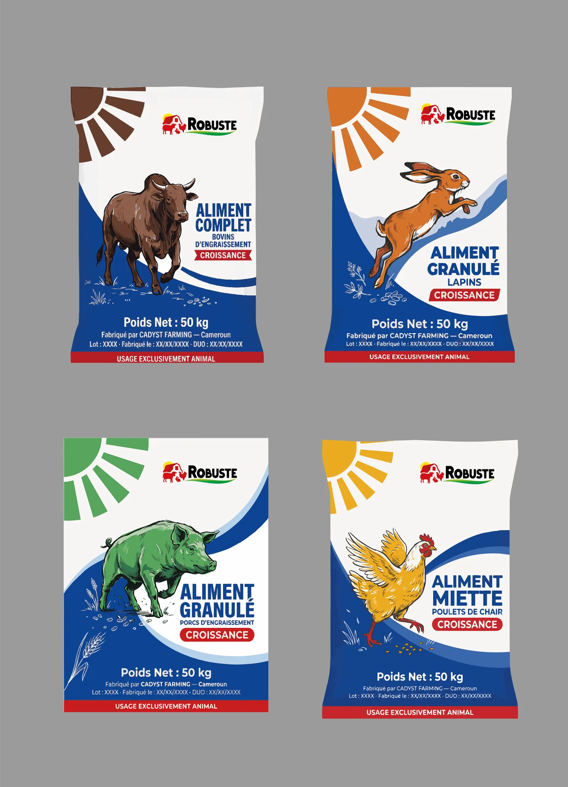
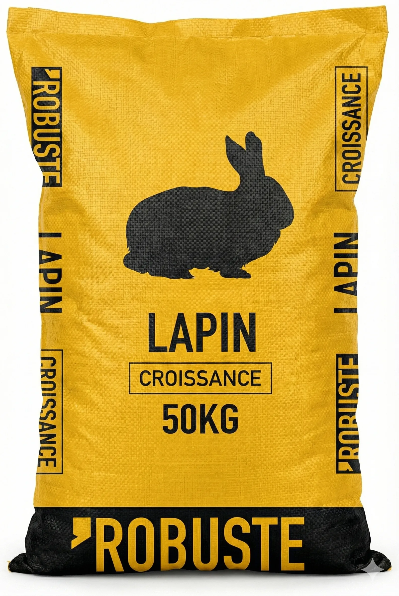
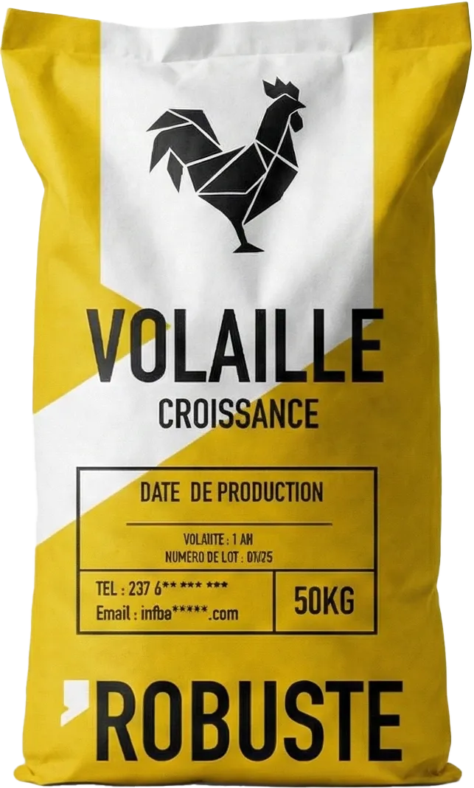
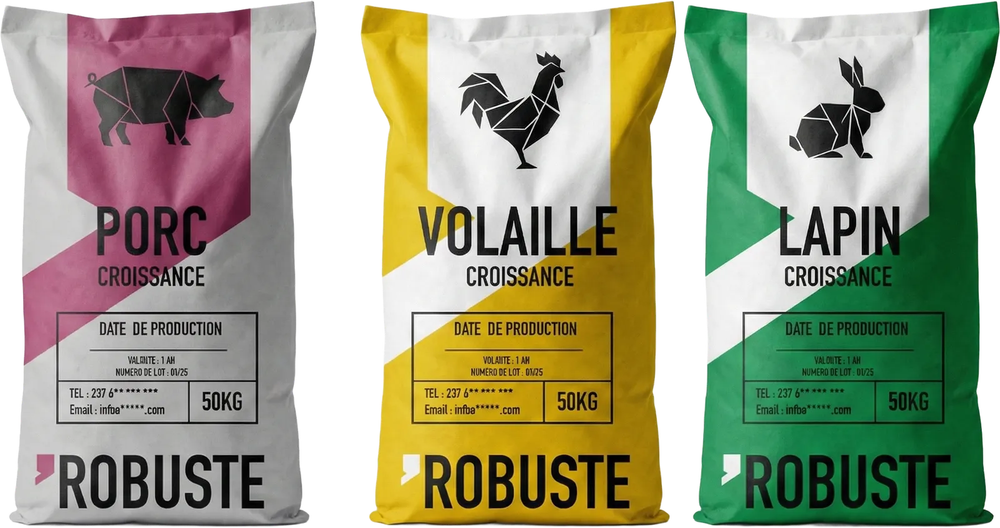
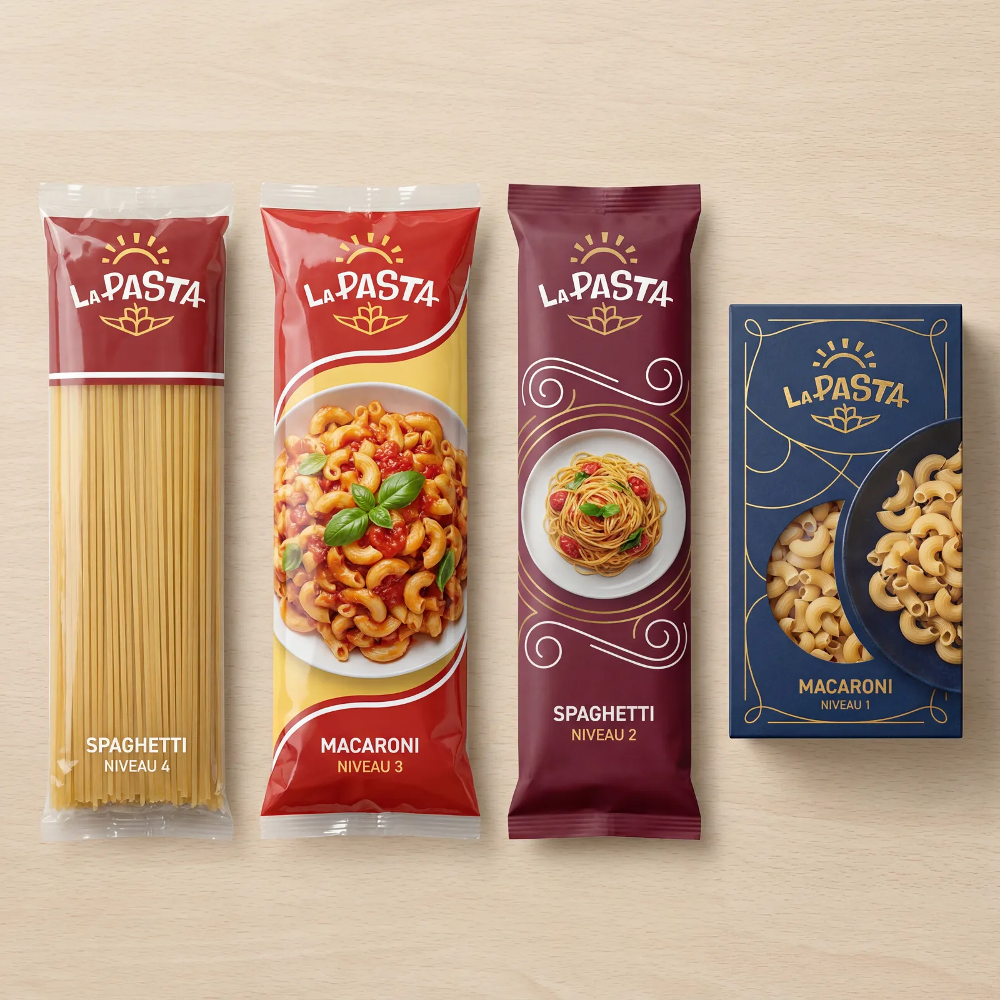

# Robuste — Packaging aliments

<!-- wiki:infobox -->

| Robuste — Packaging aliments | |
| --- | --- |
| Client | [Groupe Cadyst](../organisations/groupe-cadyst.md) |
| Via | [MATANGA Agency](../organisations/matanga-agency.md) |
| Période | 2026 |
| Casquette | Exécution |
| Catégorie | Campagne |
| Disciplines | packaging · branding |
| Folio | [Étude de cas ↗](https://xtincell.powerupgraders.com/work/robuste-packaging) |
| État de la fiche | Standard |
<!-- /wiki:infobox -->

**Robuste — Packaging aliments** est une campagne réalisée pour [Groupe Cadyst](../organisations/groupe-cadyst.md), via [MATANGA Agency](../organisations/matanga-agency.md) (2026).

## Contexte

Design de packaging pour les aliments pour bétail « Robuste » (Cadyst Farming) : sacs tissés 50 kg (lapin, volaille, bétail, porc) en jaune/noir à pictos animaux, étiquettes plates et mockups 3D photoréalistes en grange.

## Galerie

<!-- wiki:galerie -->

<!-- /wiki:galerie -->

## Preuves et médias

- Visuels : `public/work/cases/robuste-packaging/` (7 fichiers)

## Sources

- Archives de travail rangées sous « MATANGA — EXPORT DU TRAVAIL » sur les disques (relevé du 2026-11-09)
- Folio — `scripts/cases.spec.json`, entrée `robuste-packaging`

<!-- wiki:liens-entrants -->
<!-- /wiki:liens-entrants -->
