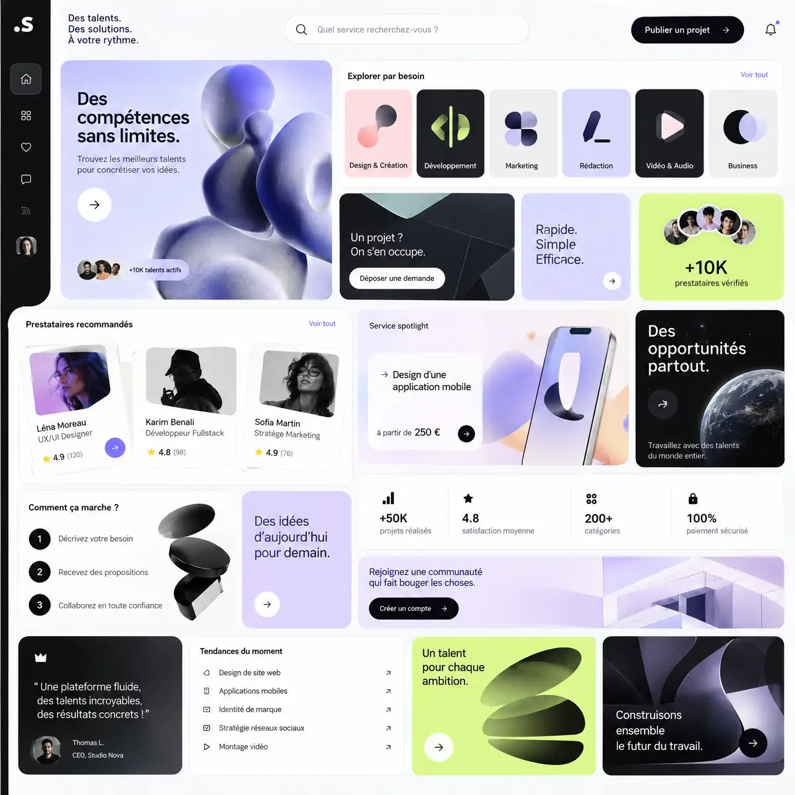
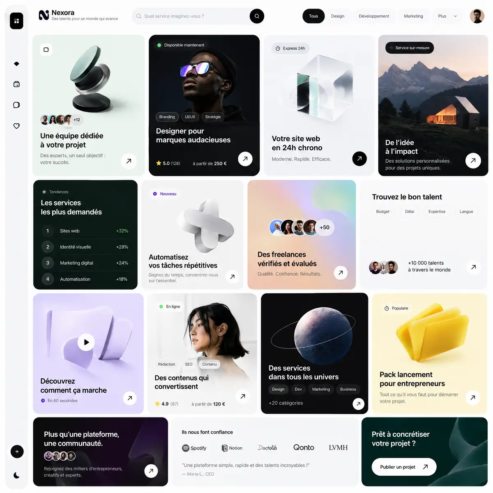
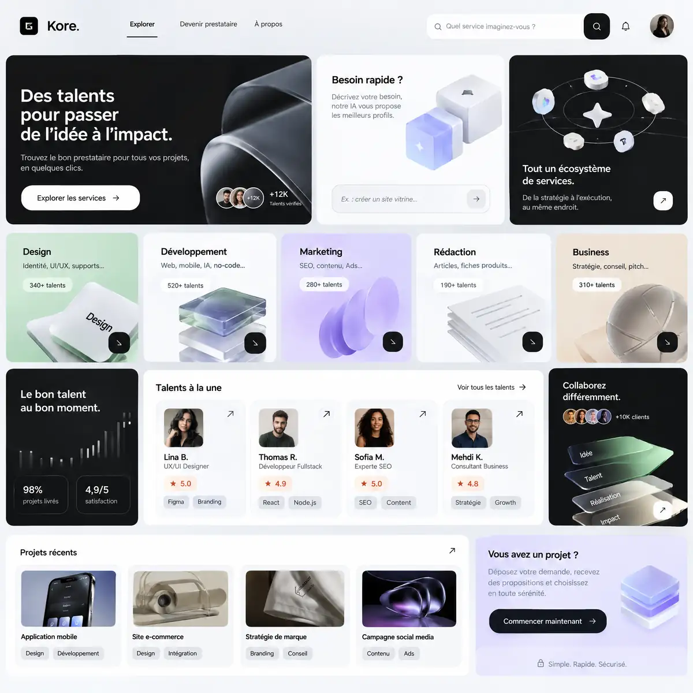

# Shinkiro

<!-- wiki:infobox -->

| Shinkiro | |
| --- | --- |
| Client | [UPgraders](../organisations/upgraders.md) |
| Période | 2026–… |
| Casquette | Stratégie |
| Catégorie | Programme |
| Sous-projets | [Argos Studio](argos-studio.md) · [DataCollector](datacollector.md) · [Générateur d'approches publicitaires](generateur-approches.md) · [La Barre — concevoir le poste de travail du DC](la-barre.md) · [Market Expansion System](market-expansion-system.md) |
| Folio | _pas encore sur le site_ |
| Code | `shinkiro` |
| État de la fiche | Standard |
<!-- /wiki:infobox -->

**Shinkiro** est un programme développé au sein de [UPgraders](../organisations/upgraders.md) (2026–…).

## Description

Programme porté par UPgraders qui unifie méthode (ADVE), entreprise, exécution et outils. Il documente le passage du cadrage ADVE au jugement créatif, puis à l'exécution.

## Dépôt

| Dépôt | Créé | Dernière activité | Visibilité | Langage | Description |
| --- | --- | --- | --- | --- | --- |
| [shinkiro](https://github.com/xtincell/shinkiro) | 2026-09-14 | 2026-10-20 | public | HTML | Shinkiro — le programme qui unifie méthode, entreprise, exécution et outils. Index et doctrine. |

## Galerie

<!-- wiki:galerie -->

<!-- /wiki:galerie -->

## Archives de travail

<!-- wiki:archives -->
_Relevé en lecture seule des disques de travail, 2026-11-09. Les pièces administratives et les commandes privées ne sont pas détaillées._

| | |
| --- | --- |
| Structure | UPgraders |
| Disques | C: |
| Fichiers | 8 (31 Mo) |
| Contenu | 8 photos |

**Opérations repérées lors du rangement**

- Concepts UX/UI Shinkiro
<!-- /wiki:archives -->

## Sources

- Métadonnées GitHub (`gh repo list xtincell`), relevé du 2026-11-09

<!-- wiki:liens-entrants -->
---
**Pages liées** : [Alexandre « Xtincell » Djengue](../personnes/alexandre-djengue.md) · [Argos Studio](argos-studio.md) · [DataCollector](datacollector.md) · [Générateur d'approches publicitaires](generateur-approches.md) · [La Barre — concevoir le poste de travail du DC](la-barre.md) · [Market Expansion System](market-expansion-system.md)
<!-- /wiki:liens-entrants -->
