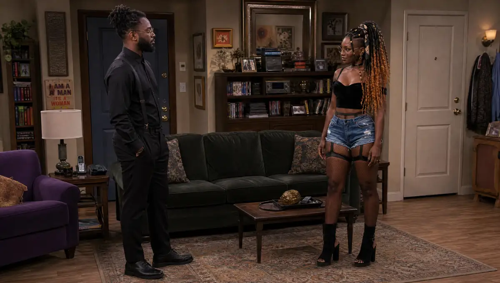
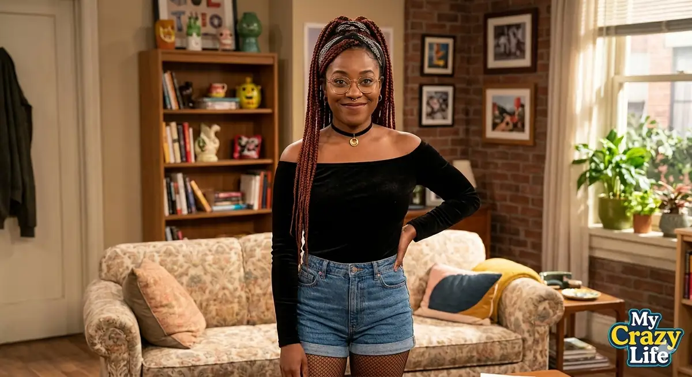

# My Crazy Life (sitcom)

<!-- wiki:infobox -->

| My Crazy Life (sitcom) | |
| --- | --- |
| Client | Projet personnel |
| Casquette | Direction créative & artistique |
| Catégorie | Production |
| Folio | _pas encore sur le site_ |
| État de la fiche | Ébauche |
<!-- /wiki:infobox -->

**My Crazy Life (sitcom)** est un projet personnel d’Alexandre « Xtincell » Djengue.

## Description

_À documenter._

## Galerie

<!-- wiki:galerie -->

<!-- /wiki:galerie -->

## Archives

- 16 fichiers dans les dossiers « Xtincell » des disques de travail (16 photos).

## Sources

- Archives personnelles rangées sur les disques (2026-11-09), dossier « Projets/Sitcom « My Crazy Life » »

<!-- wiki:liens-entrants -->
<!-- /wiki:liens-entrants -->
