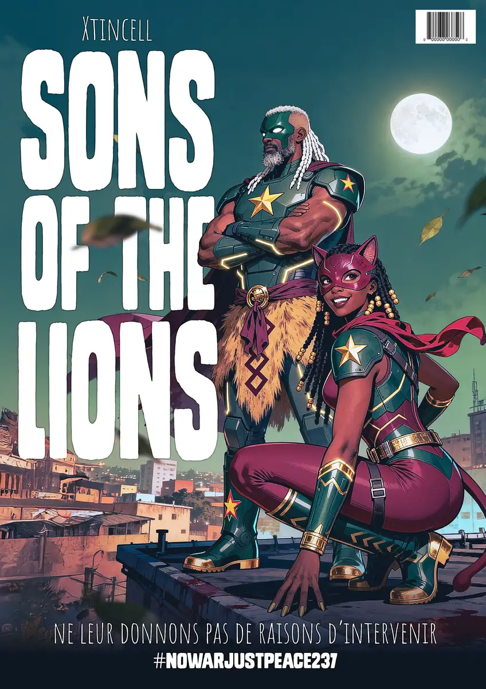

# Sons of the Lions

<!-- wiki:infobox -->

| Sons of the Lions | |
| --- | --- |
| Client | Projet personnel |
| Casquette | Direction créative & artistique |
| Catégorie | Campagne |
| Folio | _pas encore sur le site_ |
| État de la fiche | Ébauche |
<!-- /wiki:infobox -->

**Sons of the Lions** est un projet personnel d’Alexandre « Xtincell » Djengue.

## Description

_À documenter._

## Archives

- 1 fichiers dans les dossiers « Xtincell » des disques de travail (1 fichiers de création).

## Sources

- Archives personnelles rangées sur les disques (2026-11-09), dossier « Créations graphiques/Sons of the Lions »

<!-- wiki:liens-entrants -->
<!-- /wiki:liens-entrants -->
