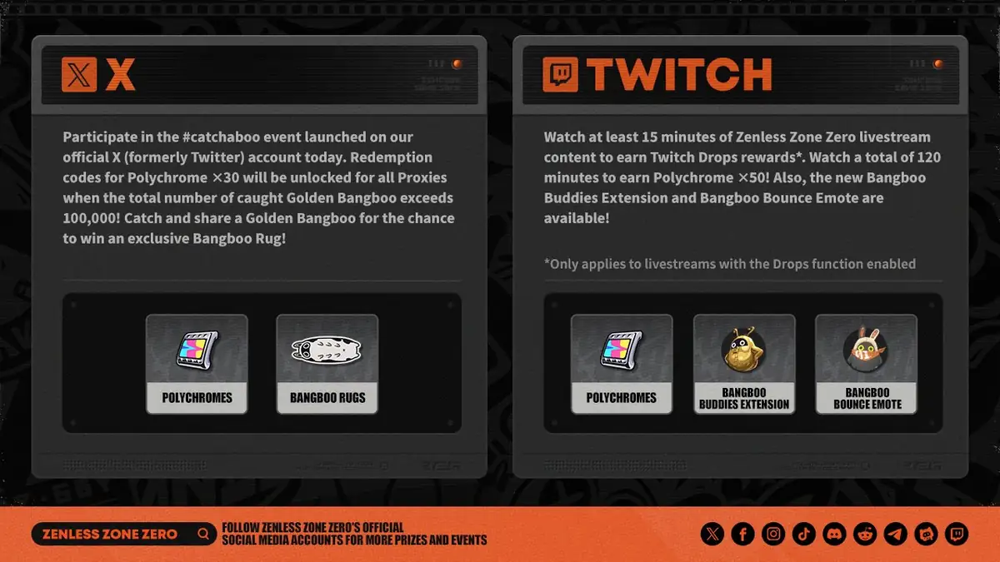

# Spark — agence de talents

<!-- wiki:infobox -->

| Spark — agence de talents | |
| --- | --- |
| Client | Projet personnel |
| Casquette | Stratégie |
| Catégorie | Projet |
| Folio | _pas encore sur le site_ |
| État de la fiche | Ébauche |
<!-- /wiki:infobox -->

**Spark — agence de talents** est un projet personnel d’Alexandre « Xtincell » Djengue.

## Description

_À documenter._

## Galerie

<!-- wiki:galerie -->

<!-- /wiki:galerie -->

## Archives

- 135 fichiers dans les dossiers « Xtincell » des disques de travail (65 photos · 52 documents · 12 fichiers de création · 4 autres · 2 sons).

## Sources

- Archives personnelles rangées sur les disques (2026-11-09), dossier « Projets/Spark — agence de talents »

<!-- wiki:liens-entrants -->
---
**Pages liées** : [Alexandre « Xtincell » Djengue](../personnes/alexandre-djengue.md)
<!-- /wiki:liens-entrants -->
