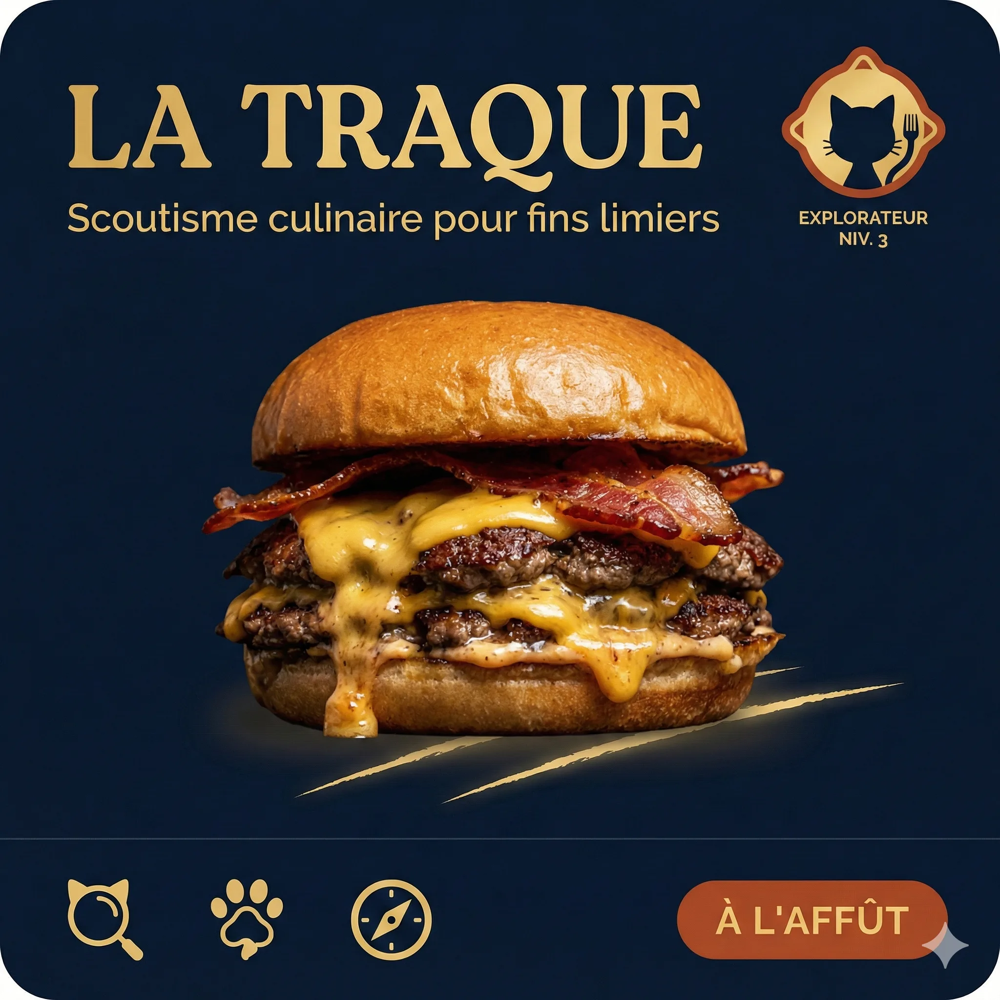
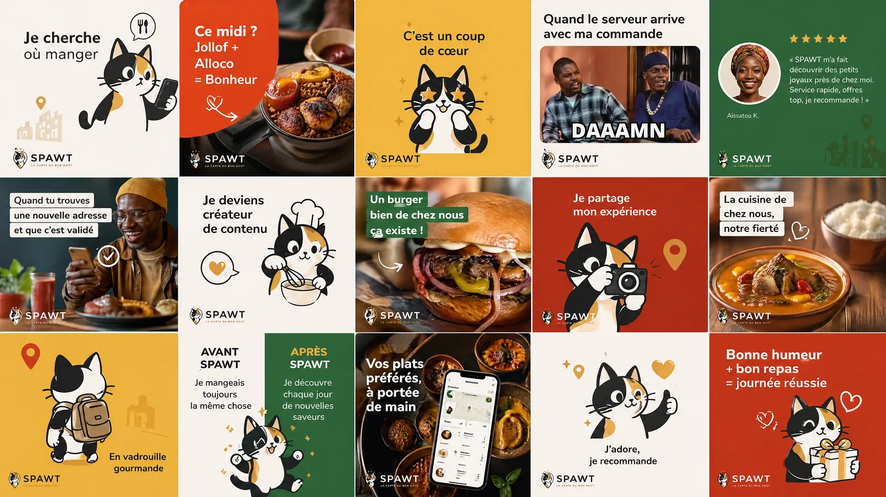
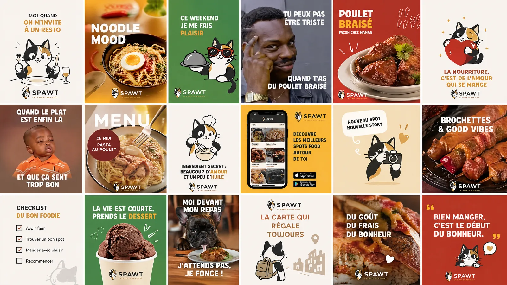
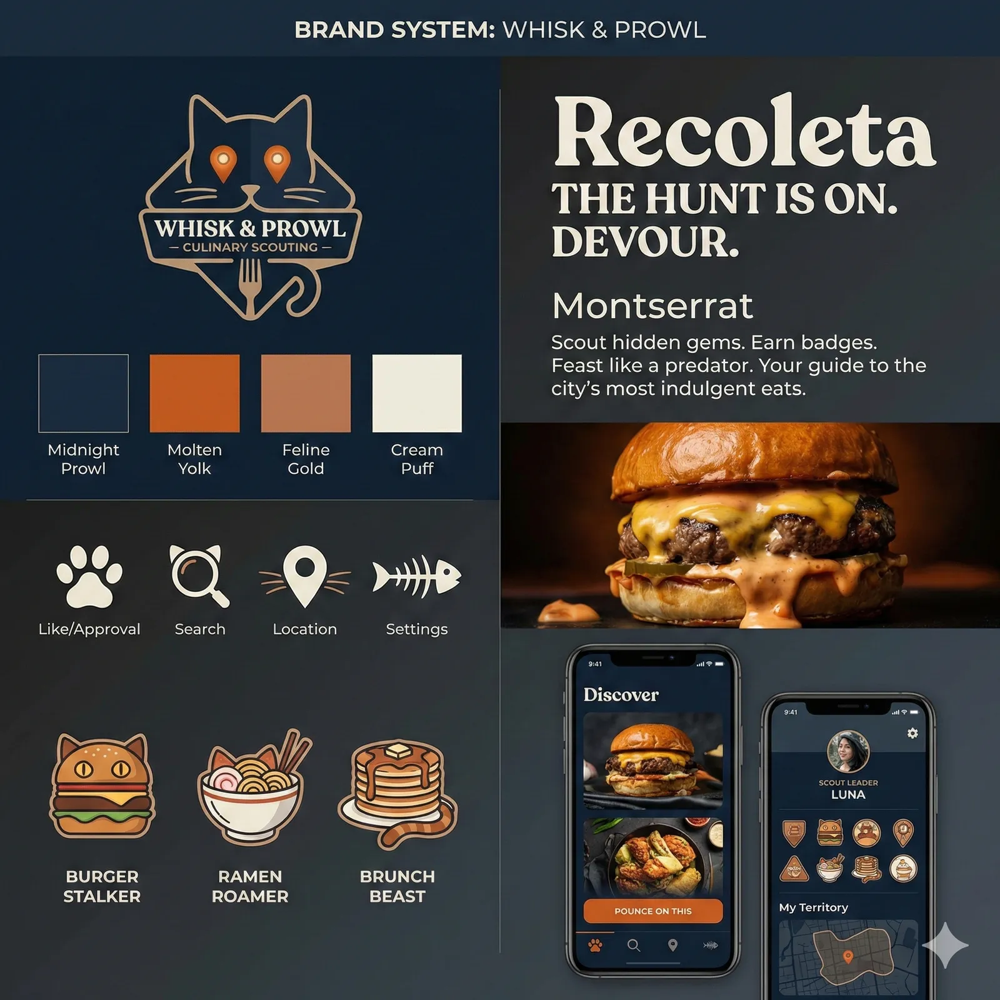
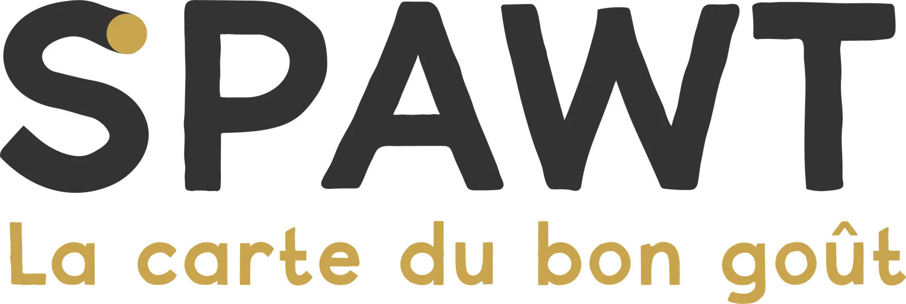

# Spawt — La carte du bon goût

<!-- wiki:infobox -->

| Spawt — La carte du bon goût | |
| --- | --- |
| Client | [Spawt](../organisations/spawt.md) |
| Période | 2026 |
| Casquette | Direction créative & artistique |
| Catégorie | Campagne |
| Disciplines | branding · social · photography |
| Folio | [Étude de cas ↗](https://xtincell.powerupgraders.com/work/spawt) |
| Code | `project_spawt` · `project_spawt_mobile_ci` · `spawt-ci-mobile-v1-mvp` · `spawt-meute-quiz` |
| État de la fiche | Standard |
<!-- /wiki:infobox -->

**Spawt — La carte du bon goût** est une campagne réalisée pour [Spawt](../organisations/spawt.md) (2026).

## Contexte

Branding et campagne social pour Spawt, app de découverte food (« où manger ») à mascotte chat calico tricolore : logo, key visuals « scoutisme culinaire » et grilles de contenu mêlant food photo et UI.

## Rôle

Direction créative et conception de l’univers visuel, en parallèle de la conception et du développement de l’application mobile. Cette sélection porte sur l’identité et les contenus de marque.

## Résultat

Logo, recherches de mascotte et visuels de communication autour de la découverte culinaire. Ces pièces documentent une étape du travail de marque ; l’application et son interface constituent un chantier distinct.

## Galerie

<!-- wiki:galerie -->

<!-- /wiki:galerie -->

## Preuves et médias

- Visuels : `public/work/cases/spawt/` (8 fichiers)

## Sources

- Folio — `scripts/cases.spec.json`, entrée `spawt`

<!-- wiki:liens-entrants -->
---
**Pages liées** : [Spawt](../organisations/spawt.md)
<!-- /wiki:liens-entrants -->
