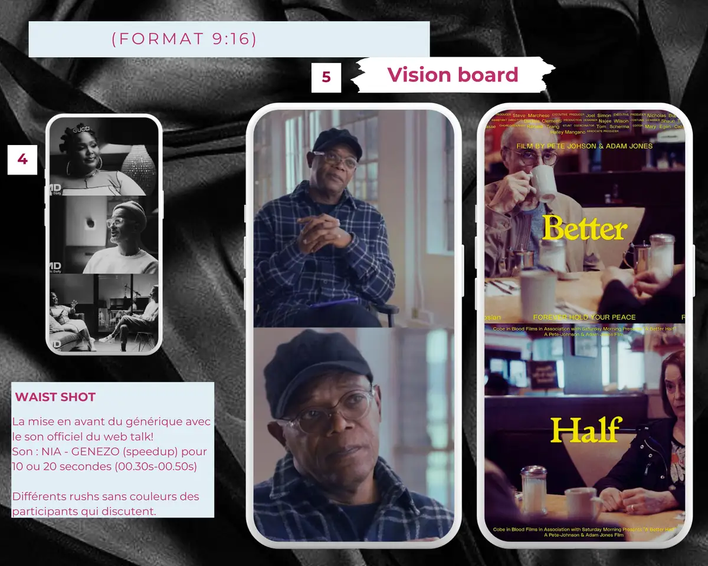
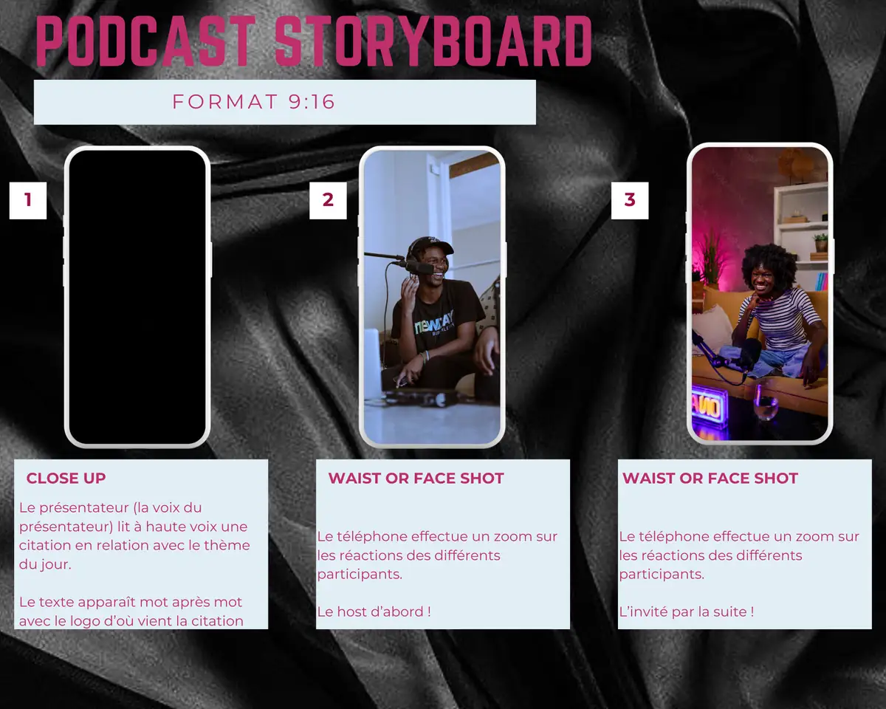
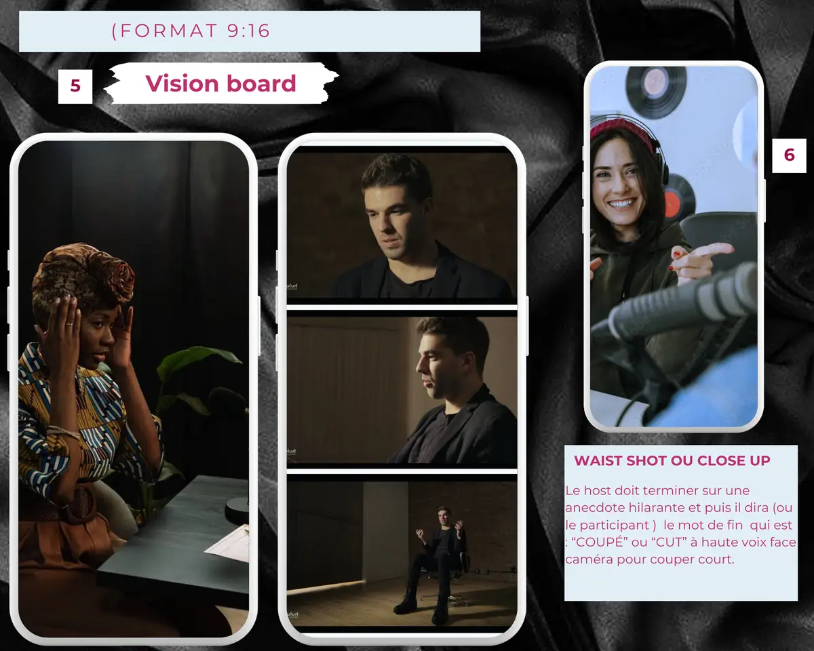

# 916 Web Talk « Lust » — storyboard

<!-- wiki:infobox -->

| 916 Web Talk « Lust » — storyboard | |
| --- | --- |
| Client | Projet personnel |
| Période | 2024 |
| Casquette | Direction créative & artistique |
| Catégorie | Production |
| Folio | _pas encore sur le site_ |
| État de la fiche | Ébauche |
<!-- /wiki:infobox -->

**916 Web Talk « Lust » — storyboard** est un projet personnel d’Alexandre « Xtincell » Djengue (2024).

## Description

_À documenter._

## Galerie

<!-- wiki:galerie -->

<!-- /wiki:galerie -->

## Archives

- 4 fichiers dans les dossiers « Xtincell » des disques de travail (3 photos · 1 autres).

## Sources

- Archives personnelles rangées sur les disques (2026-11-09), dossier « Projets/Storyboard « 916 web talk Lust » (2024-06) »

<!-- wiki:liens-entrants -->
<!-- /wiki:liens-entrants -->
