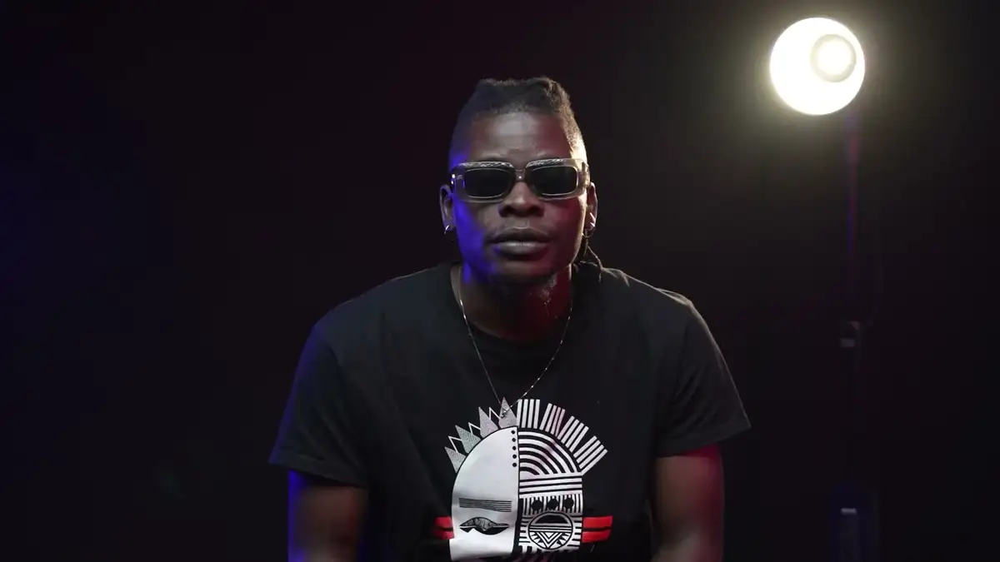
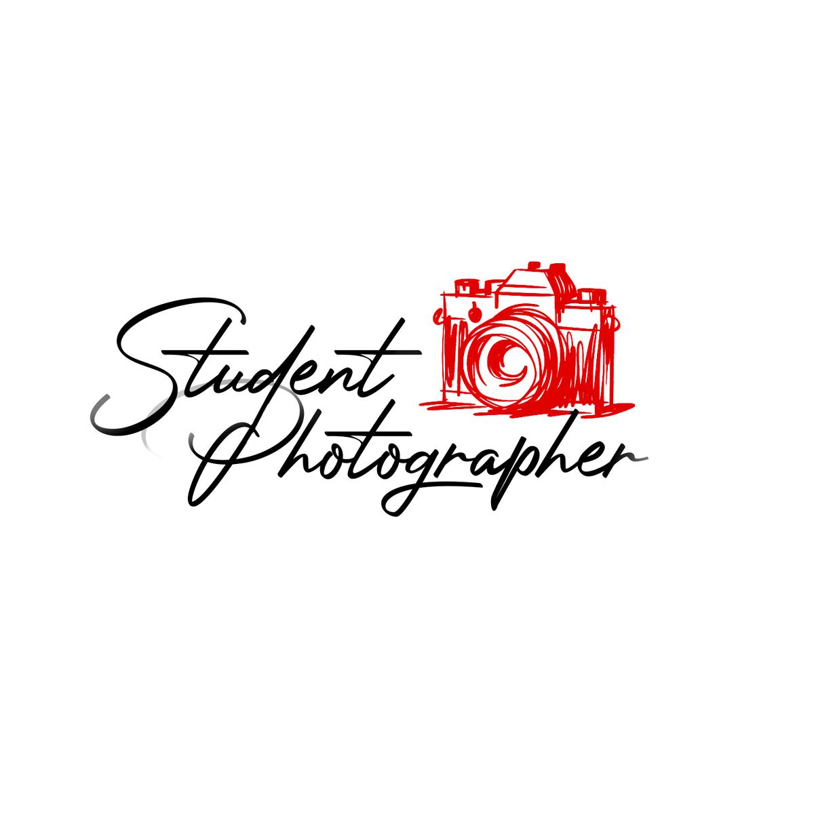
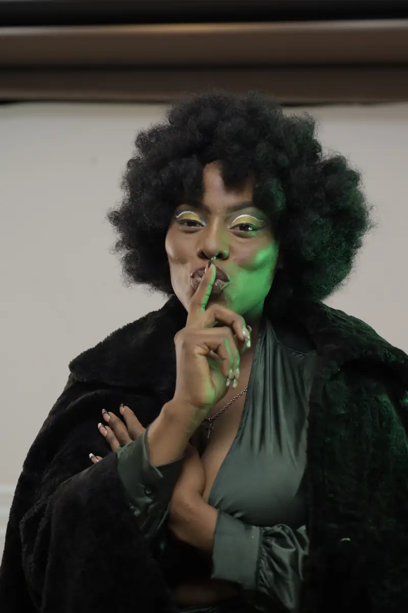
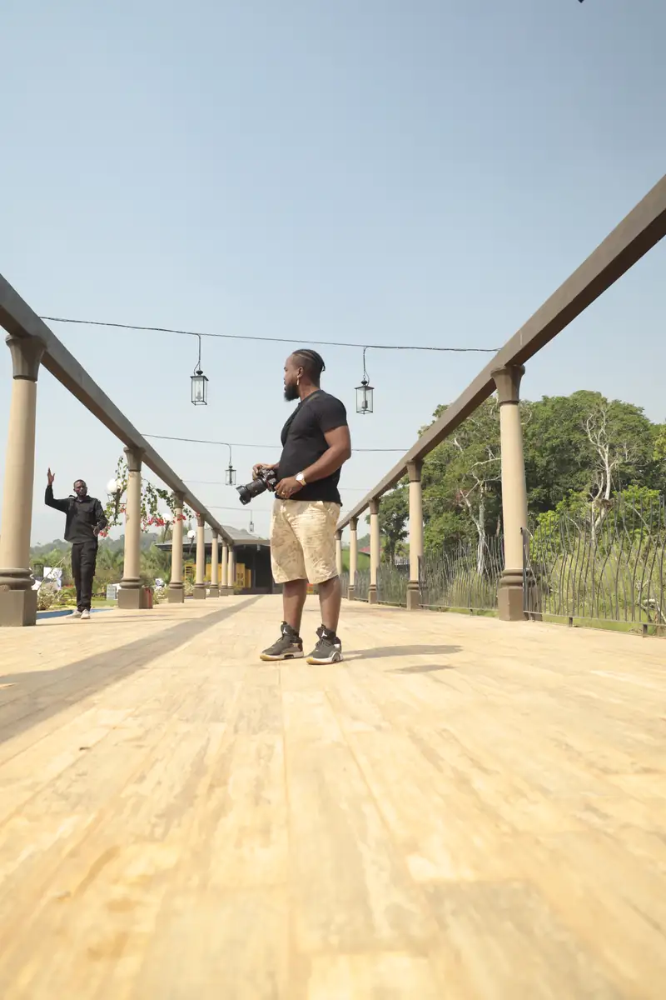
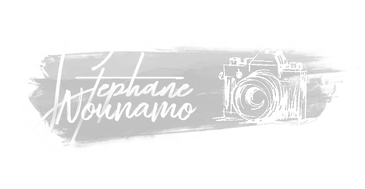
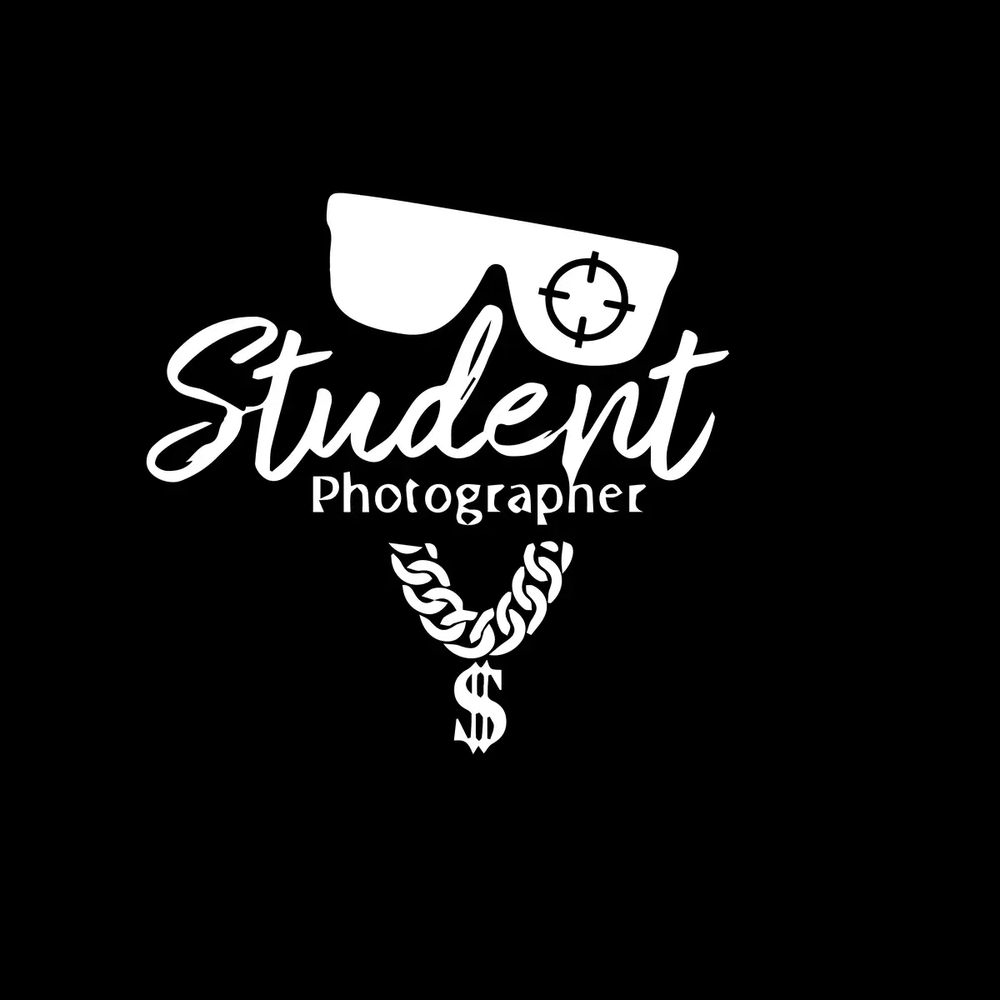

# Student Photographer (Stéphane Nounamo) — travaux

<!-- wiki:infobox -->

| Student Photographer (Stéphane Nounamo) — travaux | |
| --- | --- |
| Client | [Student Photographer (Stéphane Nounamo)](../organisations/student-photographer-stephane-nounamo.md) |
| Via | [UPgraders](../organisations/upgraders.md) |
| Période | 2021–2024 |
| Casquette | Exécution |
| Catégorie | Production |
| Sous-projets | [« Photography Masterclass » de Stéphane Nounamo (I)](evt-2022-08-27-photography-masterclass-de-stephane-nounamo-i.md) |
| Folio | _pas encore sur le site_ |
| État de la fiche | Ébauche |
<!-- /wiki:infobox -->

**Student Photographer (Stéphane Nounamo) — travaux** regroupe le travail réalisé pour [Student Photographer (Stéphane Nounamo)](../organisations/student-photographer-stephane-nounamo.md) avec [UPgraders](../organisations/upgraders.md) (2021–2024).

## Description

_À documenter : demande, rôle, livrables._ Les dossiers et opérations retrouvés sur les disques sont détaillés sur la fiche [Student Photographer (Stéphane Nounamo)](../organisations/student-photographer-stephane-nounamo.md#archives-de-travail).

## Galerie

<!-- wiki:galerie -->

<!-- /wiki:galerie -->

## Sources

- Archives de travail rangées sur les disques (2026-11-09)

<!-- wiki:liens-entrants -->
---
**Pages liées** : [« Photography Masterclass » de Stéphane Nounamo (I)](evt-2022-08-27-photography-masterclass-de-stephane-nounamo-i.md)
<!-- /wiki:liens-entrants -->
