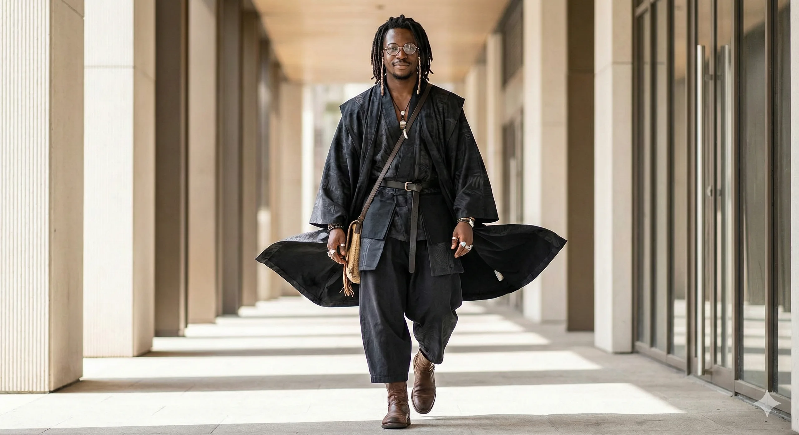
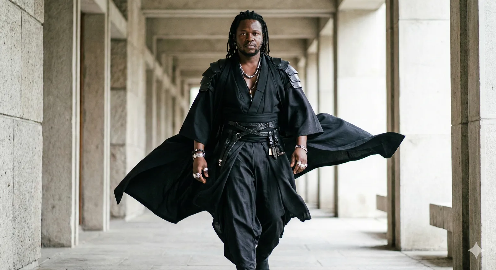
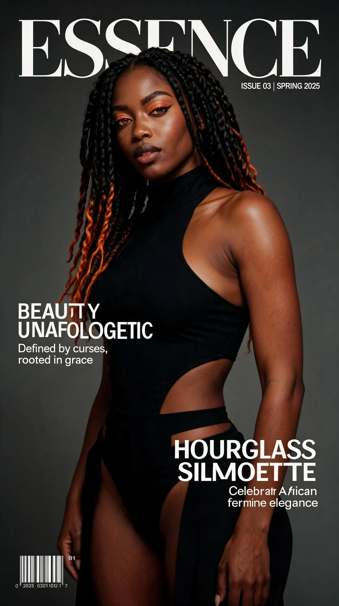
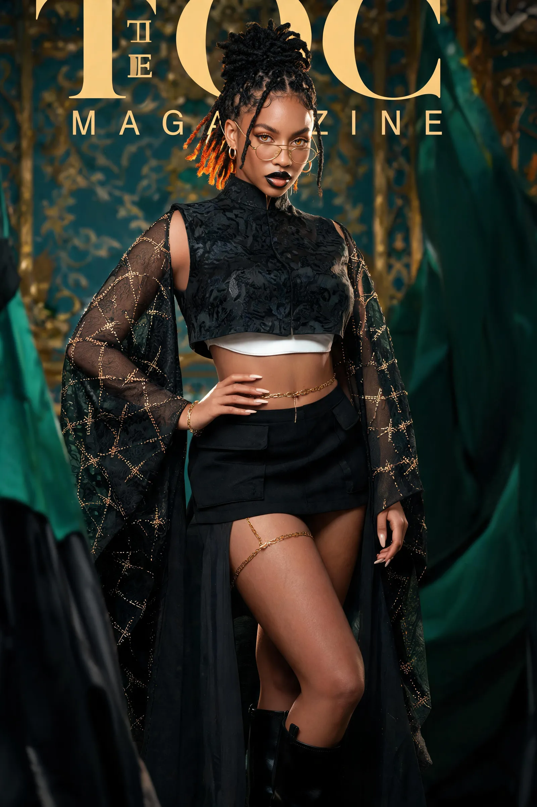
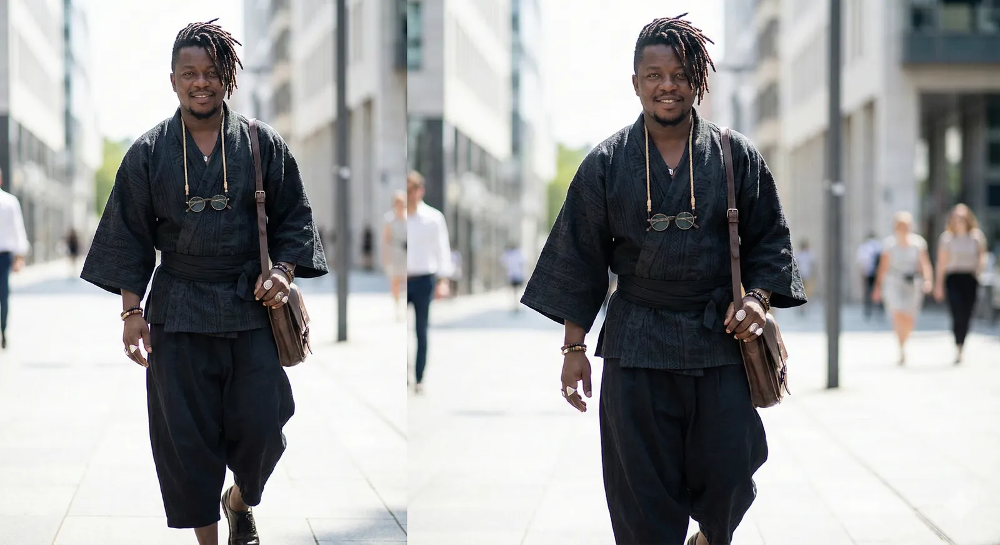
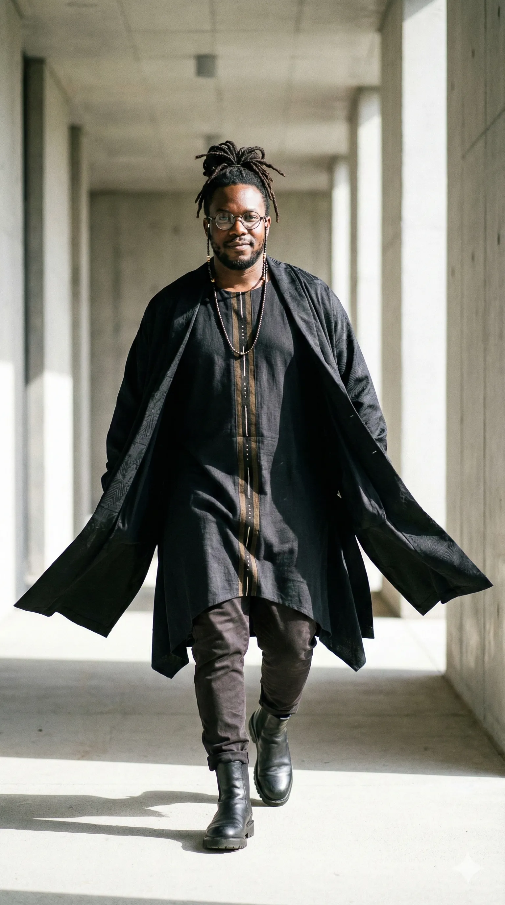
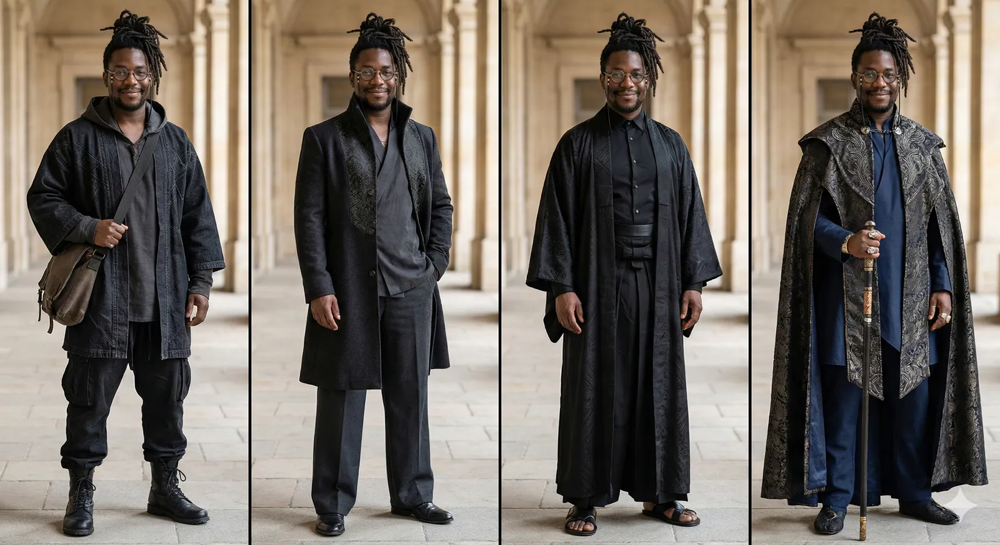
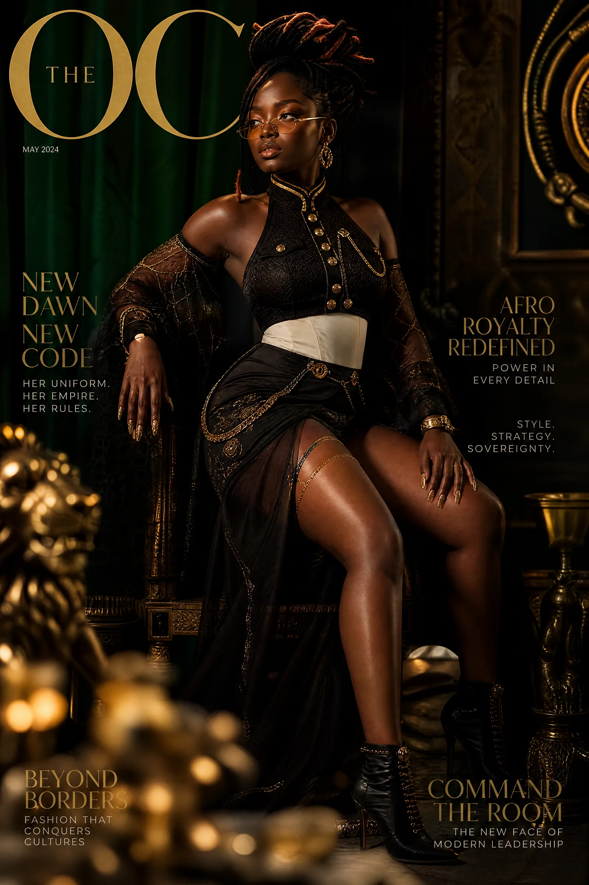
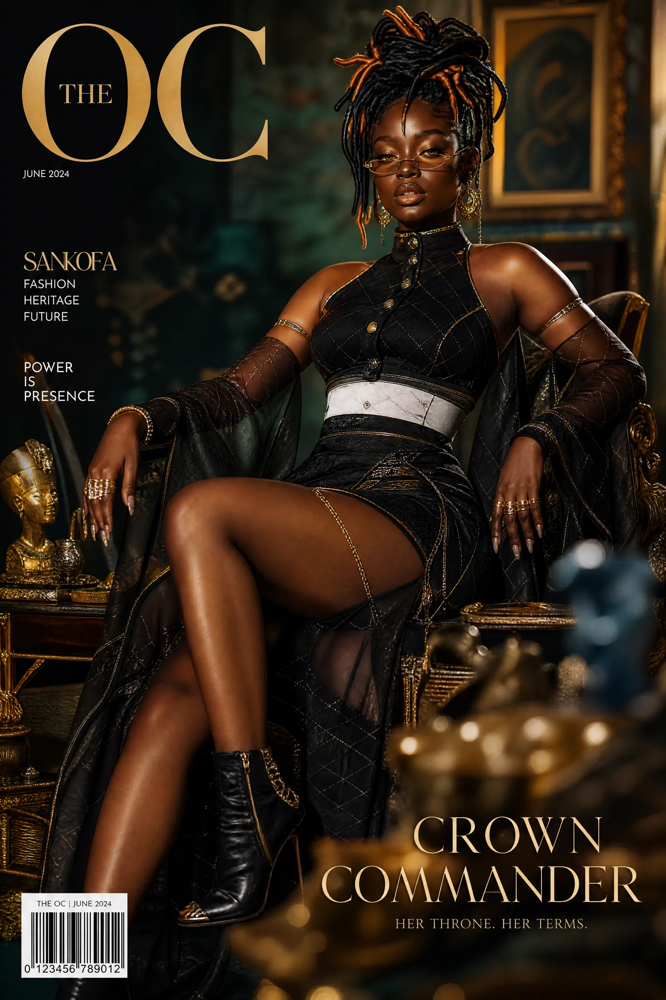
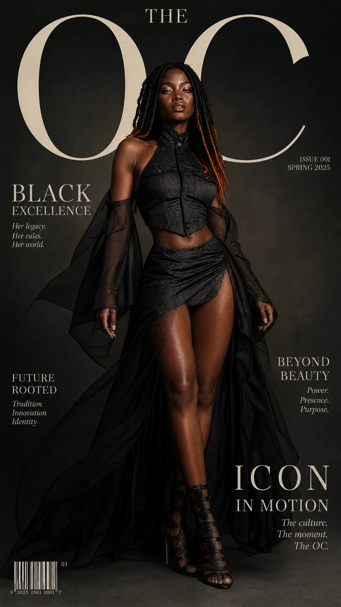

# Stylisme — Mode africaine

<!-- wiki:infobox -->

| Stylisme — Mode africaine | |
| --- | --- |
| Client | Projet personnel |
| Période | 2026 |
| Casquette | Direction créative & artistique |
| Catégorie | Collection |
| Disciplines | photography · illustration |
| Folio | [Étude de cas ↗](https://xtincell.powerupgraders.com/work/stylisme) |
| État de la fiche | Ébauche |
<!-- /wiki:infobox -->

**Stylisme — Mode africaine** est une collection personnelle d’Alexandre « Xtincell » Djengue (2026).

## Contexte

Série de stylisme mode africaine haut de gamme : couvertures éditoriales femme (faux ESSENCE / TOC Magazine, couture noire transparente, locs à pointes orange) et street-style homme en robes/kimono avant-gardistes.

## Galerie

<!-- wiki:galerie -->

<!-- /wiki:galerie -->

## Preuves et médias

- Visuels : `public/work/cases/stylisme/` (11 fichiers)

## Sources

- Folio — `scripts/cases.spec.json`, entrée `stylisme`

<!-- wiki:liens-entrants -->
<!-- /wiki:liens-entrants -->
