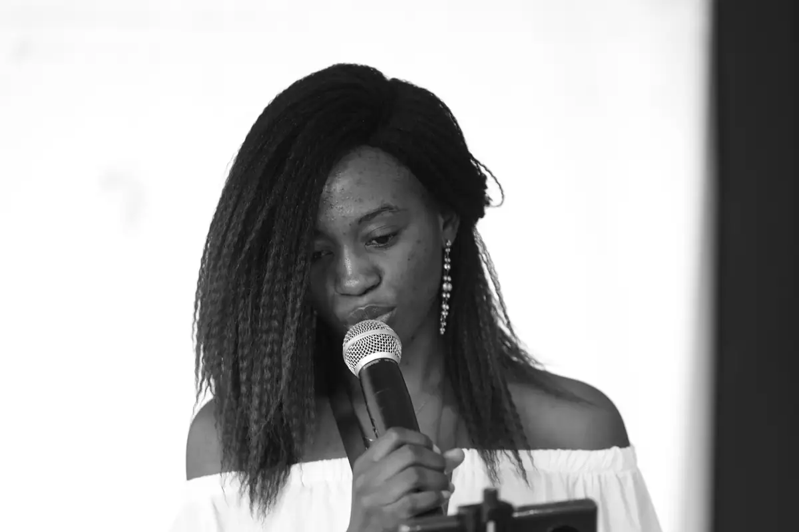
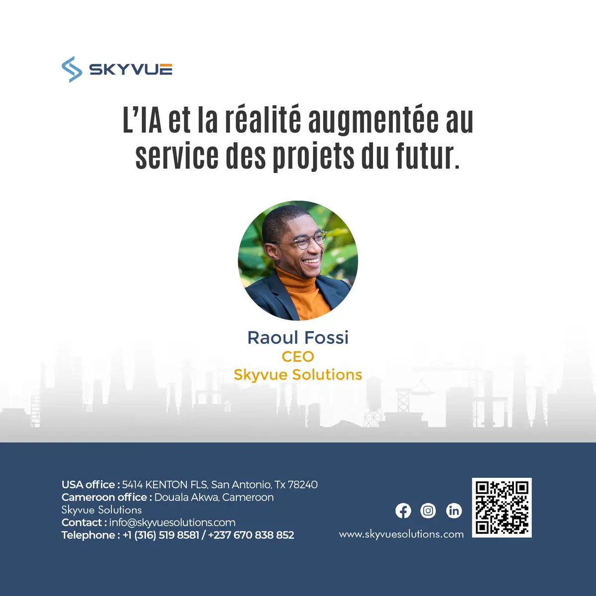
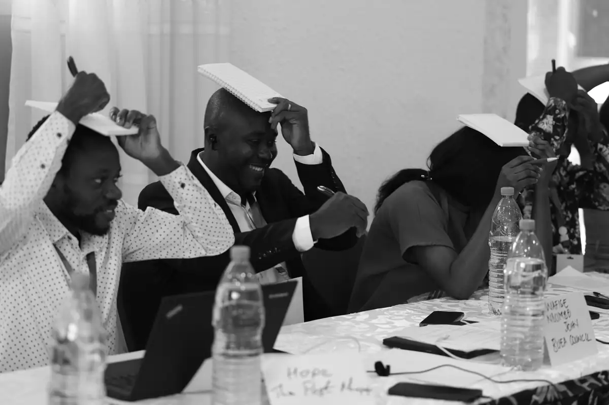
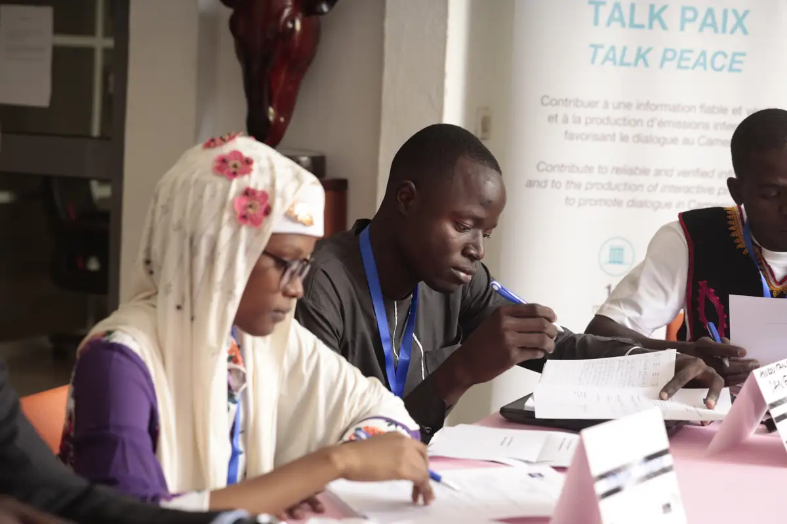
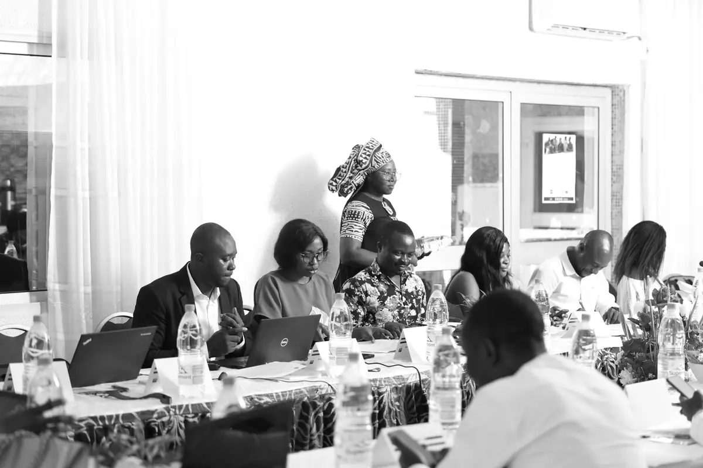
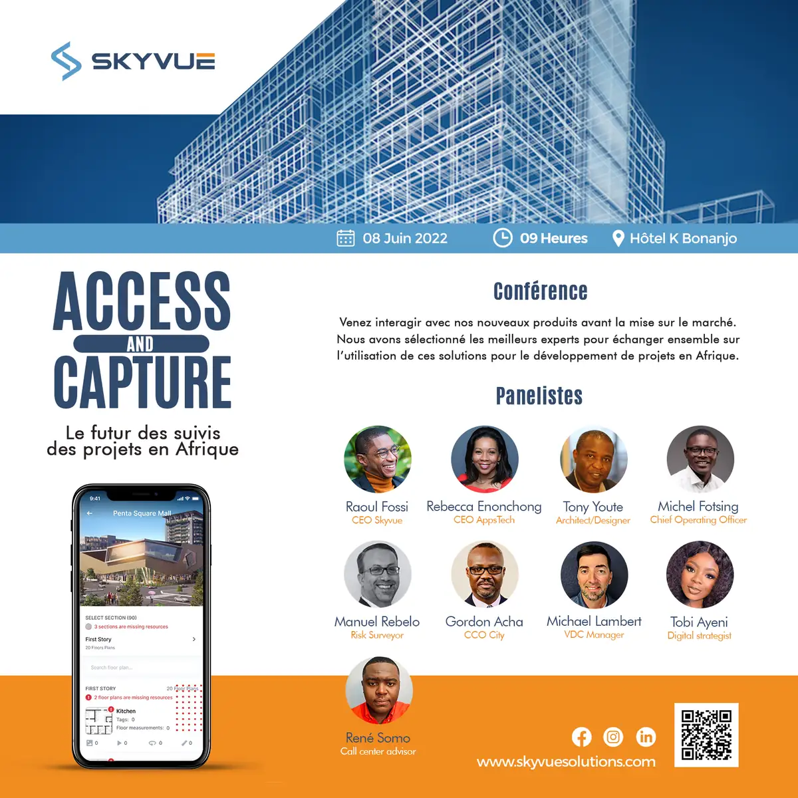

# Talk Paix (CFI) — travaux

<!-- wiki:infobox -->

| Talk Paix (CFI) — travaux | |
| --- | --- |
| Client | [Talk Paix (CFI)](../organisations/talk-paix-cfi.md) |
| Via | [UPgraders](../organisations/upgraders.md) |
| Période | 2023–2024 |
| Casquette | Exécution |
| Catégorie | Production |
| Sous-projets | [Talk Paix (CFI) — mission dans le Nord : trajet en train et atelier avec la Fondation Conseil Jeune](evt-2024-01-23-talk-paix-cfi-mission-dans-le-nord-trajet-en-train-et-ate.md) · [Talk Paix (CFI) — rushes d'ateliers régionaux 2024 (dont Garoua)](evt-2024-01-30-talk-paix-cfi-rushes-d-ateliers-regionaux-2024-dont-garou.md) · [Talk Paix (CFI) — atelier de Limbé (octobre 2023)](evt-2023-10-20-talk-paix-cfi-atelier-de-limbe-octobre-2023.md) · [Talk Paix (CFI) — atelier des médias (22-23 mars 2023)](evt-2023-03-22-talk-paix-cfi-atelier-des-medias-22-23-mars-2023.md) · [Talk Paix (CFI) — interviews et vidéo du séminaire « Désinformation et vérification de l'information »](evt-2023-04-03-talk-paix-cfi-interviews-et-video-du-seminaire-desinforma.md) |
| Folio | _pas encore sur le site_ |
| État de la fiche | Ébauche |
<!-- /wiki:infobox -->

**Talk Paix (CFI) — travaux** regroupe le travail réalisé pour [Talk Paix (CFI)](../organisations/talk-paix-cfi.md) avec [UPgraders](../organisations/upgraders.md) (2023–2024).

## Description

_À documenter : demande, rôle, livrables._ Les dossiers et opérations retrouvés sur les disques sont détaillés sur la fiche [Talk Paix (CFI)](../organisations/talk-paix-cfi.md#archives-de-travail).

## Galerie

<!-- wiki:galerie -->

<!-- /wiki:galerie -->

## Sources

- Archives de travail rangées sur les disques (2026-11-09)

<!-- wiki:liens-entrants -->
---
**Pages liées** : [Talk Paix (CFI) — atelier de Limbé (octobre 2023)](evt-2023-10-20-talk-paix-cfi-atelier-de-limbe-octobre-2023.md) · [Talk Paix (CFI) — atelier des médias (22-23 mars 2023)](evt-2023-03-22-talk-paix-cfi-atelier-des-medias-22-23-mars-2023.md) · [Talk Paix (CFI) — interviews et vidéo du séminaire « Désinformation et vérification de l'information »](evt-2023-04-03-talk-paix-cfi-interviews-et-video-du-seminaire-desinforma.md) · [Talk Paix (CFI) — mission dans le Nord : trajet en train et atelier avec la Fondation Conseil Jeune](evt-2024-01-23-talk-paix-cfi-mission-dans-le-nord-trajet-en-train-et-ate.md) · [Talk Paix (CFI) — rushes d'ateliers régionaux 2024 (dont Garoua)](evt-2024-01-30-talk-paix-cfi-rushes-d-ateliers-regionaux-2024-dont-garou.md)
<!-- /wiki:liens-entrants -->
