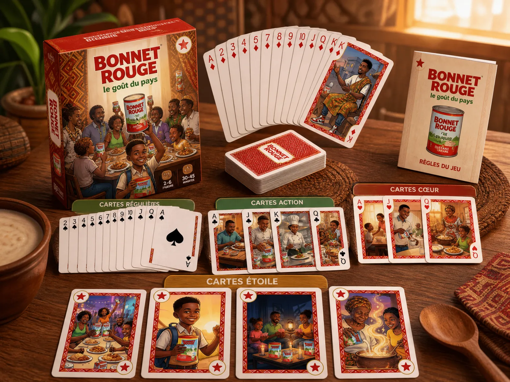
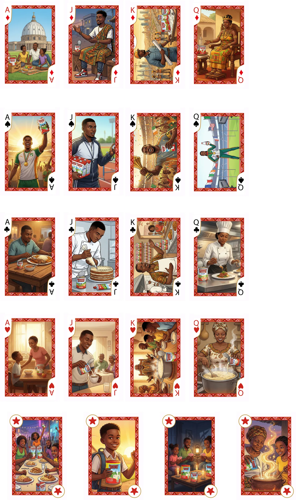
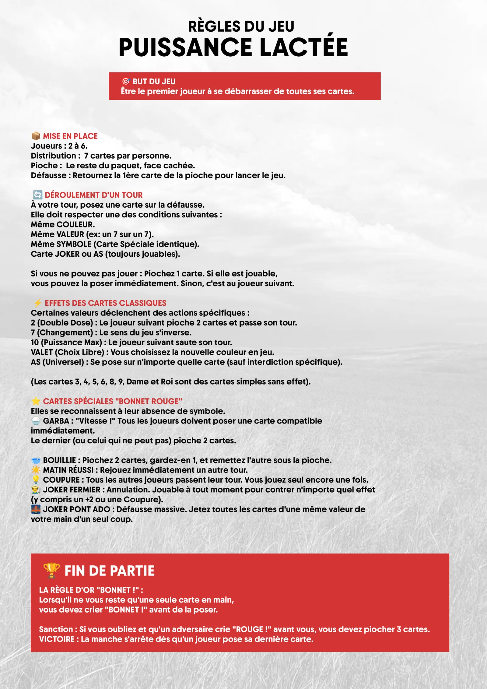
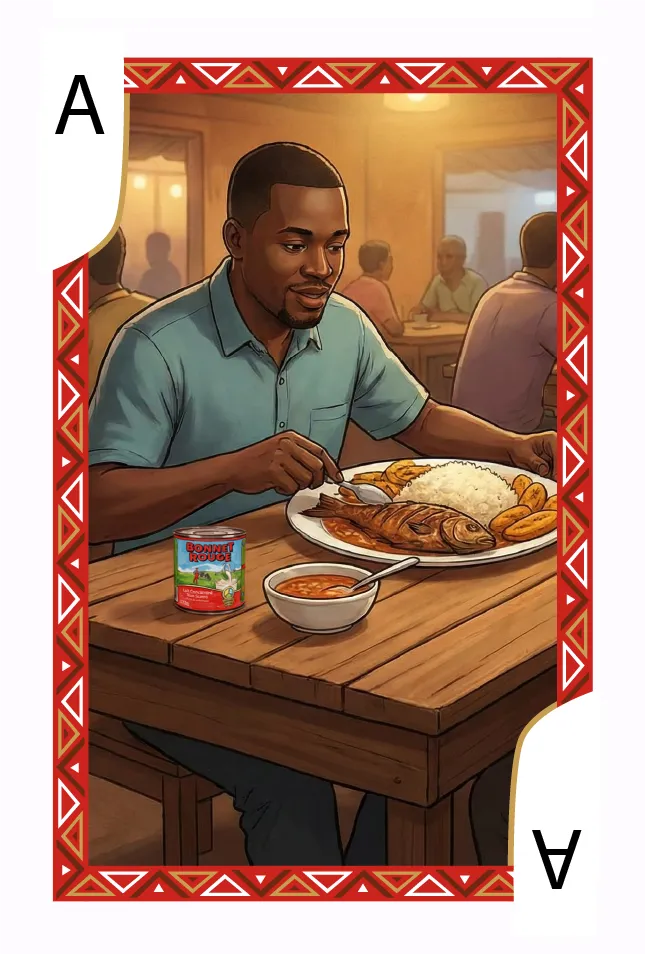
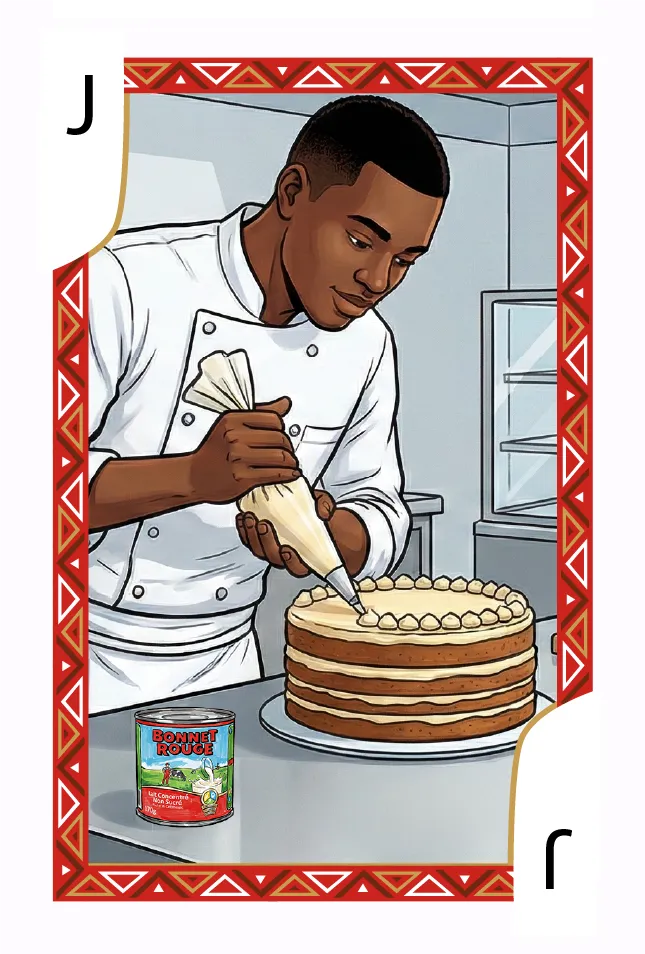
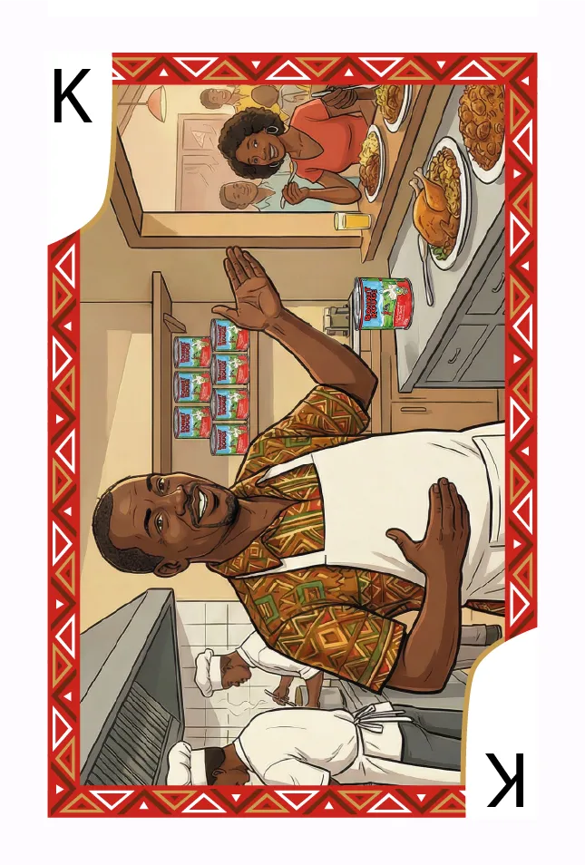

# Bonnet Rouge — « Puissance Lactée » (TCG)

<!-- wiki:infobox -->

| Bonnet Rouge — « Puissance Lactée » (TCG) | |
| --- | --- |
| Client | [FrieslandCampina](../organisations/frieslandcampina.md) |
| Via | [MATANGA Agency](../organisations/matanga-agency.md) |
| Période | 2025 |
| Casquette | Direction créative & artistique |
| Catégorie | Campagne |
| Disciplines | packaging · illustration · branding |
| Folio | [Étude de cas ↗](https://xtincell.powerupgraders.com/work/tcg-bonnet-rouge) |
| État de la fiche | Standard |
<!-- /wiki:infobox -->

**Bonnet Rouge — « Puissance Lactée » (TCG)** est une campagne réalisée pour [FrieslandCampina](../organisations/frieslandcampina.md), via [MATANGA Agency](../organisations/matanga-agency.md) (2025).

## Contexte

Jeu de cartes de marque « Puissance Lactée » comme merchandising pour le lait Bonnet Rouge : deck illustré à bordures pagne rouge mettant en scène des scènes de vie camerounaises et la boîte de lait, plus boîte produit et règles.

## Galerie

<!-- wiki:galerie -->

<!-- /wiki:galerie -->

## Preuves et médias

- Visuels : `public/work/cases/tcg-bonnet-rouge/` (8 fichiers)

## Sources

- Archives de travail rangées sous « MATANGA — EXPORT DU TRAVAIL » sur les disques (relevé du 2026-11-09)
- Folio — `scripts/cases.spec.json`, entrée `tcg-bonnet-rouge`

<!-- wiki:liens-entrants -->
<!-- /wiki:liens-entrants -->
