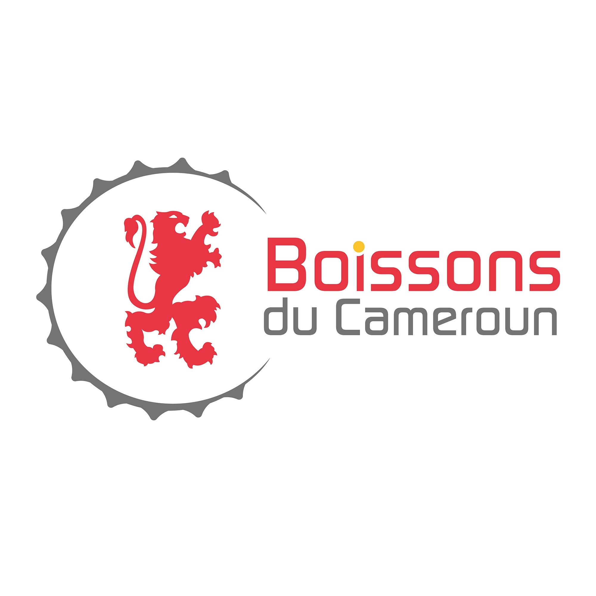
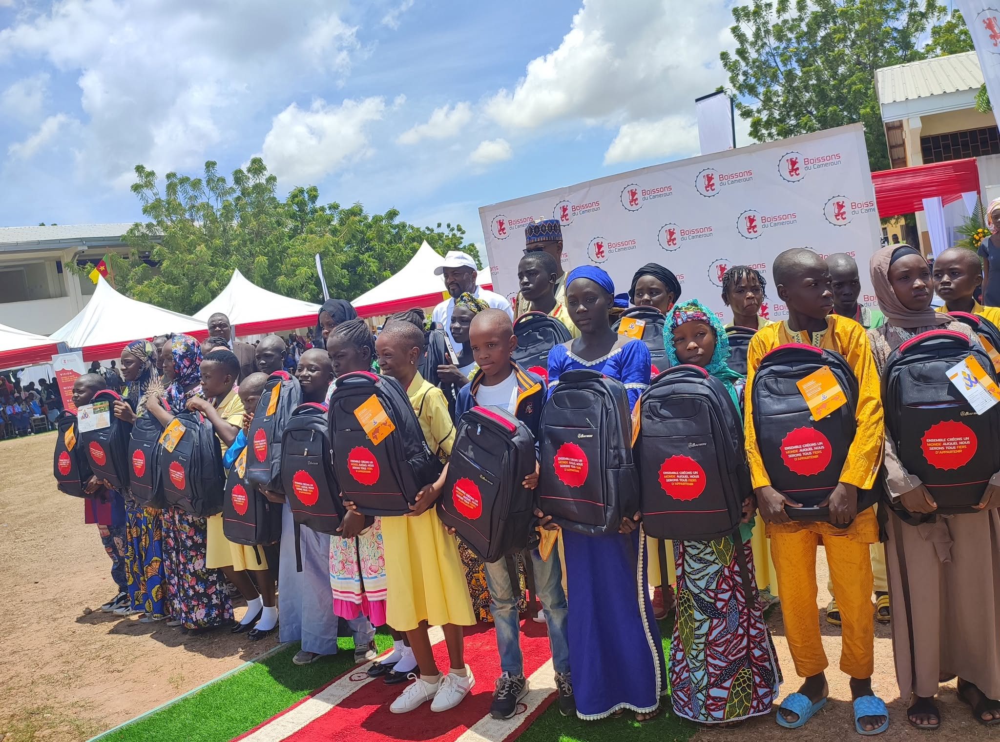
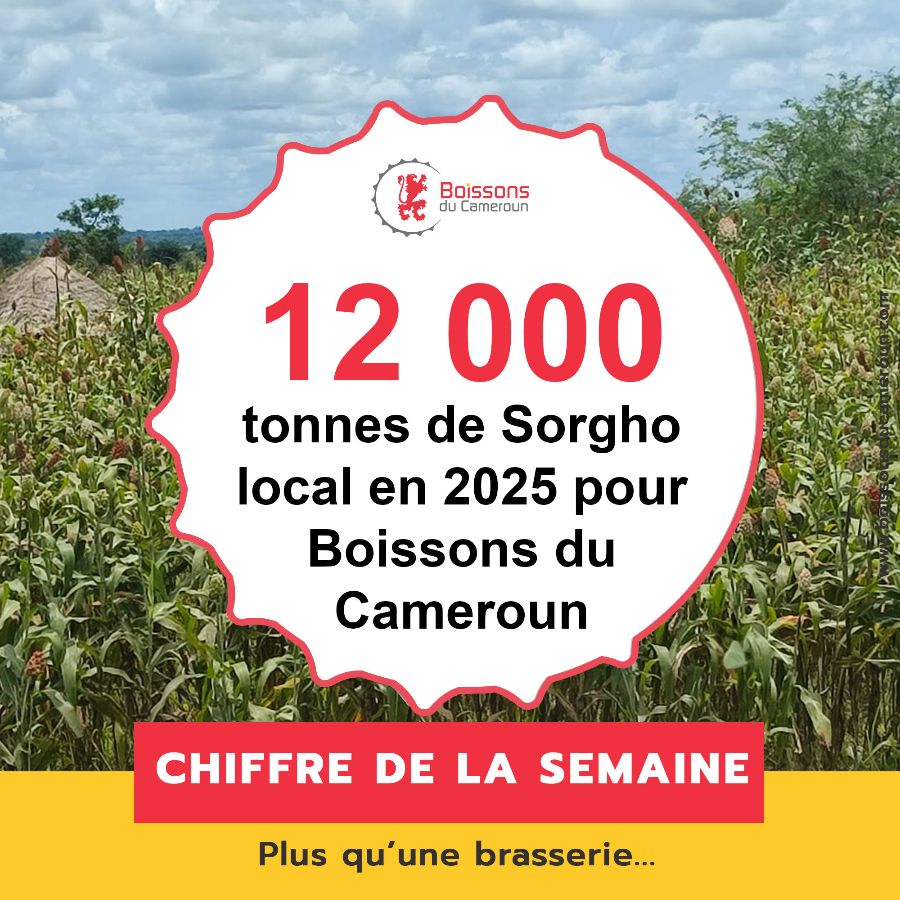
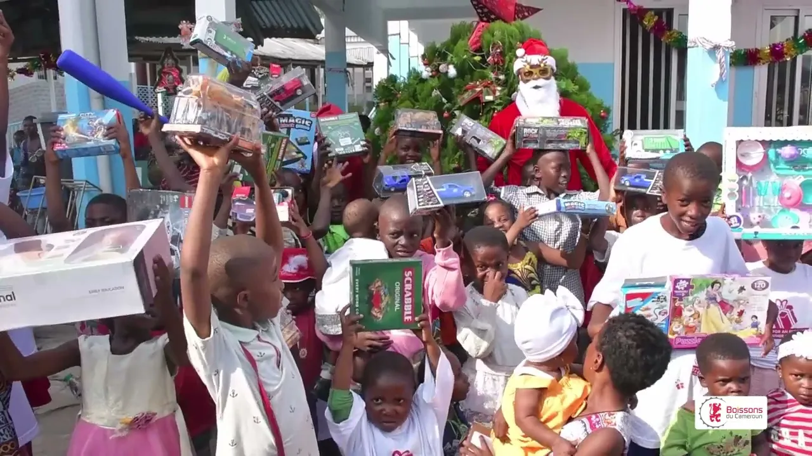
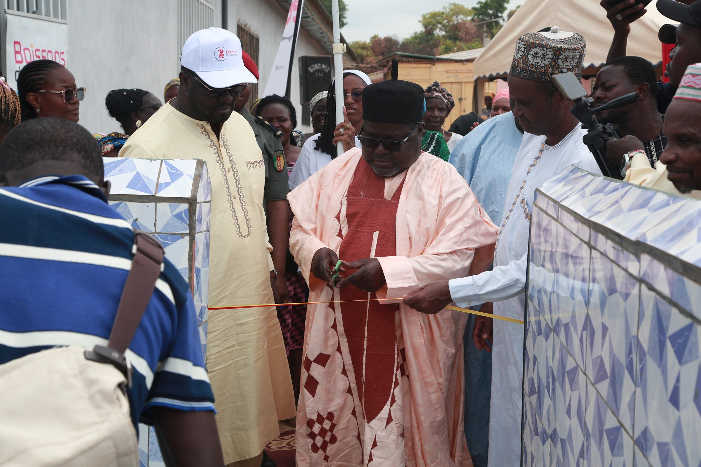
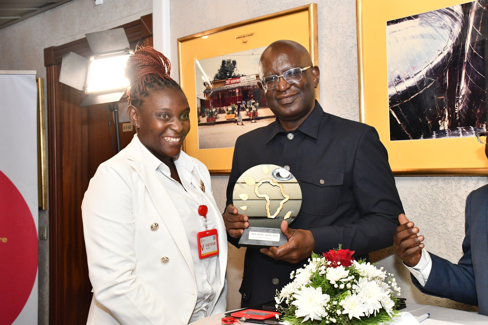

# Top (SABC) — direction artistique & production

<!-- wiki:infobox -->

| Top (SABC) — direction artistique & production | |
| --- | --- |
| Client | [Les Brasseries du Cameroun (SABC)](../organisations/brasseries-du-cameroun.md) |
| Via | [Les Brasseries du Cameroun (SABC)](../organisations/brasseries-du-cameroun.md) |
| Période | 2020–2022 |
| Casquette | Direction créative & artistique |
| Catégorie | Mission |
| Rôle | Direction Artistique & Production |
| Disciplines | FMCG · Boisson · Top Bitter Lemon · Activation · Social |
| Folio | [Folio ↗](https://xtincell.powerupgraders.com/work) _(cité, sans page dédiée)_ |
| Liens | [SABC · Boissons du Cameroun](https://www.facebook.com/boissonsducameroun/) · [SABC · YouTube](https://www.youtube.com/@BoissonsduCameroun) |
| État de la fiche | Standard |
<!-- /wiki:infobox -->

**Top (SABC) — direction artistique & production** est une mission réalisée pour [Les Brasseries du Cameroun (SABC)](../organisations/brasseries-du-cameroun.md), via [Les Brasseries du Cameroun (SABC)](../organisations/brasseries-du-cameroun.md) (2020–2022).

## Description

Période de la « bataille des limonades » au Cameroun (Top vs Bubble Up vs Spécial limonade) — lancement Top Bitter Lemon (oct. 2020), activations marque, contenus social et événementiel. Travail sur l'écosystème SABC à un moment-clé pour la franchise Top.

## Rôle

Direction Artistique & Production. Repère d’origine : « 2020 — 2022 · Douala ».

## Galerie

<!-- wiki:galerie -->

<!-- /wiki:galerie -->

## Preuves et médias

- [SABC · Boissons du Cameroun](https://www.facebook.com/boissonsducameroun/)
- [SABC · YouTube](https://www.youtube.com/@BoissonsduCameroun)
- Visuels : `public/work/top-brasseries/` (6 fichiers)

## Sources

- Folio — `src/components/folio/data/practices.ts`, entrée « TOP — Brasseries du Cameroun (SABC) »

<!-- wiki:liens-entrants -->
---
**Pages liées** : [Alexandre « Xtincell » Djengue](../personnes/alexandre-djengue.md)
<!-- /wiki:liens-entrants -->
