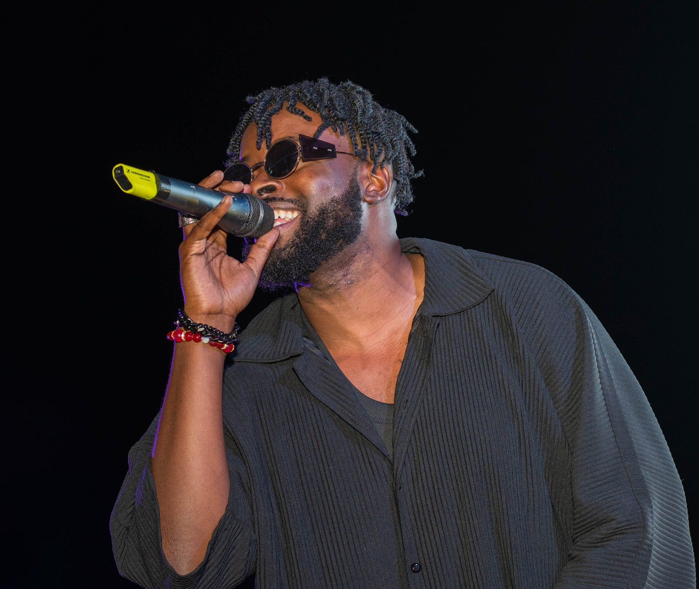
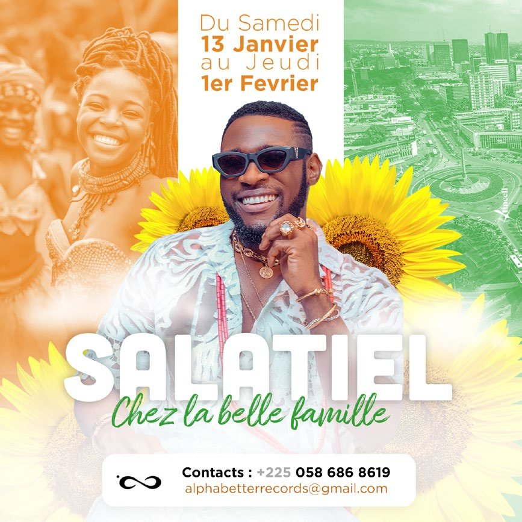
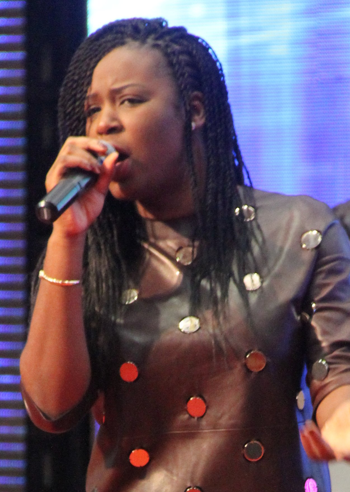
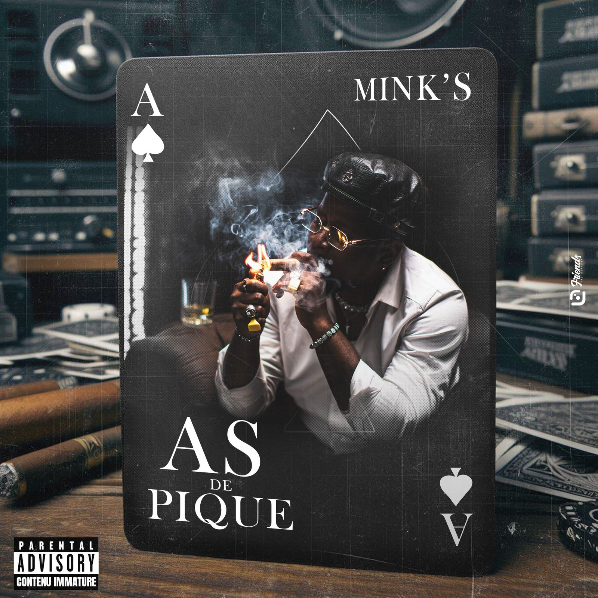
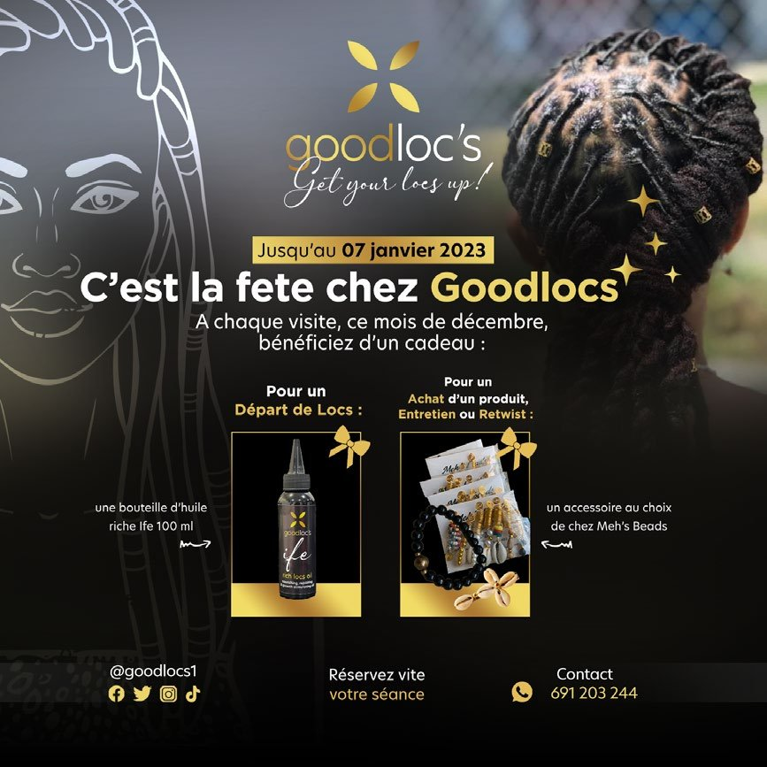

# Universal Music Africa — image d’artistes

<!-- wiki:infobox -->

| Universal Music Africa — image d’artistes | |
| --- | --- |
| Client | [Universal Music Africa](../organisations/universal-music-africa.md) |
| Via | [Imperial](../organisations/imperial.md) |
| Période | 2021–2022 |
| Casquette | Direction créative & artistique |
| Catégorie | Mission |
| Rôle | Photographe principal & DA |
| Disciplines | Locko · Mimie · Charlotte Dipanda · Singuila · Cysoul |
| Sous-projets | [Locko — photos livrées de l'année 2022 (JPG)](evt-2022-01-12-locko-photos-livrees-de-l-annee-2022-jpg.md) · [Locko — répétition live et interview télévisée (12 janvier 2022)](evt-2022-01-12-locko-repetition-live-et-interview-televisee-12-janvier-2.md) · [Locko — session en studio d'appartement (backstage, août 2022)](evt-2022-08-24-locko-session-en-studio-d-appartement-backstage-aout-2022.md) · [Saint-Valentin 2022 : soirée au Rooftop Yaoundé (13/02) et concert de Locko (14/02)](evt-2022-02-12-saint-valentin-2022-soiree-au-rooftop-yaounde-13-02-et-co.md) · [Charlotte Dipanda — sortie de l'album et soirées The Singleton (mai-juin 2021)](evt-2021-05-14-charlotte-dipanda-sortie-de-l-album-et-soirees-the-single.md) · [Charlotte Dipanda — tournée promo avec Madiba et concert au Palais des sports (août 2021)](evt-2021-08-20-charlotte-dipanda-tournee-promo-avec-madiba-et-concert-au.md) · [Locko — photos livrées de l'année 2021 (JPG)](evt-2021-07-25-locko-photos-livrees-de-l-annee-2021-jpg.md) · [Locko — promotion de l'album « Era »](evt-2021-12-05-locko-promotion-de-l-album-era.md) · [Locko — session d'écoute de l'album « Era » sur un rooftop](evt-2021-11-26-locko-session-d-ecoute-de-l-album-era-sur-un-rooftop.md) · [Locko — shooting ou tournage en combinaison orange](evt-2021-07-26-locko-shooting-ou-tournage-en-combinaison-orange.md) · [Locko — showcase « Era » au BOJ](evt-2021-12-29-locko-showcase-era-au-boj.md) · [Mimie — tournée promo du single « Faya »](evt-2021-10-06-mimie-tournee-promo-du-single-faya.md) · [Singuila — séance d'écoute de l'album « Docteur Love »](evt-2021-02-19-singuila-seance-d-ecoute-de-l-album-docteur-love.md) · [Concert de fin d'année en plein air (classé « TayC, décembre 2020 », déduit)](evt-2020-12-26-concert-de-fin-d-annee-en-plein-air-classe-tayc-decembre.md) · [Locko — galerie photo](photo-locko.md) |
| Folio | [Folio ↗](https://xtincell.powerupgraders.com/work) _(cité, sans page dédiée)_ |
| Liens | [Galerie Pixieset — Locko](https://xtincell.pixieset.com/locko/) |
| État de la fiche | Standard |
<!-- /wiki:infobox -->

**Universal Music Africa — image d’artistes** est une mission réalisée pour [Universal Music Africa](../organisations/universal-music-africa.md), via [Imperial](../organisations/imperial.md) (2021–2022).

## Description

Mission via Imperial — agence de talents dirigée par Esther Naah — pour le catalogue UMA Cameroun : Locko, Mimie, Charlotte Dipanda, Singuila, Cysoul. Direction artistique et portrait : standardiser une iconographie exportable hors du Cameroun.

## Rôle

Photographe principal & DA.

## Dates

Le CV de 2026 et les données du site font remonter cette mission à 2016. Aucune source antérieure ne l’étaye : le CV de novembre 2020 ne la mentionne pas, les missions retrouvées dans les archives datent de 2021 et 2022, et un crédit « pour Universal Music Africa via l’agence Imperial » est publié le 31 août 2021. Le wiki retient 2021–2022 ([confrontation des sources](../sources.md#confrontation-élément-par-élément)). [Le concert de fin d’année classé « TayC »](evt-2020-12-26-concert-de-fin-d-annee-en-plein-air-classe-tayc-decembre.md) est daté de décembre 2020 par le classement des disques, mais son récapitulatif photo est publié le 3 janvier 2022 : son année reste à trancher. _Sources : [disques](../sources.md#disques), [facebook](../sources.md#facebook), [cv-2020](../sources.md#cv-2020), [cv-2026](../sources.md#cv-2026)._

## Galerie

<!-- wiki:galerie -->

<!-- /wiki:galerie -->

## Preuves et médias

- [Galerie Pixieset — Locko](https://xtincell.pixieset.com/locko/)
- Visuels : `public/work/tier23/locko-uma/` (5 fichiers)
- Visuels : `public/work/tier23/charlotte-dipanda-uma/` (5 fichiers)
- Visuels : `public/work/historique/16-music-covers/` (6 fichiers)

## Sources

- Folio — `src/components/folio/data/practices.ts`, entrée « UNIVERSAL MUSIC AFRICA »
- Archives de travail rangées sur les disques — voir [disques](../sources.md#disques)
- Export du compte Facebook (2023) — voir [facebook](../sources.md#facebook)
- CV « Creative Consultant », 30 novembre 2020 — voir [cv-2020](../sources.md#cv-2020)

<!-- wiki:liens-entrants -->
---
**Pages liées** : [Alexandre « Xtincell » Djengue](../personnes/alexandre-djengue.md) · [Charlotte Dipanda — sortie de l'album et soirées The Singleton (mai-juin 2021)](evt-2021-05-14-charlotte-dipanda-sortie-de-l-album-et-soirees-the-single.md) · [Charlotte Dipanda — tournée promo avec Madiba et concert au Palais des sports (août 2021)](evt-2021-08-20-charlotte-dipanda-tournee-promo-avec-madiba-et-concert-au.md) · [Concert de fin d'année en plein air (classé « TayC, décembre 2020 », déduit)](evt-2020-12-26-concert-de-fin-d-annee-en-plein-air-classe-tayc-decembre.md) · [Locko — galerie photo](photo-locko.md) · [Locko — photos livrées de l'année 2021 (JPG)](evt-2021-07-25-locko-photos-livrees-de-l-annee-2021-jpg.md) · [Locko — photos livrées de l'année 2022 (JPG)](evt-2022-01-12-locko-photos-livrees-de-l-annee-2022-jpg.md) · [Locko — promotion de l'album « Era »](evt-2021-12-05-locko-promotion-de-l-album-era.md) · [Locko — répétition live et interview télévisée (12 janvier 2022)](evt-2022-01-12-locko-repetition-live-et-interview-televisee-12-janvier-2.md) · [Locko — session d'écoute de l'album « Era » sur un rooftop](evt-2021-11-26-locko-session-d-ecoute-de-l-album-era-sur-un-rooftop.md) · [Locko — session en studio d'appartement (backstage, août 2022)](evt-2022-08-24-locko-session-en-studio-d-appartement-backstage-aout-2022.md) · [Locko — shooting ou tournage en combinaison orange](evt-2021-07-26-locko-shooting-ou-tournage-en-combinaison-orange.md) · [Locko — showcase « Era » au BOJ](evt-2021-12-29-locko-showcase-era-au-boj.md) · [Mimie — tournée promo du single « Faya »](evt-2021-10-06-mimie-tournee-promo-du-single-faya.md) · [Saint-Valentin 2022 : soirée au Rooftop Yaoundé (13/02) et concert de Locko (14/02)](evt-2022-02-12-saint-valentin-2022-soiree-au-rooftop-yaounde-13-02-et-co.md) · [Singuila — séance d'écoute de l'album « Docteur Love »](evt-2021-02-19-singuila-seance-d-ecoute-de-l-album-docteur-love.md)
<!-- /wiki:liens-entrants -->
