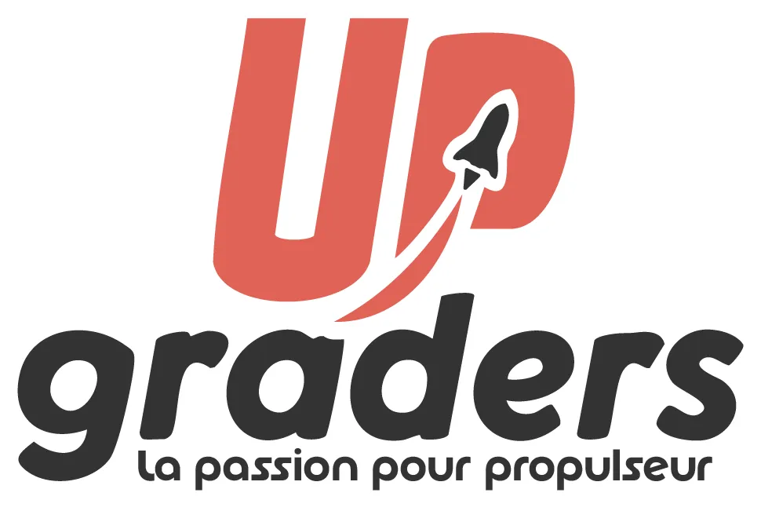
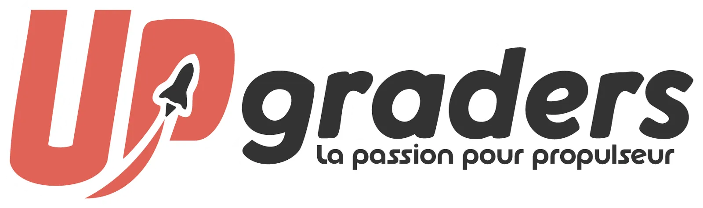
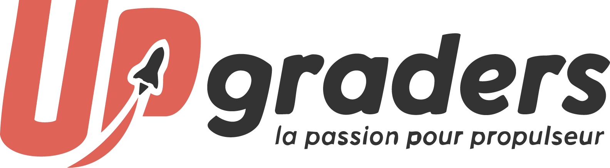
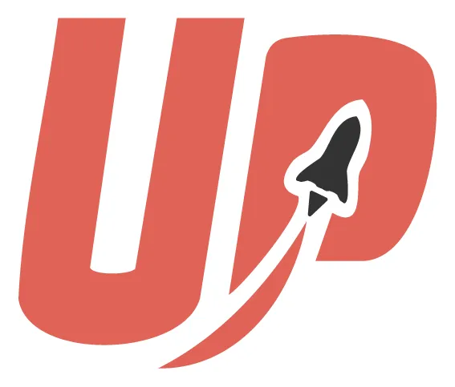
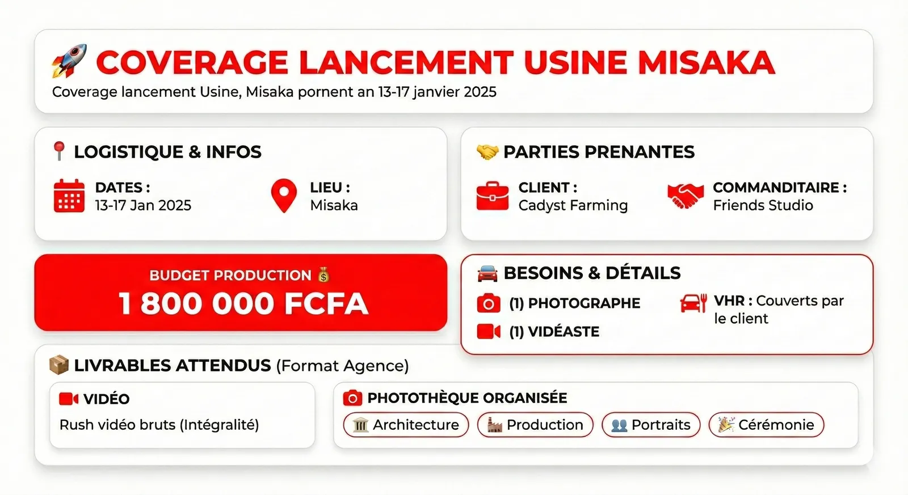

# UPgraders — Identité d'agence

<!-- wiki:infobox -->

| UPgraders — Identité d'agence | |
| --- | --- |
| Client | [UPgraders](../organisations/upgraders.md) |
| Période | 2025 |
| Casquette | Stratégie |
| Catégorie | Campagne |
| Disciplines | branding |
| Folio | [Étude de cas ↗](https://xtincell.powerupgraders.com/work/upgraders-case) |
| État de la fiche | Ébauche |
<!-- /wiki:infobox -->

**UPgraders — Identité d'agence** est une campagne réalisée pour [UPgraders](../organisations/upgraders.md) (2025).

## Contexte

Identité visuelle de l'agence UPgraders, métaphore de la propulsion (fusée), signature « La passion pour propulseur » : système de logo complet (icône, monogramme, lockups) et couverture projet.

## Galerie

<!-- wiki:galerie -->

<!-- /wiki:galerie -->

## Preuves et médias

- Visuels : `public/work/cases/upgraders-case/` (8 fichiers)

## Sources

- Folio — `scripts/cases.spec.json`, entrée `upgraders-case`

<!-- wiki:liens-entrants -->
<!-- /wiki:liens-entrants -->
