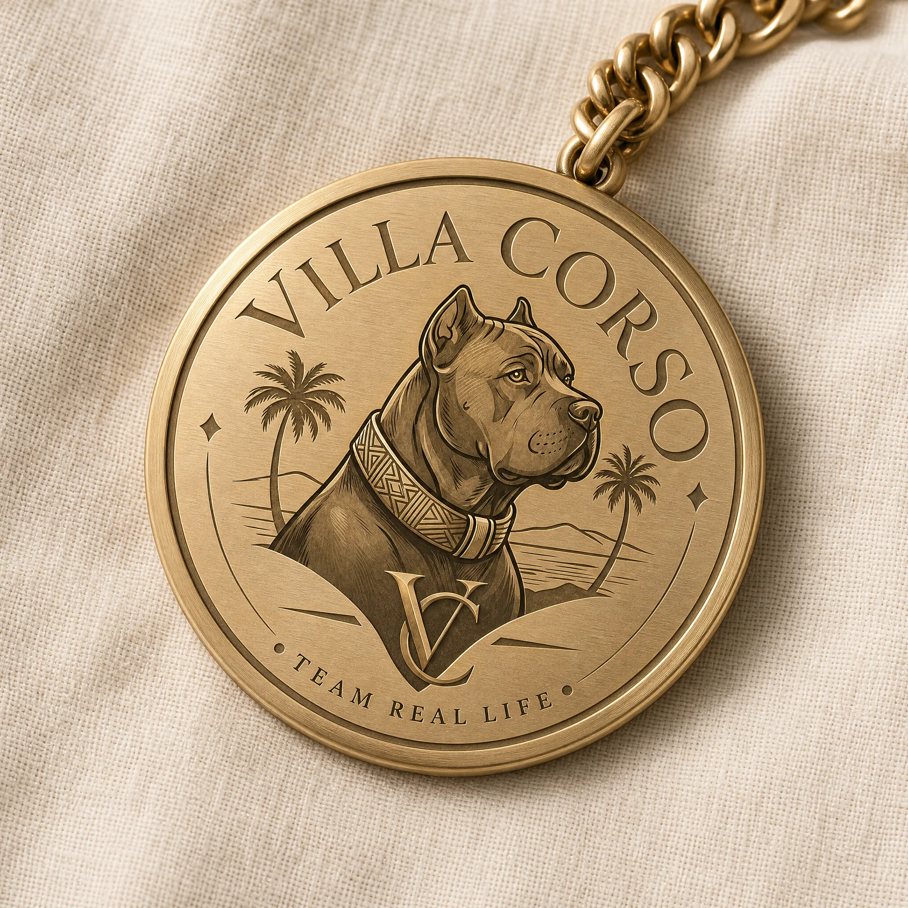
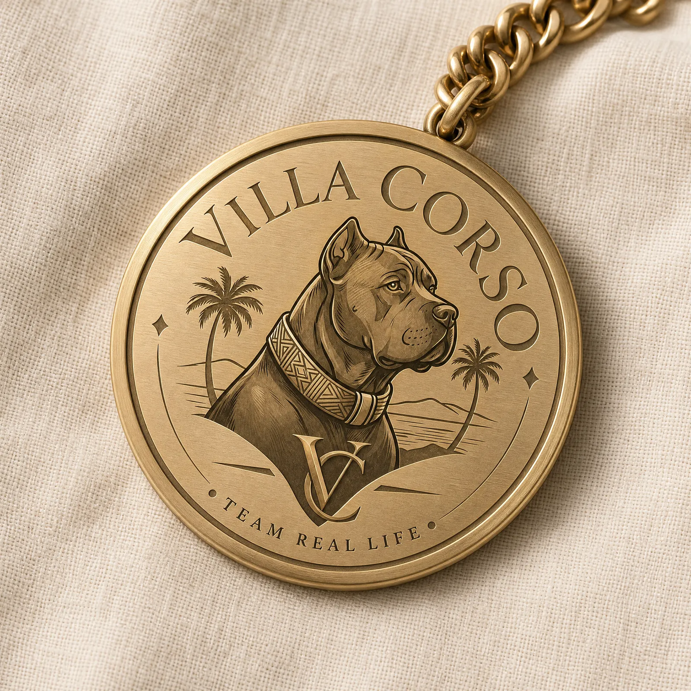
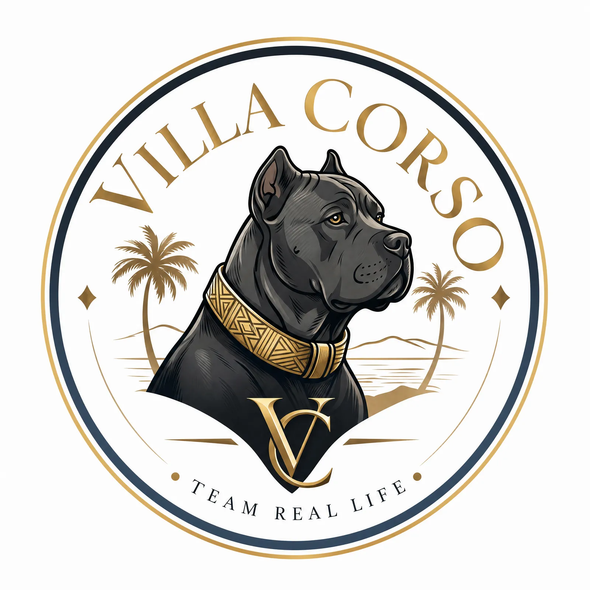
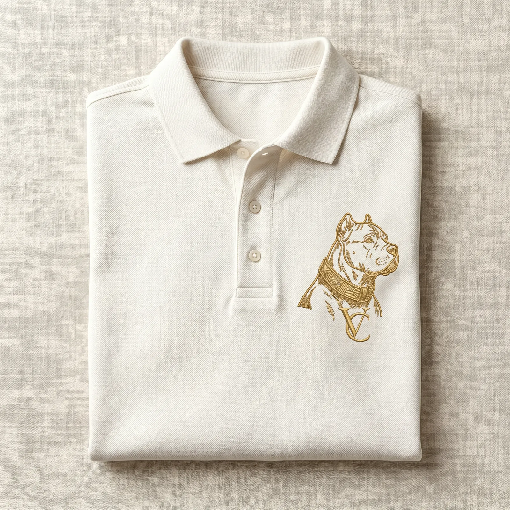
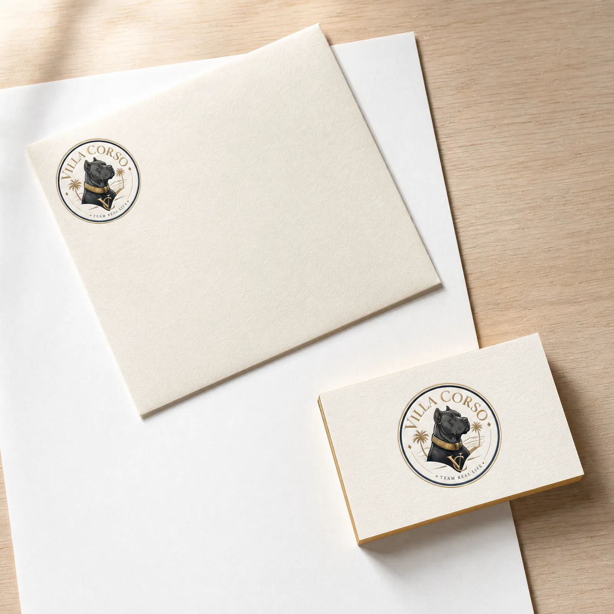
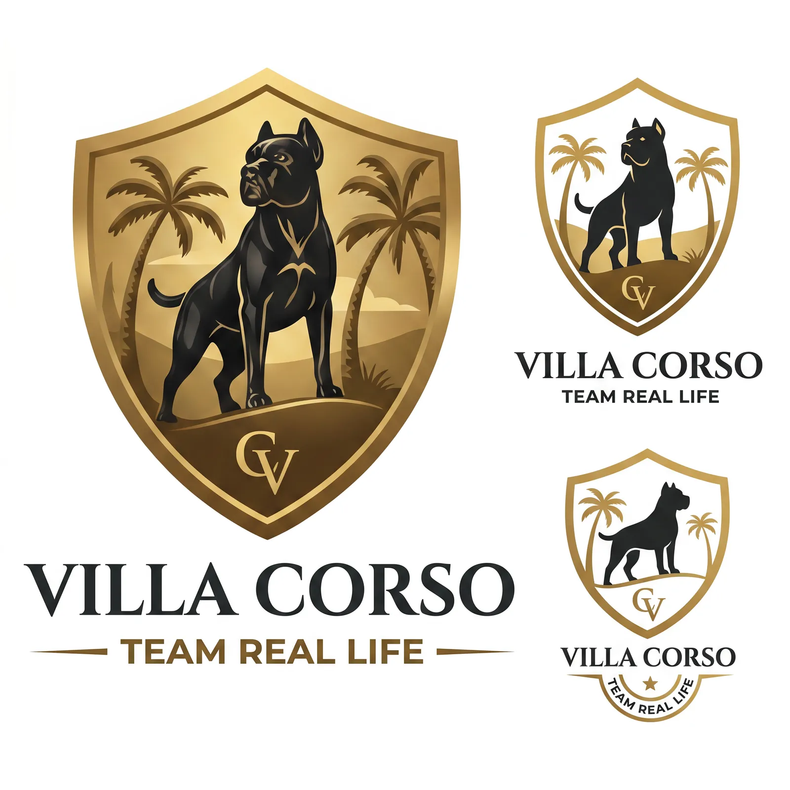
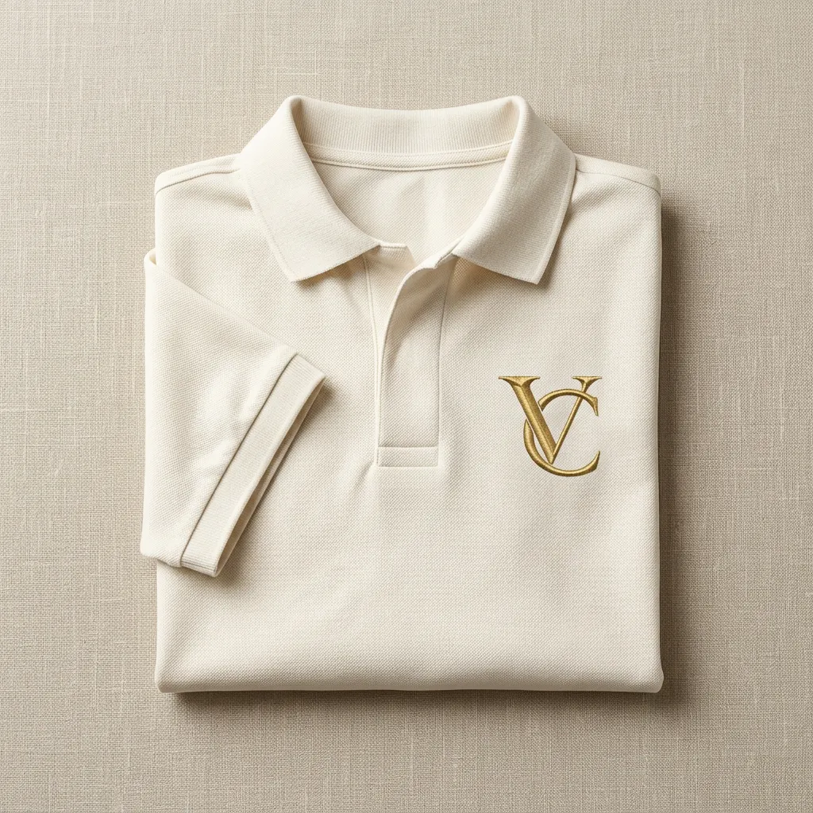
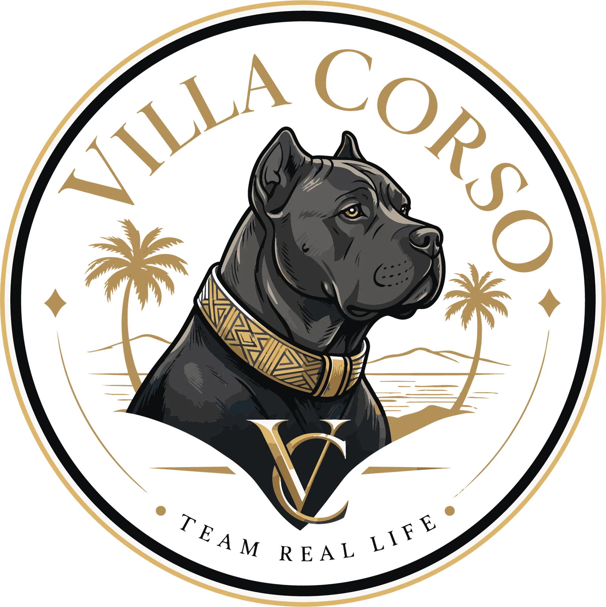

# Villa Corso — Élevage Cane Corso

<!-- wiki:infobox -->

| Villa Corso — Élevage Cane Corso | |
| --- | --- |
| Client | [Villa Corso](../organisations/villa-corso.md) |
| Période | 2025 |
| Casquette | Direction créative & artistique |
| Catégorie | Campagne |
| Disciplines | branding · packaging |
| Folio | [Étude de cas ↗](https://xtincell.powerupgraders.com/work/villa-corso) |
| État de la fiche | Ébauche |
<!-- /wiki:infobox -->

**Villa Corso — Élevage Cane Corso** est une campagne réalisée pour [Villa Corso](../organisations/villa-corso.md) (2025).

## Contexte

Identité de marque pour « Villa Corso » (« Team Real Life »), élevage de chiens Cane Corso : logo blason (tête de Cane Corso, monogramme VC) décliné sur polo brodé, médaillon laiton et papeterie, palette or/noir/crème.

## Galerie

<!-- wiki:galerie -->

<!-- /wiki:galerie -->

## Preuves et médias

- Visuels : `public/work/cases/villa-corso/` (8 fichiers)

## Sources

- Folio — `scripts/cases.spec.json`, entrée `villa-corso`

<!-- wiki:liens-entrants -->
<!-- /wiki:liens-entrants -->
