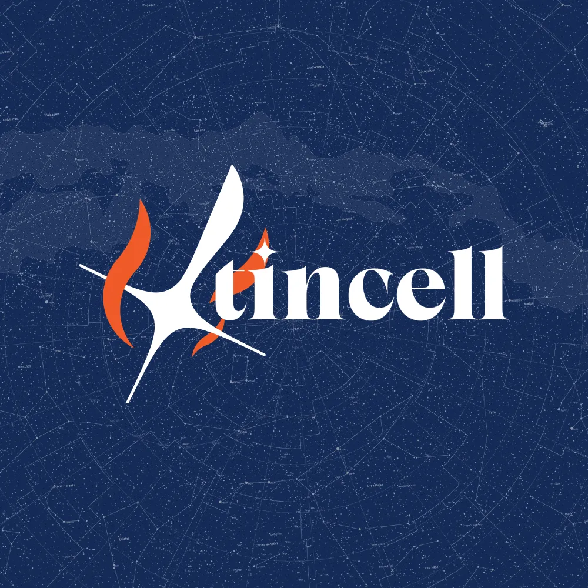
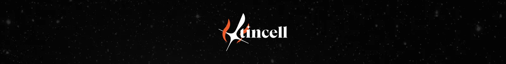
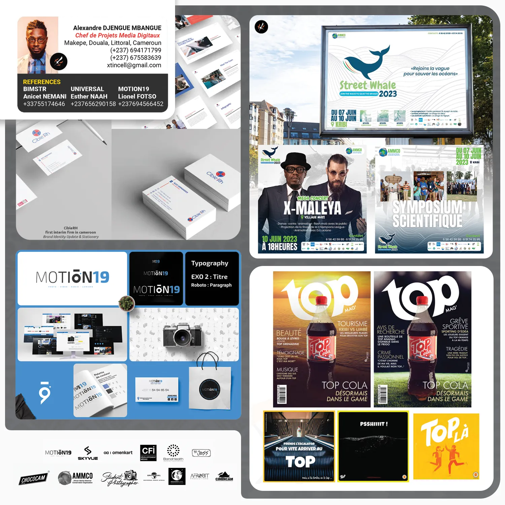
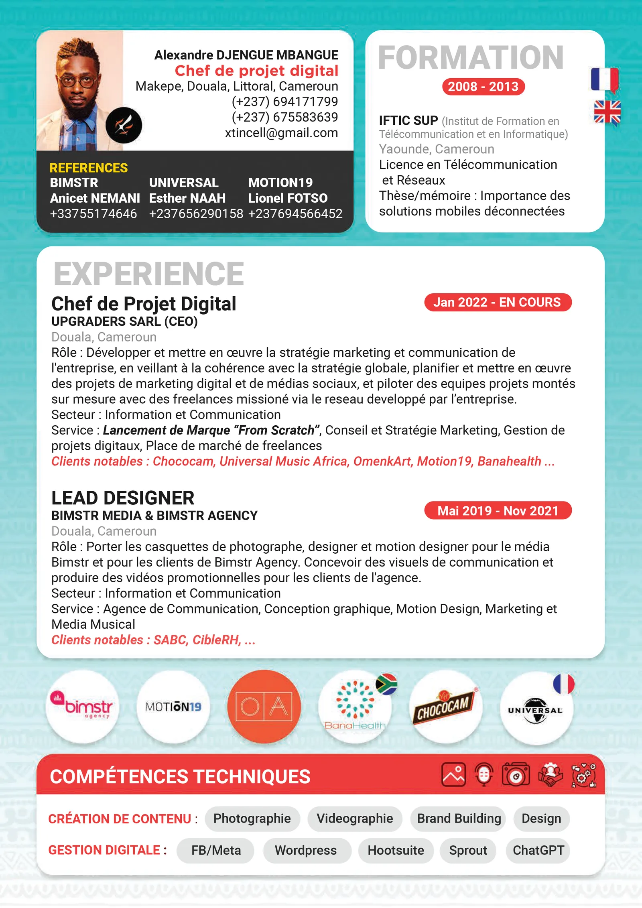
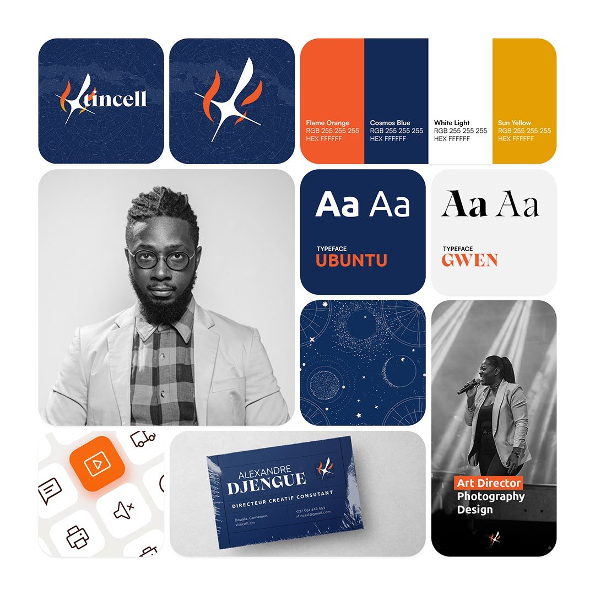

# Xtincell — Marque personnelle

<!-- wiki:infobox -->

| Xtincell — Marque personnelle | |
| --- | --- |
| Client | Projet personnel |
| Période | 2024–2025 |
| Casquette | Stratégie |
| Catégorie | Campagne |
| Disciplines | branding |
| Folio | [Étude de cas ↗](https://xtincell.powerupgraders.com/work/xtincell-brand) |
| État de la fiche | Ébauche |
<!-- /wiki:infobox -->

**Xtincell — Marque personnelle** est une campagne personnelle d’Alexandre « Xtincell » Djengue (2024–2025).

## Contexte

Identité personnelle d'Alexandre « Xtincell » Djengue, directeur de création / brand strategist : logo flamme « Spark » sur fond cosmique, bannière Behance et CV-portfolio une page.

## Historique du nom

Alexandre se fait d’abord connaître en ligne sous le nom de son blog, [Geek de brousse](geek-de-brousse-blog.md), ajouté à son profil Facebook en septembre 2014. Dans son témoignage de 2018, il raconte avoir changé de pseudonyme pour « Xtincell » en passant au graphisme : « nous ne sommes qu’étincelle dans le brazier qu’est l’univers ». Le nom se retrouve ensuite dans sa chaîne [YouTube](youtube-xtincell.md), son compte Medium, son podcast [Créapreneur](creapreneur-podcast.md) et son site. _Sources : [blog-disrupteur-2018](../sources.md#blog-disrupteur-2018), [geekdebrousse](../sources.md#geekdebrousse), [facebook](../sources.md#facebook)._

## Le logo Spark

Selon Alexandre, le logo Spark est **plurisémiotique** : plusieurs lectures y coexistent, sans qu’aucune ne prime. _Source : [temoignage-logo](../sources.md#temoignage-logo)._

| Lecture | Sens |
| --- | --- |
| Étincelle | La vie, éphémère et petite face à l’univers, « mais on brille fort » ; la passion qui fait surmonter l’adversité |
| Étoile filante | L’espoir, les vœux qu’on ne formule pas, les rêves ; la liberté |
| Épée | La grande lame blanche : un outil qui aide et sert, en choisissant ses combats |
| X | L’inconnue, la variable, « vous, moi » ; l’initiale d’Alexandre |
| Plan de Lorentz | Le X comme cône de lumière ; les bords creusés de l’étoile comme hyperboles (lecture ajoutée en septembre 2026) |

Il en résume l’intention ainsi : « une aide éphémère, passionnée, une étincelle filante qui donne le meilleur pour ce qu’elle croit juste ». Il cite comme références *Tengen Toppa Gurren Lagann*, *Cloud Atlas* (2012), *Your Name* (2016) et *V pour Vendetta*. Un logo antérieur, une aile inspirée de *Tsubasa Reservoir Chronicle* accompagnée de la mention « fils du feu » en japonais, a été abandonné. _Source : [temoignage-logo](../sources.md#temoignage-logo)._

## Direction artistique du site

La direction du portfolio est consignée dans le dépôt du site : `DESIGN.md` (mise à jour du 25 octobre 2026) fixe la devise « Parce qu’il y a toujours un moyen. », la palette (noir `#080808`, papier `#f5f0e8`, flamme `#ff682f`), les polices (Instrument Serif, Space Grotesk, JetBrains Mono) et le parcours en trois actes : le regard, la direction, la fabrique. Les études de hero (`MOCKUPS-HERO.md`), le personnage animé (`docs/character/`) et les notes de refonte (`docs/`) complètent ce dossier.

## Galerie

<!-- wiki:galerie -->

<!-- /wiki:galerie -->

## Preuves et médias

- Visuels : `public/work/cases/xtincell-brand/` (6 fichiers)
- Visuels complémentaires : `public/work/historique/00-personal-branding-xtincell/` (2 fichiers)

## Sources

- Propos d’Alexandre sur son logo, juillet 2023 et septembre 2026 — voir [temoignage-logo](../sources.md#temoignage-logo)
- Folio — `scripts/cases.spec.json`, entrée `xtincell-brand`
- Folio — `DESIGN.md`, `MOCKUPS-HERO.md`, `docs/character/`
- Alexandre Djengue, « Mon expérience de designer graphique free-lance au Cameroun », *Le blog du disrupteur*, 8 octobre 2018 — voir [blog-disrupteur-2018](../sources.md#blog-disrupteur-2018)

<!-- wiki:liens-entrants -->
<!-- /wiki:liens-entrants -->
